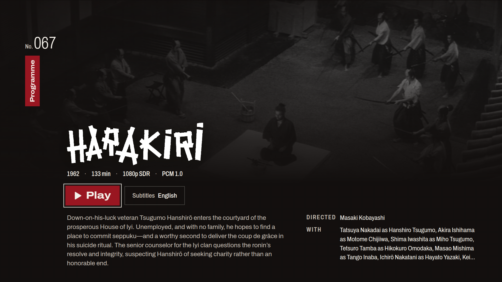
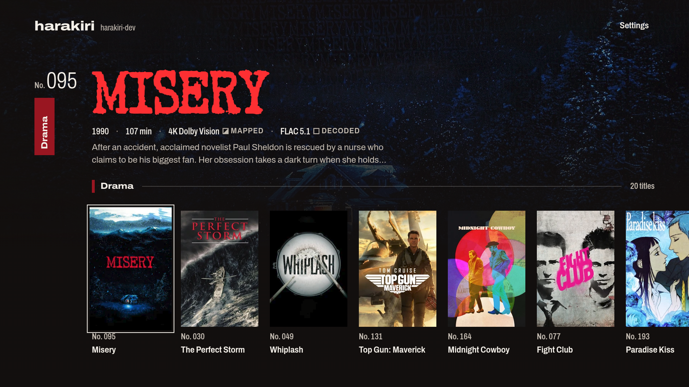
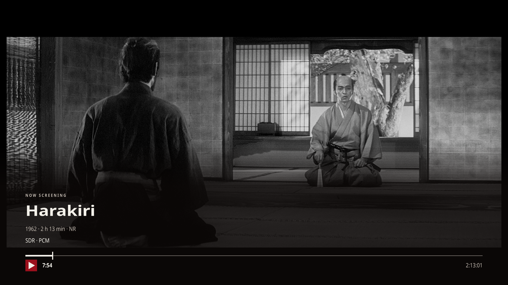

<div align="center">

<p></p>

<p><picture>
  <source media="(prefers-color-scheme: dark)" srcset="docs/assets/readme/logo-dark.svg">
  <source media="(prefers-color-scheme: light)" srcset="docs/assets/readme/logo-light.svg">
  
</picture></p>

**A TV-first, gamepad-first Jellyfin player that plays every file as it is.**

[](#getting-started)
[](https://jellyfin.org)
[](https://mpv.io)
[](docs/PRD.md#mvp-scope)

[Why](#why-harakiri-exists) • [Dogmas](#the-dogmas) • [A look around](#a-look-around) • [Getting started](#getting-started) • [Proving fidelity](#how-harakiri-proves-fidelity) • [Layout](#project-layout)


</div>

mpv decodes everything, HDR reaches the TV, and compressed audio reaches the AV receiver untouched. The library is a festival programme for one, driven from the couch with a d-pad and two buttons. A validation harness proves the picture and the sound without an HDR TV or a receiver on the desk.

> [!NOTE]
> Every screenshot on this page is the app running against a real personal library, not a mock-up. Harakiri (Kobayashi, 1962), the film this project is named after, is on stage.

## Why harakiri exists

Jellyfin Desktop transcoded a Dolby Vision Profile 5 episode to H.264 with AAC 5.1. HDR was gone, and the Dolby Digital Plus track reached the receiver as PCM instead of a bitstream. The server log said `TranscodeReasons=VideoRangeTypeNotSupported`.

The player was not the limit. A client setting ("Force Transcode Dolby Vision", on by default) adds a `VideoRangeType NotEquals DOVI` condition to the device profile, and Profile 5 has no fallback layer, so the server transcodes it. On top of that, the Qt client renders libmpv inside its web view, which takes the swapchain away from mpv and makes HDR output impossible ([jellyfin-desktop#523](https://github.com/jellyfin/jellyfin-desktop/issues/523)).

harakiri fixes both causes: it tells the server it can play anything, and it lets mpv own the picture.

## The dogmas

These rules decide every trade-off in the code. Each one is enforced by a test, a lint, or the architecture, not by good intentions.

1. **Play the file as it is.** The device profile declares no codec conditions, wildcard direct play, and a 1 Gbps ceiling. Nothing is transcoded silently: when the server insists, the app says so with the server's reasons. A condition on `VideoRangeType` would bring back the bug that started the project.
2. **mpv owns the picture.** mpv runs in its own fullscreen window with `gpu-next` on Vulkan, so HDR10, HDR10+ and Dolby Vision (mapped to HDR10) reach the TV. It never renders into the web view. The player controls are drawn by mpv's `osd-overlay`, because Wayland cannot stack a web window over it.
3. **The bitstream arrives byte for byte.** AC3, E-AC3 Atmos, TrueHD Atmos, DTS, DTS-HD MA and DTS:X are passed through untouched, and the harness checks that the bytes match the source. A DTS-HD track is never cut to its lossy core; if it cannot be passed through, it is decoded whole.
4. **Something always plays.** Each play aims for the best signal and steps down only when the output cannot carry it: bitstream, then PCM; Vulkan, then OpenGL; HDR, then SDR. Every step is a downgrade with a reason and a sentence the UI can show. These decisions live in one pure engine, [`packages/fidelity`](packages/fidelity), and its [compatibility table](docs/fidelity/compatibility.md) is generated and diffed by a test.
5. **Fidelity is visible, never hype.** Programme notes read like a festival brochure, not a codec sheet: "1962 · 133 min · 1080p SDR · PCM 1.0". Every signal is labelled _native_ (it passes as it is), _mapped_ (converted on purpose, like Dolby Vision delivered as HDR10) or _decoded_ (the sound becomes PCM), and the handoff to the player states the whole path before mpv takes the screen.
6. **The couch is the desk.** Every screen works with a d-pad, select and back at ten feet, and playing something takes three presses from launch. During playback mpv owns the gamepad, and the renderer ignores it, unconditionally, so one press never acts twice.
7. **The library is the hero.** The owner's artwork carries the experience, and the interface recedes around it.
8. **Proven without the gear.** Tests run the real thing where it is cheap: real mpv, real ffmpeg, a real Jellyfin in a container, generated media. Everything committed runs from a fresh clone with podman as its only service.

## A look around

<table>
  <tr>
    <td width="50%"></td>
    <td width="50%"></td>
  </tr>
  <tr>
    <td><b>The title page.</b> Programme notes, synopsis, cast, Play and Resume. Audio and subtitle choice live here.</td>
    <td><b>The programme.</b> Continue Watching, Next Up, Recently Added and sections drawn from the library, virtualized for d-pad speed.</td>
  </tr>
  <tr>
    <td width="50%"></td>
    <td width="50%"></td>
  </tr>
  <tr>
    <td><b>The screening handoff.</b> The house dims and a slug states what reaches the TV and the receiver. Then mpv takes the screen.</td>
    <td><b>The player.</b> mpv's own window, with harakiri's controls drawn through <code>osd-overlay</code> to match the library.</td>
  </tr>
</table>

## Getting started

> [!IMPORTANT]
> harakiri is an MVP. It targets Fedora 44 with KDE Plasma on Wayland, on x64. Windows and macOS come later.

### Install the AppImage

Each [GitHub release](https://github.com/tcorzo/harakiri/releases) ships one Linux x64 AppImage. It uses the system mpv, so install `mpv` 0.41 or newer and `ffmpeg` from RPM Fusion first.

> [!WARNING]
> Fedora's own `ffmpeg-free` has no HEVC, H.264 or VC-1 decoder. Install the RPM Fusion `ffmpeg`, or most of a real library will not play.

```sh
chmod +x harakiri-x86_64.AppImage
./harakiri-x86_64.AppImage
```

The AppImage updates itself. It checks for a new release at startup and every six hours, downloads only while nothing is playing, and installs on the next quit. Settings shows the state and offers "Restart to update".

On first launch harakiri finds Jellyfin servers on the network (or takes an address), signs in with a password or Quick Connect, and lands in the library. The session survives restarts, with the token encrypted by the OS keyring.

### Build from source

You need [mise](https://mise.jdx.dev), which pins bun, node, hk and the HDR tools, and these Fedora packages outside mise:

- `mpv` 0.41 or newer, and `ffmpeg` from RPM Fusion.
- `weston` 15 or newer, `kwin` and `mesa-vulkan-drivers`, for the headless harness.
- `podman`, for the dev and test Jellyfin.

```sh
mise trust && mise run setup   # deps, git hooks, and a check of the media stack
mise run dev                   # the app with hot reload
mise run package               # the same AppImage a release ships, into apps/desktop/dist
```

### A Jellyfin to try it on

The repo brings its own server. It runs a pinned Jellyfin 12.4 in podman on a generated corpus of the formats the app must handle. Run `mise run media:fetch-fate` first to add TrueHD Atmos, DTS-HD MA, DTS:X and VC-1 from FFmpeg's public test samples, since no open encoder makes them.

```sh
mise run jellyfin:up   # http://127.0.0.1:8096, user harakiri, password harakiri-dev
```

To see the UI on your own films instead, set `JELLYFIN_DEV_LIBRARY=own` with your movie and series paths in `.env` (see [`.env.example`](.env.example) and [`dev/jellyfin/COMMANDS.txt`](dev/jellyfin/COMMANDS.txt)).

### Everyday commands

| Command              | What it does                                                                         |
| -------------------- | ------------------------------------------------------------------------------------ |
| `mise run check`     | Everything CI gates on: lints, types, unit and harness tests. No server, no network. |
| `mise run e2e`       | Builds the app and drives it with Playwright inside a nested, invisible KWin.        |
| `mise run doctor`    | Checks mpv, libplacebo, ffmpeg and the headless compositors.                         |
| `mise run test:fate` | Proves DTS-HD MA, DTS:X and TrueHD Atmos passthrough on FFmpeg's FATE samples.       |
| `mise tasks`         | Lists the rest.                                                                      |

> [!TIP]
> Heavy processes run in their own memory-capped systemd scope through [`scripts/bounded.sh`](scripts/bounded.sh), and `mise run watchdog` stops the largest one before the machine runs out of memory. The `mise` tasks already do this.

## How harakiri proves fidelity

No part of the harness needs an HDR TV or an AV receiver.

| Area     | What is checked                                                                                                                                                               |
| -------- | ----------------------------------------------------------------------------------------------------------------------------------------------------------------------------- |
| Sound    | The IEC 61937 stream from `ffmpeg -f spdif` and from `mpv --ao=pcm` is extracted by a hand-rolled parser and compared byte for byte with the source track.                    |
| Picture  | mpv runs headless under `kwin_wayland --virtual` with lavapipe, and its properties prove the Dolby Vision profile, the reshaping pass and the target colorspace.              |
| HDR      | Weston 15 headless stands in for an HDR TV, and the Wayland protocol log shows mpv setting PQ, BT.2020 and the HDR metadata.                                                  |
| Jellyfin | A real Jellyfin 12.4 and 10.11 in podman return direct play with no transcoding URL for every fixture. Jellyfin Desktop's own profile, run as a negative control, transcodes. |
| App      | Playwright drives the built Electron app through onboarding, d-pad and gamepad navigation, the play handoff, and resume, asserting mpv's real state over IPC.                 |

## Project layout

| Path                                     | What lives there                                                                             |
| ---------------------------------------- | -------------------------------------------------------------------------------------------- |
| [`apps/desktop`](apps/desktop)           | Electron main process, preload, and the React renderer.                                      |
| [`packages/fidelity`](packages/fidelity) | The pure engine that decides how each play reaches the output and how it steps down.         |
| [`packages/mpv`](packages/mpv)           | A typed JSON IPC client for mpv and the playback argument builder.                           |
| [`packages/jellyfin`](packages/jellyfin) | The client generated from the pinned OpenAPI spec, and the "never transcode" device profile. |
| [`packages/input`](packages/input)       | One action model for keyboard, gamepad and remote, and the guard between the UI and mpv.     |
| [`packages/harness`](packages/harness)   | The IEC 61937 extractor, picture checks, the `doctor` CLI, and the generated media corpus.   |
| [`dev/jellyfin`](dev/jellyfin)           | The local dev Jellyfin: podman, a pinned image, an idempotent bootstrap.                     |

## Further reading

- [`docs/PRD.md`](docs/PRD.md): scope, behaviour, fidelity rules and acceptance criteria. It is the source of truth.
- [`docs/fidelity/compatibility.md`](docs/fidelity/compatibility.md): what plays on which output, and why each downgrade happens.
- [`docs/research/`](docs/research): the research behind every choice, including a census of a real 1,600-file library.
- [`CLAUDE.md`](CLAUDE.md): how to work in the repo, the rules, and what enforces each one.
