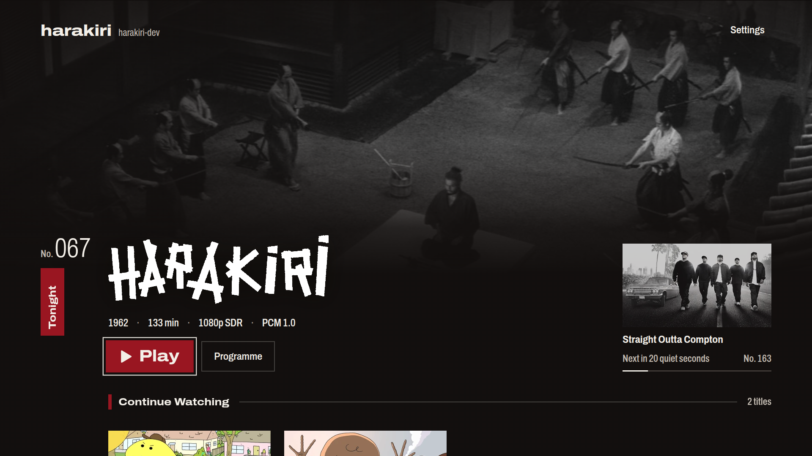
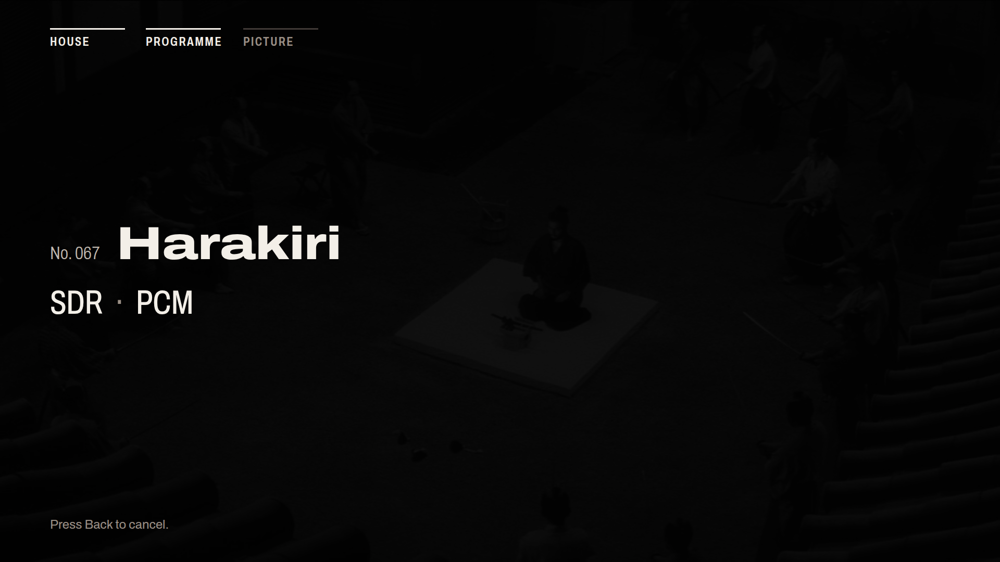

<div align="center">

<p></p>

<p><picture>
  <source media="(prefers-color-scheme: dark)" srcset="docs/assets/readme/logo-dark.svg">
  <source media="(prefers-color-scheme: light)" srcset="docs/assets/readme/logo-light.svg">
  
</picture></p>

**A TV-first, gamepad-first Jellyfin player that just works.**

[](#getting-started)
[](https://jellyfin.org)
[](https://mpv.io)
[](docs/PRD.md#mvp-scope)

[Why](#why-another-jellyfin-client) • [Showcase](#showcase) • [Getting started](#getting-started) • [Proving fidelity](#how-harakiri-proves-fidelity) • [Layout](#project-layout)



</div>

## Why another Jellyfin client?

Basically, I got fed up with not being able to just sit down with a meal and _watch a movie_. Every single time I had to mess around with settings, audio passthrough, tone-mapping, transcoding, etc. BROTHER, give me my movieeeee. So I built harakiri to just work. It attempts to play whatever you throw at it at the highest possible quality, but, if it can't it won't just blow up. It gracefully and unobtrusively falls back to a lower quality (see the [compatibility table](docs/fidelity/compatibility.md)).

## Showcase

<table>
  <tr>
    <td width="50%"></td>
    <td width="50%"></td>
  </tr>
  <tr>
    <td width="50%"></td>
    <td width="50%"></td>
  </tr>
</table>

## Getting started

### Install the AppImage

Each [GitHub release](https://github.com/tcorzo/harakiri/releases) ships one Linux x64 AppImage. Until harakiri bundles its own mpv, it uses the system mpv, so install `mpv` 0.41 or newer and `ffmpeg` from RPM Fusion first.

> [!WARNING]
> Fedora's own `ffmpeg-free` has no HEVC, H.264 or VC-1 decoder. Install the RPM Fusion `ffmpeg`, or most of a real library will not play.

```sh
chmod +x harakiri-x86_64.AppImage
./harakiri-x86_64.AppImage
```

### Build from source

You need [mise](https://mise.jdx.dev), which pins bun, node, hk and the HDR tools, and these Fedora packages outside mise:

- `ffmpeg` from RPM Fusion, for the test harness.
- `weston` 15 or newer, `kwin` and `mesa-vulkan-drivers`, for the headless harness.
- `podman`, for the dev and test Jellyfin and the mpv build.
- A read-write `/dev/kvm` (join the `kvm` group), for the microVM guest that runs e2e and the platform tests. Its first run downloads smolvm, a Fedora image and about 2 GB of packages into `.cache/vm`.

`setup` also builds harakiri's mpv in podman. The first build takes minutes and pulls about 3 GB of images; the bundle it leaves in `.cache/mpv` is about 70 MB.

```sh
mise trust && mise run setup   # deps, git hooks, harakiri's mpv, and a check of the media stack
mise run dev                   # the app with hot reload
mise run package               # the same AppImage a release ships, into apps/desktop/dist
```

### Everyday commands

| Command              | What it does                                                                                                               |
| -------------------- | -------------------------------------------------------------------------------------------------------------------------- |
| `mise run check`     | Everything CI gates on: lints, types, unit and harness tests. No server, no network.                                       |
| `mise run e2e`       | Builds the app and drives it with Playwright inside a nested, invisible KWin, mostly in the dev/vm guest.                  |
| `mise run doctor`    | Checks the harness tools: ffmpeg, the headless compositors, podman, dovi_tool, hdr10plus_tool and a read-write `/dev/kvm`. |
| `mise run test:fate` | Proves DTS-HD MA, DTS:X and TrueHD Atmos passthrough on FFmpeg's FATE samples.                                             |
| `mise tasks`         | Lists the rest.                                                                                                            |

> [!TIP]
> Heavy processes run in their own memory-capped systemd scope through [`scripts/bounded.sh`](scripts/bounded.sh), and `mise run watchdog` stops the largest one before the machine runs out of memory. The `mise` tasks already do this.

## How harakiri proves fidelity

No part of the harness needs an HDR TV or an AV receiver.

| Area     | What is checked                                                                                                                                                               |
| -------- | ----------------------------------------------------------------------------------------------------------------------------------------------------------------------------- |
| Sound    | The IEC 61937 stream from `ffmpeg -f spdif` and from `mpv --ao=pcm` is extracted by a hand-rolled parser and compared byte for byte with the source track.                    |
| Picture  | mpv runs headless under `kwin_wayland --virtual` with lavapipe, and its properties prove the Dolby Vision profile, the reshaping pass and the target colorspace.              |
| HDR      | Weston 15 headless stands in for an HDR TV, and the Wayland protocol log shows mpv setting PQ, BT.2020 and the HDR metadata.                                                  |
| Jellyfin | A real Jellyfin 12.4 and 10.11 in podman return direct play with no transcoding URL for every fixture. Jellyfin Desktop's own profile, run as a negative control, transcodes. |
| App      | Playwright drives the built Electron app through onboarding, d-pad and gamepad navigation, the play handoff, and resume, asserting mpv's real state over IPC.                 |

## Project layout

| Path                                     | What lives there                                                                             |
| ---------------------------------------- | -------------------------------------------------------------------------------------------- |
| [`apps/desktop`](apps/desktop)           | Electron main process, preload, and the React renderer.                                      |
| [`packages/fidelity`](packages/fidelity) | The pure engine that decides how each play reaches the output and how it steps down.         |
| [`packages/mpv`](packages/mpv)           | A typed JSON IPC client for mpv and the playback argument builder.                           |
| [`packages/jellyfin`](packages/jellyfin) | The client generated from the pinned OpenAPI spec, and the "never transcode" device profile. |
| [`packages/input`](packages/input)       | One action model for keyboard, gamepad and remote, and the guard between the UI and mpv.     |
| [`packages/harness`](packages/harness)   | The IEC 61937 extractor, picture checks, the `doctor` CLI, and the generated media corpus.   |
| [`dev/jellyfin`](dev/jellyfin)           | The local dev Jellyfin: podman, a pinned image, an idempotent bootstrap.                     |
| [`dev/vm`](dev/vm)                       | The microVM guest (smolvm, Fedora) that runs e2e and the platform tests off your desktop.    |

## Further reading

- [`docs/PRD.md`](docs/PRD.md): scope, behaviour, fidelity rules and acceptance criteria. It is the source of truth.
- [`docs/fidelity/compatibility.md`](docs/fidelity/compatibility.md): what plays on which output, and why each downgrade happens.
- [`docs/research/`](docs/research): the research behind every choice, including a census of a real 1,600-file library.
- [`CLAUDE.md`](CLAUDE.md): how to work in the repo, the rules, and what enforces each one.

## License

MIT. See [LICENSE](LICENSE).
