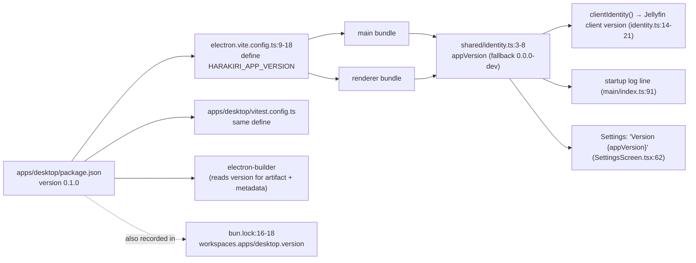
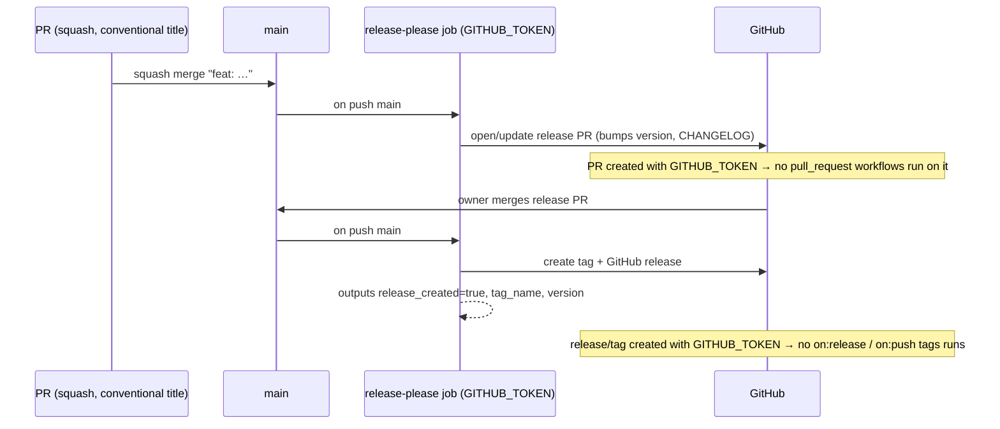

# Research: Packaging the desktop app on CI/CD after a release-please merge, with self auto-update

**Date**: 2026-11-17T20:10:00-03:00
**Git Commit**: 9485899d7ea5f3d2e015431032e5e78a2ea7e7fa (same as `origin/main`)
**Branch**: tcorzo/package
**Repository**: harakiri (`tcorzo/harakiri`, private)

## Research Question

1. "I want the application packaged on CI/CD, after merging via release-please."
2. Addendum: "I also want self auto-update."

Scope of this document: how the repo, the desktop app, the CI and the GitHub repository look today, plus the external behaviour of release-please, electron-builder and electron-updater that a release pipeline and an updater would sit on.

## Research Methodology (verbatim)

This document will remain objective and factual. It does not contain any recommendations or implementation suggestions.
Open questions will not ask Why things haven't been built or what should be built in the future.

There is no "implementation" section - that is intentional.

## Summary

harakiri has no release machinery yet. The only GitHub workflow checks PR titles; there is no release-please config, no changelog, no tag (other than a stray `pre-squash`), no GitHub release, no repository secret and no branch protection. What exists is the _input_ release-please needs: every commit on `main` is a squash-merge whose title is a Conventional Commit, enforced locally by hk and on every PR by `pr-title.yml`. The only version in the repo is `apps/desktop/package.json`'s `0.1.0`, which electron-vite bakes into the main and renderer bundles as `HARAKIRI_APP_VERSION`; `bun.lock` records the same version.

Packaging is configured but has never run anywhere visible. `electron-builder.yml` is ten lines: AppImage only, output to `dist/`, no `publish`, no icon. `bun run package` exists only as a package script and is not a mise task. The packaged app would spawn whatever `mpv` is on `PATH`; nothing is bundled, although `docs/research/06-mpv-packaging.md` describes Flatpak (with mpv built in) as the primary Linux target and AppImage-with-bundled-mpv as secondary. `mise run check`, which CLAUDE.md names as the CI gate, is not run by any workflow, and its hermetic tests need real system `mpv` and `ffmpeg`.

There is no update code at all. The main process already owns a quit protocol that matters to an updater: every `app.quit()` is intercepted by a `before-quit` handler that stops mpv (5 s cap) and then calls `app.exit(0)`. The renderer reaches main through a typed, zod-validated five-file IPC pattern, and the Settings screen is the only place the version is shown. There is no toast or banner primitive.

Externally: release-please-action is at v5; PRs, tags and releases it creates with the default `GITHUB_TOKEN` do not trigger other workflows, and its `node` strategy updates `package.json` but not `bun.lock`. electron-builder 26.18.0 detects `bun.lock` and writes `latest-linux.yml` plus an embedded `app-update.yml` whenever a publish provider resolves, even with `--publish never`. electron-updater 6.8.x can update AppImage, deb, rpm and pacman builds on Linux (not Flatpak or Snap). Against a _private_ GitHub repo, update checks and downloads need a token present in the running app.

## Detailed Findings

### 1. The repo has release-please's input (Conventional Commits on `main`) but none of its machinery

Every commit that lands on `main` is a squash-merge whose title is the PR title. The GitHub repo is configured for exactly that: squash is the only merge method, and the squash commit title is the PR title (queried with `gh api repos/tcorzo/harakiri`).

| Repo setting                                                                                    | Value                                                                  |
| ----------------------------------------------------------------------------------------------- | ---------------------------------------------------------------------- |
| Visibility                                                                                      | private                                                                |
| Merge methods                                                                                   | squash only (`mergeCommitAllowed: false`, `rebaseMergeAllowed: false`) |
| `squash_merge_commit_title` / `_message`                                                        | `PR_TITLE` / `COMMIT_MESSAGES`                                         |
| Default workflow token permissions                                                              | `read`                                                                 |
| "Allow GitHub Actions to create and approve pull requests" (`can_approve_pull_request_reviews`) | `false`                                                                |
| Actions secrets                                                                                 | none                                                                   |
| Branch protection on `main`                                                                     | none (404 "Branch not protected")                                      |
| Releases                                                                                        | none (`latestRelease: null`)                                           |
| Tags                                                                                            | `pre-squash` only                                                      |
| License                                                                                         | none                                                                   |

The Conventional Commit rule is enforced twice, with the same checker:

- **Commits**: `hk.pkl` hooks `commit-msg` to hk's builtin `check_conventional_commit` (`hk.pkl:39-51`). There is no commitlint and no allowed-types list in the repo; the accepted types are whatever hk 2.10.0's builtin accepts.
- **PR titles**: `.github/workflows/pr-title.yml` runs `mise run lint:pr-title` on `opened, edited, reopened, synchronize`, passing the title through `env` (`pr-title.yml:3-21`). The task (`mise.toml:124-135`) writes the title to a temp file and runs `hk util check-conventional-commit` on it.

Nothing consumes those commits yet. There is no `release-please-config.json`, no `.release-please-manifest.json`, no `CHANGELOG.md`, and `git tag` lists only `pre-squash`. `main` has two commits: `5f7f237 Initial commit` and `9485899 feat: add harakiri MVP, a TV-first Jellyfin player with passthrough (#1)`.

#### Testing patterns

`lint:pr-title` has no test file; it runs on every PR in CI (the run history shows one failed and three passing runs on PR #1). The hk commit-msg hook runs locally only.

### 2. One version number, in `apps/desktop/package.json`, flows into the bundles, Jellyfin and the UI

`apps/desktop/package.json:3` (`"version": "0.1.0"`) is the only `version` field in the repo. The root `package.json` and the five `packages/*` manifests have none, and all six workspaces are `private: true`.



The define is applied to `main` and `renderer` but not `preload` (`electron.vite.config.ts:18-36`). `identity.ts` documents why it exists: unpackaged, `app.getVersion()` returns Electron's version, so the app never calls `app.getVersion()` (`identity.ts:3-7`; decision recorded in `docs/decisions/autonomous-run.md:135`).

`bun.lock` also stores the workspace version (`bun.lock:16-18`), so a change to `apps/desktop/package.json`'s version without re-running `bun install` leaves the lockfile out of step with the manifest.

#### Testing patterns

`apps/desktop/vitest.config.ts` defines `HARAKIRI_APP_VERSION` for unit tests. No test asserts on the version value itself.

### 3. Packaging is a ten-line AppImage config that no task or workflow runs

`apps/desktop/electron-builder.yml`, in full:

```yaml
appId: dev.harakiri.desktop
productName: harakiri
directories:
  output: dist
files:
  - out/**
  - package.json
linux:
  target: AppImage
  category: AudioVideo
```

Absent from it: `publish`, `artifactName`, `icon` (no `apps/desktop/build/` or `resources/` dir exists), `extraResources`, `asar` settings, desktop-entry metadata beyond `category`, any `deb`/`rpm`/`flatpak` target, and any mpv or system-dependency declaration. The bundled `package.json` has no `author`, `description` or `homepage`.

The build pipeline is two stages:

```text
bun run package                             (apps/desktop/package.json:11)
  electron-vite build                       → apps/desktop/out/{main/index.js, preload/index.cjs, renderer/index.html}
    main:     externalizeDeps { exclude: @harakiri/* }   (electron.vite.config.ts:21-26)
              → workspace packages (raw .ts) are bundled; other deps stay external
    preload:  externalizeDeps false, CJS "[name].cjs"     (electron.vite.config.ts:28-34)
    renderer: tanstackRouter + react + tailwind           (electron.vite.config.ts:35-49)
  electron-builder --linux AppImage         → apps/desktop/dist/
    files: out/** + package.json; externalized deps collected from node_modules
```

Both output dirs are gitignored (`.gitignore:2-3`). There is no `package`, `build` or `release` mise task: `mise.toml` runs `bun run build` only inside the `e2e` task (`mise.toml:106-114`, via `scripts/bounded.sh build 3G`). Nothing in the repo, its docs or its reviews records `bun run package` having been run; the only trace is an open item in `docs/decisions/autonomous-run.md:267`: "Renderer chunk is 845 kB... Split before packaging."

electron-builder 26.18.0 (the pinned version) detects `bun.lock` and collects production `node_modules` with a dedicated `BunNodeModulesCollector` (`app-builder-lib@26.18.0/out/node-module-collector/packageManager.js:100-101`, `index.js:27-28`; it shells out to `bun pm ls --json`). Upstream, 26.18.1 is published under the `v26` dist-tag (2026-10-26), while `latest` still points at 26.18.0.

#### Testing patterns

No test exercises packaging. e2e launches the _built_ bundle (`out/main/index.js`) with Electron from `node_modules`, not a packaged app (`apps/desktop/e2e/support/harakiri.ts:26,146-168`; `e2e/headless.sh:6` exits if `out/` is missing). As a result `app.isPackaged` is `false` in e2e, so the packaged-only branches (fullscreen window, the packaged CSP variant) are not exercised.

### 4. The packaged app depends on a system mpv; the packaging research expects a bundled one

At runtime the app spawns `mpv` from `PATH`. `spawnMpv` takes an optional `binary` that defaults to `"mpv"` (`packages/mpv/src/client.ts:34-35,131-133`), and the only caller passes none (`apps/desktop/src/main/player/playback.ts:291-294`). `process.resourcesPath` is never used; `app.isPackaged` is used once, for `fullscreen` (`main/index.ts:32`).

Everything else mpv needs is generated at runtime, not shipped as files:

- the app-owned config dir is `join(app.getPath("userData"), "mpv")` (`main/player/index.ts:79`);
- `input.conf` is written into it on each play (`playback.ts:289-290`);
- `--config-dir` comes first in argv, then `--idle=yes`, the caller's args, and `--input-ipc-server` in a `mkdtemp` dir (`client.ts:129-136`, `args.ts:74`);
- the ASS overlay is built in code (`main/player/overlay.ts`).

The docs describe a different end state:

| Source                                      | What it says about distribution                                                                                                                                                                                |
| ------------------------------------------- | -------------------------------------------------------------------------------------------------------------------------------------------------------------------------------------------------------------- |
| `docs/research/06-mpv-packaging.md:125-127` | The app spawns its own mpv binary; a user-configured system mpv is an override                                                                                                                                 |
| `06-mpv-packaging.md:131-134`               | Flatpak primary (freedesktop 26.08, `ffmpeg-full`, libplacebo 7.387 + mpv master as modules, zypak); AppImage secondary (bundle self-built mpv, keep host Vulkan/Mesa); RPM/deb depend on distro mpv, degraded |
| `06-mpv-packaging.md:114-118,186`           | Fedora `ffmpeg-free` has no HEVC decoder; "Flatpak avoids this"                                                                                                                                                |
| `06-mpv-packaging.md:147`                   | Running packaging scripts with `node` through mise is "the safe default"; bun-as-runner gotchas unverified                                                                                                     |
| `docs/PRD.md:181`                           | Open question: when harakiri ships its own mpv build (Flatpak, mpv master, libplacebo 7.387)                                                                                                                   |
| `docs/PRD.md:173`                           | Windows and macOS builds are out of scope                                                                                                                                                                      |
| CLAUDE.md Dependencies                      | "electron-vite 6.0.0, electron-builder 26.18.0 — dev server; AppImage, Flatpak, RPM"; video is "system mpv 0.41.0 + libplacebo 7.360.1 + RPM Fusion ffmpeg 8.1.3"                                              |

`docs/PRD.md` has no packaging, distribution, install or update section.

#### Testing patterns

`mise run doctor` (`packages/harness/src/doctor.ts:57-65`, tested by `doctor.test.ts`) probes `mpv --version` on `PATH`. No test covers a packaged app finding mpv.

### 5. CI today is one 20-second PR-title job; the CI gate (`check`) needs system mpv and ffmpeg

`.github/workflows/pr-title.yml` is the only workflow. It runs on `ubuntu-latest` with `permissions: contents: read`, uses `actions/checkout@v4` and `jdx/mise-action@v4` (both pinned by major tag), installs only `hk` (`install_args: hk`), and runs `mise run lint:pr-title` (`pr-title.yml:7-21`). It has no `push`, `release`, `workflow_dispatch` or `schedule` trigger and no cache configuration.

The toolchain comes from `mise.toml:1-12` and `mise.lock`. `lockfile = true` is set, and `mise.lock` covers `linux-x64` for all five tools:

| Tool           | Pin     | linux-x64 in mise.lock |
| -------------- | ------- | ---------------------- |
| bun            | 1.4.4   | yes                    |
| node           | 26.13.0 | yes                    |
| hk             | 2.10.0  | yes                    |
| dovi_tool      | 2.3.4   | yes                    |
| hdr10plus_tool | 1.7.2   | yes                    |

`mise run check` is `depends = ["lint", "lint:skips", "lint:private", "typecheck", "test"]` (`mise.toml:137-139`). Format checking is not in it (only the hk pre-commit step runs `oxfmt --check`, `hk.pkl:20-24`).

| `check` dependency | Command                                                 | Needs beyond bun/git                                                                                                                                                                             |
| ------------------ | ------------------------------------------------------- | ------------------------------------------------------------------------------------------------------------------------------------------------------------------------------------------------ |
| `lint`             | `bun x oxlint --type-aware`                             | nothing                                                                                                                                                                                          |
| `lint:skips`       | `bun scripts/lint-skips.ts`                             | nothing                                                                                                                                                                                          |
| `lint:private`     | `bun scripts/lint-private.ts`                           | nothing; `.private-denylist` is gitignored and its absence is a no-op (`lint-private.ts:49-59`), so only the generic path/domain rules apply                                                     |
| `typecheck`        | `bounded.sh typecheck 2G -- bun x tsc -b`               | nothing                                                                                                                                                                                          |
| `test`             | `bounded.sh test 3G -- bun x vitest run --maxWorkers=2` | system `mpv` and `ffmpeg`: hermetic tests spawn real mpv (`packages/mpv/src/client.test.ts`, `packages/harness/src/audio/t1-mpv.test.ts`, `apps/desktop/src/main/player/playback.local.test.ts`) |

`scripts/bounded.sh` runs commands in a `systemd-run --user --scope` under `harakiri.slice`. When there is no systemd user manager, as on a hosted runner, its guard (`bounded.sh:8-11`) prints `bounded.sh: no systemd user manager here, running <name> without a memory cap` and `exec`s the command directly with the same exit code.

The tiers that need services (`*.live`, `*.contract`, `*.fate`) are excluded from the default run (`vitest.shared.ts:11-18`), and `e2e` needs `kwin_wayland`, podman and network (`mise.toml:106-114`).

Neither hosted Ubuntu image preinstalls mpv or ffmpeg ([24.04 list](https://github.com/actions/runner-images/blob/main/images/ubuntu/Ubuntu2404-Readme.md), [26.04 list](https://github.com/actions/runner-images/blob/main/images/ubuntu/Ubuntu2604-Readme.md)). This is what the Ubuntu archive offers ([mpv](https://packages.ubuntu.com/search?keywords=mpv&searchon=names&suite=all&section=all), [ffmpeg](https://packages.ubuntu.com/search?keywords=ffmpeg&searchon=names&suite=all&section=all)), against the dev stack's mpv 0.41.0 and FFmpeg 8.1.3:

| Runner label   | mpv (apt) | ffmpeg (apt) |
| -------------- | --------- | ------------ |
| `ubuntu-24.04` | 0.37.0    | 6.1.1        |
| `ubuntu-26.04` | 0.41.0    | 8.0.1        |

Ubuntu 26.04 runners are GA, and `ubuntu-latest` was scheduled to move from 24.04 to 26.04 between 2026-10-19 and 2026-11-19 ([changelog](https://github.blog/changelog/2026-09-17-ubuntu-26-generally-available-and-latest-migration), [tracking issue](https://github.com/actions/runner-images/issues/14748)). On 2026-11-17 the runner-images README still listed `ubuntu-latest` on the 24.04 row, while a tracking-issue comment from 2026-11-15 says it already resolves to 26.04. The pr-title job's runs so far ran on `ubuntu-latest`.

#### Testing patterns

There is no test of the workflows themselves. `bounded.sh` has no test; its no-systemd fallback is the path a hosted runner takes.

### 6. Quitting is already a protocol: `before-quit` stops mpv, then `app.exit(0)`

An updater's install step goes through app quit, so the existing quit path is relevant. `main()` wires it up before the window exists (`apps/desktop/src/main/index.ts:80-115`):

```text
module top level
  if HARAKIRI_USER_DATA → app.setPath("userData")        index.ts:20   (before the lock: the lock keys on userData)
  if app.requestSingleInstanceLock()                       index.ts:119
    main()                                                 (not awaited: ready fires after top-level await settles)
  else app.exit(0)

main()
  openRunLog(app.getPath("logs"))  + logtape configure     index.ts:83-89
  log "harakiri {version} on Electron {electron}"          index.ts:91
  logProcessTrouble()                                      index.ts:58-78
  killOnExit(player.mpvPid)                                index.ts:98   → process.on("exit") SIGKILLs a live mpv
  holdQuitUntilStopped(app, player.stop)                   index.ts:99
  app.on("second-instance", focusExistingWindow)           index.ts:100
  app.on("window-all-closed", () => app.quit())            index.ts:102  (every platform)
  removeStaleMpvDirs(tmpdir)
  await app.whenReady()
  installContentSecurityPolicy, registerIpc, createWindow
```

`holdQuitUntilStopped` (`apps/desktop/src/main/lifecycle.ts:40-55`) always calls `event.preventDefault()` on `before-quit`. The first time, it races `player.stop()` against a 5000 ms cap (`stopWithin`, `lifecycle.ts:10-32`), logs a timeout, and calls `app.exit(0)`. Later `before-quit` events only `preventDefault` and return. `app.exit(0)` skips `will-quit` and `quit`, and nothing in the app listens to `will-quit`.

```text
on before-quit(event)
  event.preventDefault()
  if already stopping: return
  stopping = true
  result = race(player.stop(), 5 s)   # quits mpv, reports the stop to Jellyfin, resolves when mpv exits
  if result is timed-out: log warning
  app.exit(0)
```

Logging is logtape: console at `info`, plus a per-run file `harakiri-<ISO>-<pid>.log` under `app.getPath("logs")` (mode 0600, newest 10 kept) at `debug` for the `["harakiri"]` category (`main/run-log.ts:13-34`, `index.ts:83-89`). Modules call `getLogger(["harakiri", "<name>"])`.

#### Testing patterns

`lifecycle.test.ts` (`// @vitest-environment node`) tests `holdQuitUntilStopped` against a fake `QuittingApp { on, exit }` (`lifecycle.ts:34-37`) and `removeStaleMpvDirs` against real temp dirs with `utimesSync`. `run-log.test.ts` tests the run log. `index.ts` and `ipc.ts` have no unit tests; e2e covers them, including the teardown check that no mpv process remains.

### 7. Main↔renderer communication is a typed five-file pattern; main pushes only to the requesting renderer

A new capability exposed to the renderer touches five places. `device:id` shows the whole path:

```text
shared/bridge.ts:14-25      channels = { …, deviceId: "device:id", playerEvent: "player:event", testProbe: "test:probe" }
shared/bridge.ts:161-192    type HarakiriBridge { deviceId(): Promise<DeviceId>; player.onEvent(l): () => void; test?: {…} }
preload/bridge.ts:41        deviceId: () => invoke(channels.deviceId, DeviceId)     # zod-parses the reply
main/ipc.ts:21              handle(channels.deviceId, () => deviceId())            # fromAppOnly sender check
renderer OnboardingScreen.tsx:525   queryFn: () => window.harakiri.deviceId()
```

- `createBridge(ipc, { e2e, warn })` (`preload/bridge.ts:21-69`) takes only `invoke`, `on` and `removeListener`. Invoke errors are mapped with `fromIpc` (`shared/errors.ts`). Push listeners `safeParse` the payload and drop malformed events with a warning.
- `registerIpc(isAppUrl)` (`main/ipc.ts:13-51`) wraps every handler in `fromAppOnly` (`security.ts:78-87`), which throws `ForeignSenderError` unless `event.senderFrame.url` is the app URL. Inputs are parsed in main with zod.
- Main-to-renderer pushes happen in one place: the `player:play` handler sends `player:event` to `event.sender` (`ipc.ts:40-47`), because no window has focus while mpv is fullscreen. There is no broadcast to all windows and no stored window reference for pushes.
- The e2e-only `test:probe` channel is registered when `isE2E` (`ipc.ts:50`), and the preload exposes `test` only when argv contains `--harakiri-e2e` (`preload/index.ts`, `preload/bridge.ts:67`).

#### Testing patterns

`preload/bridge.test.ts` drives `createBridge` with a `fakeIpc(replies, failure?)` that returns `{ ipc, invoked, push }`; `push(channel, payload)` fires `on` listeners. `security.test.ts` builds fake `Session`, `WebContents` and `IpcMainInvokeEvent` objects from `import type` electron types. `player/index.test.ts` uses `vi.mock("electron", …)` with `vi.hoisted` mocks.

### 8. Settings is the only screen that shows the version, and the renderer has no app-level notice surface

`SettingsScreen.tsx` (81 lines) is a norigin focus container (`focusKey: "settings"`, `trackChildren`, `forceFocus`, lines 15-19) that focuses `settings-sign-out` on mount (lines 21-23). It renders a read-only `<dl>` (Signed in as, Server, Address, App → `Version {appVersion}`, lines 52-63) and two `ListAction` rows, Sign out and Change server (lines 64-76).

```tsx
<SettingsScreen> (renderer/src/settings/SettingsScreen.tsx)
  useFocusable({ focusKey: "settings", trackChildren, forceFocus })
  <FocusContext.Provider>
    <main aria-label="Settings">
      <dl> … <dd>Version {appVersion}</dd> </dl>
      <ListAction focusKey="settings-sign-out" label="Sign out" />   (ui/actions.tsx)
      <ListAction label="Change server" />
```

Actions are `PlayAction`, `QuietAction` and `ListAction` in `ui/actions.tsx`, all built on a shared `useAction` → `useFocusable<object, HTMLButtonElement>`. The root route renders only `<Suspense fallback={<Curtain />}><Outlet /></Suspense>` after `useInputHub()` (`routes/__root.tsx:6-12`). There is no toast, banner, snackbar or notification component. Status text is inline with `role="alert"` or `aria-live="polite"` (for example `ScreeningScreen.tsx:93,385,403,407` and `OnboardingScreen.tsx:89,212`).

#### Testing patterns

Renderer unit tests run in `happy-dom` (`apps/desktop/vitest.config.ts`). Focus behaviour is covered by e2e specs (`e2e/navigation.spec.ts`, `e2e/onboarding.spec.ts`).

### 9. Network and CSP: main has no HTTP client of its own; packaged `connect-src` already allows any http(s) origin

`src/main` makes no direct `fetch`, `net` or `ky` calls. Jellyfin calls in the player go through `@harakiri/jellyfin`, which uses ky, and `main/discovery.ts` does UDP discovery.

The CSP is set as a response header on the app's main frame only (`security.ts:43-57`). `contentSecurityPolicy(appUrl)` (`security.ts:26-41`) uses `connect-src 'self' http: https:` when packaged and adds `ws:` (plus `'unsafe-inline'` scripts) for the Vite dev server, decided by whether the app URL is `file:` (`security.ts:27,35`). The documented reason is that the renderer talks to a Jellyfin origin known only after sign-in (`docs/decisions/autonomous-run.md:111-112`). `confineWebContents` blocks navigation away from the app, webviews and `window.open` (`security.ts:62-68`).

Main's env schema (`src/main/env.ts`) has three variables: `HARAKIRI_E2E`, `HARAKIRI_USER_DATA` and `HARAKIRI_DISCOVERY_ADDRESS`. `ELECTRON_RENDERER_URL`, `HARAKIRI_MPV_ARGS` and `HARAKIRI_AUDIO_OUTPUT` are read from `process.env` directly, and the last two only when `isE2E`.

#### Testing patterns

`security.test.ts` asserts on the CSP strings and the sender check.

### 10. release-please v5: what a single-package Electron repo gets from it, and the `GITHUB_TOKEN` limit

These are external facts, as of 2026-11-17.

- **Version.** `googleapis/release-please-action` v5.0.0 (2026-04-22) is the latest release; its only breaking change is Node 24. It bundles release-please 17.6.0. ([releases](https://github.com/googleapis/release-please-action/releases), [README](https://github.com/googleapis/release-please-action))
- **Outputs.** The root component has `release_created`, `tag_name`, `version`, `major`, `minor`, `patch`, `sha`, `upload_url`, `html_url` and `body`. Global outputs are `releases_created`, `paths_released`, `prs_created`, `pr` and `prs`. A non-root path gets prefixed outputs such as `steps.<id>.outputs['apps/desktop--release_created']`. ([README](https://github.com/googleapis/release-please-action))
- **Permissions.** The action needs `contents: write`, `pull-requests: write` and `issues: write`, plus the repo setting "Allow GitHub Actions to create and approve pull requests". That setting is `false` on this repo today (section 1). ([README](https://github.com/googleapis/release-please-action))
- **Manifest config.** `release-please-config.json` holds `packages` keyed by path, and `.release-please-manifest.json` holds the current version per path, so seeding `"apps/desktop": "0.1.0"` makes that the starting version. Pre-1.0 behaviour is set by `bump-minor-pre-major` and `bump-patch-for-minor-pre-major`. ([manifest-releaser.md](https://raw.githubusercontent.com/googleapis/release-please/main/docs/manifest-releaser.md), [config schema](https://raw.githubusercontent.com/googleapis/release-please/main/schemas/config.json))
  - `include-component-in-tag` defaults to `true`, which gives tags like `desktop-v0.2.0`; `false` gives `v0.2.0`.
  - Other settings: `extra-files` for generic, json, yaml, toml or xml version markers; `changelog-sections`; `draft` and `force-tag-creation` (both default `false`); `bootstrap-sha` and `last-release-sha`.
- **`node` strategy vs `bun.lock`.** The `node` strategy updates `package.json`, `package-lock.json`, `npm-shrinkwrap.json`, `CHANGELOG.md` and `changelog.json`. It does not reference `bun.lock` ([node.ts](https://raw.githubusercontent.com/googleapis/release-please/main/src/strategies/node.ts)). The `node-workspace` plugin reads its package list from release-please's own `packages` config, not from the root `workspaces` field ([node-workspace.ts](https://raw.githubusercontent.com/googleapis/release-please/main/src/plugins/node-workspace.ts)).
- **`GITHUB_TOKEN` events.** "Events triggered by the `GITHUB_TOKEN` will not create a new workflow run", except `workflow_dispatch` and `repository_dispatch` ([GitHub docs](https://docs.github.com/en/actions/concepts/security/github_token)). A release, tag or release PR created by release-please with the default token therefore does not fire `on: release`, `on: push: tags`, or `pull_request` checks on the release PR. The documented ways around this are:
  - a PAT passed as `token`, which is the README's documented option;
  - a GitHub App token from [`actions/create-github-app-token`](https://github.com/actions/create-github-app-token);
  - a job in the same workflow gated on the `release_created` output, which needs no extra trigger.
- **Pre-1.0 releases are normal releases and become "Latest".** `Manifest.buildReleases()` sets `prerelease: config.prerelease && (version has a prerelease part || major === 0)`. So a 0.x release is flagged prerelease only when `prerelease: true` is set in `release-please-config.json`, and the default is `false` ([manifest.ts](https://raw.githubusercontent.com/googleapis/release-please/main/src/manifest.ts), [manifest-releaser.md](https://raw.githubusercontent.com/googleapis/release-please/main/docs/manifest-releaser.md)). `github-api.ts` passes only `draft` and `prerelease` to `repos.createRelease`, and `make_latest` appears nowhere in the source ([github-api.ts](https://raw.githubusercontent.com/googleapis/release-please/main/src/github-api.ts)). GitHub's API therefore applies its default, under which a non-draft, non-prerelease release becomes Latest ([createRelease](https://github.com/octokit/plugin-rest-endpoint-methods.js/blob/main/docs/repos/createRelease.md)). That "Latest" designation is what electron-updater's public `github` provider reads (section 12).
- **Drafts.** With `draft: true`, GitHub creates no tag until the release is published, so release-please cannot find the release and opens duplicate release PRs ([issue #962](https://github.com/googleapis/release-please-action/issues/962)). `force-tag-creation` is the schema's documented answer; there is no confirmation of it against the current action.



### 11. electron-builder 26.18: metadata is written whenever a publish provider resolves; its GitHub publisher has rules about existing releases

- **Docs version trap.** The default electron.build pages (`/docs/...`) describe the unreleased v27 / electron-updater 7 line. The 26.x docs live under `/v26/docs/...`. Some features in the default pages do not exist in 26.x/6.x, for example `allowUnverifiedLinuxPackages`, `installPendingUpdateIfAvailable()`, and v27's removal of implicit publishing. ([v26 auto-update](https://www.electron.build/v26/docs/features/auto-update), [next auto-update](https://www.electron.build/docs/features/auto-update))
- **Update metadata.** The file name is `${channel}-${platform}${archSuffix}.yml`, so the Linux x64 file is `latest-linux.yml` ([updateInfoBuilder.js 26.18.0](https://unpkg.com/app-builder-lib@26.18.0/out/publish/updateInfoBuilder.js)). `app-update.yml` is written into `resources/` in `onAfterPack` whenever a publish config resolves, whether or not the build publishes. With no `publish` block, electron-builder falls back to a GitHub config derived from repository info ([PublishManager.js 26.18.0](https://unpkg.com/app-builder-lib@26.18.0/out/publish/PublishManager.js)). For AppImage the blockmap is embedded in the AppImage, so no separate `.blockmap` file is published ([v26 AppImage](https://www.electron.build/v26/docs/appimage)).
- **Implicit publishing is still on in 26.18.0.** It publishes on a git tag, in CI (`onTagOrDraft`), or for an npm script named `release`, and logs a deprecation warning. Passing `--publish` explicitly overrides this. ([PublishManager.js](https://unpkg.com/app-builder-lib@26.18.0/out/publish/PublishManager.js), [v26 publish](https://www.electron.build/v26/docs/publish))
- **The GitHub publisher's handling of an existing release** ([gitHubPublisher.js 26.18.0](https://unpkg.com/electron-publish@26.18.0/out/gitHubPublisher.js)):

  ```text
  find release whose tag_name == tagNamePrefix + version   (default prefix "v"; GH_TOKEN or GITHUB_RELEASE_TOKEN)
  if found and it is a draft: upload assets
  if found and published:
    if releaseType is draft (the default): skip, logging "existing type not compatible with publishing type"
    if releaseType is release or prerelease:
      upload only if it was published < 2 h ago (unless EP_GH_IGNORE_TIME=true)
  if not found and publishing: create a release (a draft by default)
  an asset name that already exists is deleted and re-uploaded
  ```

  `publishAutoUpdate` (default `true`) controls whether `latest-linux.yml` is uploaded. `EP_DRAFT` and `EP_PRE_RELEASE` override `releaseType`. The other common pattern is `--publish never` followed by `gh release upload <tag> <files> --clobber`. `--clobber` replaces only assets with the same name ([example](https://github.com/plainpacket/PortPatch/pull/2)).

- **Linux targets on Ubuntu runners** ([v26 Linux](https://www.electron.build/docs/linux), [multi-platform build](https://www.electron.build/docs/features/multi-platform-build)):

  | Target   | Extra packages on the runner                                        | Auto-updatable by electron-updater 6.8         |
  | -------- | ------------------------------------------------------------------- | ---------------------------------------------- |
  | AppImage | none listed                                                         | yes (`AppImageUpdater`)                        |
  | deb      | none listed                                                         | yes (`DebUpdater`, elevates via pkexec/sudo)   |
  | rpm      | `rpm` (for `rpmbuild`)                                              | yes (`RpmUpdater`; `dnf install --nogpgcheck`) |
  | pacman   | `bsdtar`                                                            | yes (`PacmanUpdater`)                          |
  | flatpak  | `flatpak flatpak-builder fuse3`, plus runtime/SDK/BaseApp downloads | no                                             |
  | snap     | snapcraft for custom stage packages                                 | no (disabled when `SNAP` is set)               |

- **Bun.** app-builder-lib 26.18.0 picks the bun collector when it finds `bun.lock` or `bun.lockb` (section 3). One known bun-monorepo failure mode: transitive deps were missing from the app's `node_modules`, and the fix was to declare them directly and set `npmRebuild: true` ([superset-sh/superset#483](https://github.com/superset-sh/superset/pull/483)).

### 12. electron-updater 6.8 on Linux: AppImage swaps its own file; a private GitHub repo needs a token inside the app

- **Electron's built-in `autoUpdater` has no Linux support**: "There is no built-in support for auto-updater on Linux" ([Electron docs](https://www.electronjs.org/docs/latest/api/auto-updater)).
- **Versions.** electron-updater `latest` is 6.8.11 (2026-10-20), `v26` is 6.8.12 (2026-10-26), and `next` is 7.0.0-alpha.13 (from `npm view`). It is not a dependency of `apps/desktop` today.
- **How the updater is chosen and how AppImage installs** ([main.js](https://unpkg.com/electron-updater@6.8.11/out/main.js), [AppImageUpdater.js](https://unpkg.com/electron-updater@6.8.11/out/AppImageUpdater.js)):

  ```text
  on Linux:
    if resources/package-type exists (deb | rpm | pacman): use the matching updater
    otherwise: use AppImageUpdater
  AppImageUpdater:
    inactive unless $APPIMAGE is set; disabled if $SNAP is set
    download the new AppImage (differential via the embedded blockmap, else full)
    verify sha512 from latest-linux.yml
    chmod 755
    install:
      unlink $APPIMAGE, mv the new file into place, run it
      if the old file name contained a version: keep the new versioned name instead, emit appimage-filename-updated
  ```

  The AppImage path needs no root, only a writable directory.

- **deb, rpm and pacman** go through `LinuxUpdater`, which elevates with `gksudo`, `kdesudo`, `pkexec` or `beesu`, falling back to `sudo` ([LinuxUpdater.js](https://unpkg.com/electron-updater@6.8.11/out/LinuxUpdater.js)). v26 installs without signature checks (`dnf --nogpgcheck`, `zypper --allow-unsigned-rpm`, `apt --allow-unauthenticated`) ([RpmUpdater.js](https://unpkg.com/electron-updater@6.8.11/out/RpmUpdater.js), [DebUpdater.js](https://unpkg.com/electron-updater@6.8.11/out/DebUpdater.js)).
- **API surface (6.8.11)** ([AppUpdater.d.ts](https://unpkg.com/electron-updater@6.8.11/out/AppUpdater.d.ts)):
  - Methods: `checkForUpdates()`, `checkForUpdatesAndNotify()`, `downloadUpdate()`, `quitAndInstall(isSilent = false, isForceRunAfter = false)`.
  - Events: `error`, `checking-for-update`, `update-available`, `update-not-available`, `download-progress`, `update-downloaded`, `update-cancelled`, `appimage-filename-updated`.
  - Options: `autoDownload` (default `true`), `autoInstallOnAppQuit` (default `true`, which installs from a quit handler), `allowPrerelease`, `allowDowngrade`, `channel`, `logger` (any `{ info, warn, error }`), `forceDevUpdateConfig`, `requestHeaders`.
  - The feed comes from the embedded `app-update.yml`; the docs advise against `setFeedURL`.
- **ESM import.** The package is CJS and `autoUpdater` is a lazy getter, so TypeScript or ESM code uses `import pkg from "electron-updater"; const { autoUpdater } = pkg` ([v26 auto-update](https://www.electron.build/v26/docs/features/auto-update)). The desktop main bundle is ESM (`"type": "module"`, `import.meta.dirname` in `main/index.ts`).
- **Feed providers and the private repo**:
  - Public `github` provider: it reads `releases.atom` and, with `allowPrerelease` false, takes the tag GitHub marks _latest_. With `allowPrerelease` true it skips non-semver tags such as `desktop-v0.2.0`. It downloads from `/releases/download/{tag}/{file}` ([GitHubProvider.js](https://unpkg.com/electron-updater@6.8.11/out/providers/GitHubProvider.js)).
  - `private: true`: when `GH_TOKEN` is set, the updater uses the GitHub API (`/releases/latest`) with `authorization: token …`. The docs call this "only for very special cases", note the 5000 requests/hour per-user limit with up to 3 requests per check, and say never to put `token` in config files ([v26 auto-update](https://www.electron.build/v26/docs/features/auto-update), [v26 publish](https://www.electron.build/v26/docs/publish), [PrivateGitHubProvider.ts](https://raw.githubusercontent.com/electron-userland/electron-builder/master/packages/electron-updater/src/providers/PrivateGitHubProvider.ts), [issue 1393](https://github.com/electron-userland/electron-builder/issues/1393)).
  - `generic` provider: any static HTTPS host serving `latest-linux.yml` and the artifact, with `files[].url` resolved relative to the feed URL. Uploading is left to the user ([v26 publish](https://www.electron.build/v26/docs/publish)).
  - Private-repo release assets require authentication to download. "Anyone with read access to a repository can view and compare releases" ([About releases](https://docs.github.com/en/repositories/releasing-projects-on-github/about-releases)).
- **Integrity.** Linux has no code-signature check. The updater compares the `sha512` from `latest-linux.yml` after a full or differential download ([AppUpdater.js](https://unpkg.com/electron-updater@6.8.11/out/AppUpdater.js)).
- **Running and testing** ([v26 AppImage](https://www.electron.build/v26/docs/appimage), [v26 auto-update](https://www.electron.build/v26/docs/features/auto-update)):
  - The default AppImage toolset in v26 (`0.0.0`) needs FUSE 2. The `1.0.3` toolset (beta) uses a static runtime without that dependency. This machine (Fedora 44) has `fuse-libs-2.9.9` and `fuse3-libs-3.18.3` installed.
  - The AppImage does not integrate itself into the desktop, and AppImageLauncher is the documented route. A 2020 report says updates failed under AppImageLauncher; it is unconfirmed for 2026.
  - Unpackaged runs need `dev-app-update.yml` plus `forceDevUpdateConfig = true`. `AppImageUpdater` still needs `APPIMAGE` set, or it throws `ERR_UPDATER_OLD_FILE_NOT_FOUND`. Any static HTTP server works as a `generic` feed in tests, and the docs mention Minio. The env var `ELECTRON_BUILDER_LINUX_PACKAGE_MANAGER` overrides package-manager detection for deb/rpm.

### 13. Private-repo costs: Actions minutes and artifact storage are billed, while release assets are not size-capped

Standard Linux runners draw from the account's included allowance on private repos ($0.006/min for Linux 2-core). Artifact storage is shared with Packages (Free 500 MB, Pro 1 GB, Team 2 GB), and the cache is a separate 10 GB per repo ([billing](https://docs.github.com/en/billing/concepts/product-billing/github-actions)). Release assets have a 2 GiB per-file cap and up to 1000 assets per release, with no total-size or bandwidth limit ([About releases](https://docs.github.com/en/repositories/releasing-projects-on-github/about-releases)). The single existing job takes about 16-20 s per run (from `gh run list`).

## Code References

Links are pinned to commit `9485899`, which is `main`. The repo is private, so the links resolve only for collaborators.

### Release inputs and CI (exhaustive for CI)

- [`.github/workflows/pr-title.yml:1-21`](https://github.com/tcorzo/harakiri/blob/9485899d7ea5f3d2e015431032e5e78a2ea7e7fa/.github/workflows/pr-title.yml#L1-L21): the only workflow; PR-title Conventional Commit check
- [`mise.toml:1-12`](https://github.com/tcorzo/harakiri/blob/9485899d7ea5f3d2e015431032e5e78a2ea7e7fa/mise.toml#L1-L12): settings (`lockfile = true`), tool pins, `.env` loading
- [`mise.toml:106-114`](https://github.com/tcorzo/harakiri/blob/9485899d7ea5f3d2e015431032e5e78a2ea7e7fa/mise.toml#L106-L114): `e2e`, the only task that builds the desktop app
- [`mise.toml:124-139`](https://github.com/tcorzo/harakiri/blob/9485899d7ea5f3d2e015431032e5e78a2ea7e7fa/mise.toml#L124-L139): `lint:pr-title` and `check`
- `mise.lock`: locked tool URLs per platform (linux-x64 present for all five tools)
- [`hk.pkl:1-51`](https://github.com/tcorzo/harakiri/blob/9485899d7ea5f3d2e015431032e5e78a2ea7e7fa/hk.pkl): pre-commit steps, pre-push typecheck/test, commit-msg conventional-commit
- [`scripts/bounded.sh:8-19`](https://github.com/tcorzo/harakiri/blob/9485899d7ea5f3d2e015431032e5e78a2ea7e7fa/scripts/bounded.sh#L8-L19): systemd scope runner and its no-systemd fallback
- [`scripts/lint-private.ts:26-67`](https://github.com/tcorzo/harakiri/blob/9485899d7ea5f3d2e015431032e5e78a2ea7e7fa/scripts/lint-private.ts#L26-L67): generic rules, optional denylist
- `scripts/lint-skips.ts`, `scripts/watchdog.sh`: other `check` and dev scripts
- [`vitest.shared.ts:11-18`](https://github.com/tcorzo/harakiri/blob/9485899d7ea5f3d2e015431032e5e78a2ea7e7fa/vitest.shared.ts#L11-L18): tier exclusion from the default test run
- `.gitignore:2-3,15`: `out/`, `dist/`, `.private-denylist`

### Versioning

- [`apps/desktop/package.json:3,8-12`](https://github.com/tcorzo/harakiri/blob/9485899d7ea5f3d2e015431032e5e78a2ea7e7fa/apps/desktop/package.json#L3-L12): the only version (0.1.0) and the `build` and `package` scripts
- `package.json`: root workspaces and catalog; no version, scripts or `packageManager`
- `bun.lock:16-18`: workspace version recorded in the lockfile
- [`apps/desktop/electron.vite.config.ts:9-36`](https://github.com/tcorzo/harakiri/blob/9485899d7ea5f3d2e015431032e5e78a2ea7e7fa/apps/desktop/electron.vite.config.ts#L9-L36): reads the version, defines `HARAKIRI_APP_VERSION`, externalization rules
- [`apps/desktop/src/shared/identity.ts:3-21`](https://github.com/tcorzo/harakiri/blob/9485899d7ea5f3d2e015431032e5e78a2ea7e7fa/apps/desktop/src/shared/identity.ts#L3-L21): `appVersion` and `clientIdentity()`
- `apps/desktop/vitest.config.ts`: the same define for tests

### Packaging (exhaustive)

- [`apps/desktop/electron-builder.yml:1-10`](https://github.com/tcorzo/harakiri/blob/9485899d7ea5f3d2e015431032e5e78a2ea7e7fa/apps/desktop/electron-builder.yml): the whole config
- `docs/research/06-mpv-packaging.md:114-147,186`: distribution research (Flatpak primary, AppImage secondary, packager table)
- `docs/PRD.md:171-181`: out-of-scope platforms and the own-mpv-build open question
- `docs/decisions/autonomous-run.md:111-116,135,267`: packaged CSP, bundling of workspace packages, version injection, the split-before-packaging item

### Runtime that packaging and updating touch

- [`apps/desktop/src/main/index.ts:20-127`](https://github.com/tcorzo/harakiri/blob/9485899d7ea5f3d2e015431032e5e78a2ea7e7fa/apps/desktop/src/main/index.ts#L20-L127): userData override, window, `main()` wiring, single-instance lock
- [`apps/desktop/src/main/lifecycle.ts:10-101`](https://github.com/tcorzo/harakiri/blob/9485899d7ea5f3d2e015431032e5e78a2ea7e7fa/apps/desktop/src/main/lifecycle.ts#L10-L101): `stopWithin`, `holdQuitUntilStopped`, `killOnExit`, `removeStaleMpvDirs`
- `apps/desktop/src/main/run-log.ts:13-34`: per-run log file
- `apps/desktop/src/main/env.ts`: the t3 env schema
- [`apps/desktop/src/main/security.ts:26-87`](https://github.com/tcorzo/harakiri/blob/9485899d7ea5f3d2e015431032e5e78a2ea7e7fa/apps/desktop/src/main/security.ts#L26-L87): CSP, `confineWebContents`, `fromAppOnly`
- `apps/desktop/src/main/ipc.ts:13-51`: `registerIpc` and the only main-to-renderer push
- `apps/desktop/src/main/player/index.ts:44-136`: e2e env hooks, config dir, `stop()`, `mpvPid`
- `apps/desktop/src/main/player/playback.ts:289-294`: `input.conf` write and the `spawnMpv` call
- `packages/mpv/src/client.ts:34-35,129-136` and `packages/mpv/src/args.ts:74`: mpv binary default and argv order
- `packages/harness/src/doctor.ts:57-65`: mpv probe

### IPC bridge and settings UI

- `apps/desktop/src/shared/bridge.ts:14-25,135-192`: channels, zod payloads, `HarakiriBridge`
- `apps/desktop/src/shared/errors.ts`: `fromIpc` error mapping
- `apps/desktop/src/preload/index.ts`, `apps/desktop/src/preload/bridge.ts:21-69`: `contextBridge` exposure and `createBridge`
- `apps/desktop/src/renderer/src/env.d.ts`: `window.harakiri` typing
- `apps/desktop/src/renderer/src/settings/SettingsScreen.tsx:15-76`: the version row and actions
- `apps/desktop/src/renderer/src/ui/actions.tsx`, `ui/focus.ts:7-12`: action components and `focusFirst`
- `apps/desktop/src/renderer/src/routes/__root.tsx:6-12`: root route (no overlay slot)

### Tests relevant to this area (key files; others exist)

- `apps/desktop/src/main/lifecycle.test.ts`, `security.test.ts`, `run-log.test.ts`, `session.test.ts`: main-process unit tests with injected fakes
- `apps/desktop/src/main/player/index.test.ts`: `vi.mock("electron")` pattern
- `apps/desktop/src/preload/bridge.test.ts`: `fakeIpc` bridge tests
- `apps/desktop/src/main/player/playback.local.test.ts`, `packages/mpv/src/client.test.ts`, `packages/harness/src/audio/t1-mpv.test.ts`: hermetic tests that need system mpv and ffmpeg
- `apps/desktop/e2e/support/harakiri.ts:26,99-168`, `apps/desktop/e2e/headless.sh`, `apps/desktop/playwright.config.ts`: e2e launch of the built (unpackaged) app

## Architecture Documentation

The repo keeps one source of truth per concern and derives the rest. The app version lives in one manifest and reaches every bundle through a compile-time define, so nothing reads `app.getVersion()`. Conventional Commits are checked by one hk builtin, called from a local hook and from CI. Toolchain versions live in `mise.toml` and `mise.lock`, and the one existing workflow installs them through `jdx/mise-action` instead of separate setup actions.

Heavy work runs through mise tasks that wrap `scripts/bounded.sh`. On a machine without a systemd user manager the wrapper degrades to a plain `exec`, so the same task definitions run on hosted runners. The hermetic/tier split keeps services out of the default test run but not system binaries: real mpv and ffmpeg are part of "cheap, real" testing.

The desktop app is built in two stages (electron-vite bundles; electron-builder packs `out/**`). Workspace packages are compiled into the main bundle, so the packed `node_modules` holds only third-party runtime deps. At runtime, everything mpv needs except the binary is generated into `userData`. The binary is assumed to be on `PATH`, unlike the bundled-mpv model the packaging research describes.

The main process is defensive about its edges. The renderer gets a narrow, zod-validated bridge whose handlers reject foreign senders. Navigation and new windows are blocked. The CSP is set per response, and quitting is a controlled protocol that waits for mpv before `app.exit(0)`. Main pushes to the renderer only as replies to a renderer's own request. The renderer is a TV-first spatial-navigation UI with no global notice surface; status is shown inline per screen.

## Open Questions

1. Do the hermetic mpv and ffmpeg tests pass with Ubuntu 26.04's apt packages (mpv 0.41.0, FFmpeg 8.0.1 rather than 8.1.3)? The golden values were observed with FFmpeg 8.1.3 (`t1-mpv.test.ts:64`). Whether Ubuntu's ffmpeg build includes every decoder the corpus needs (HEVC included) was not confirmed from a source, and no job has run them there.
2. Does `bun run package` produce a working AppImage today? It has never been run as far as the repo records. Unchecked: whether the bun collector gathers every externalized runtime dep from bun's workspace layout, and what electron-builder's defaults produce without an icon or author.
3. Does the AppImage built with electron-builder 26.18's default toolset (`0.0.0`, FUSE 2) start on the owner's Fedora 44 machine and on target TV boxes? `fuse-libs` 2.9.9 is installed on this machine, but no AppImage has been run.
