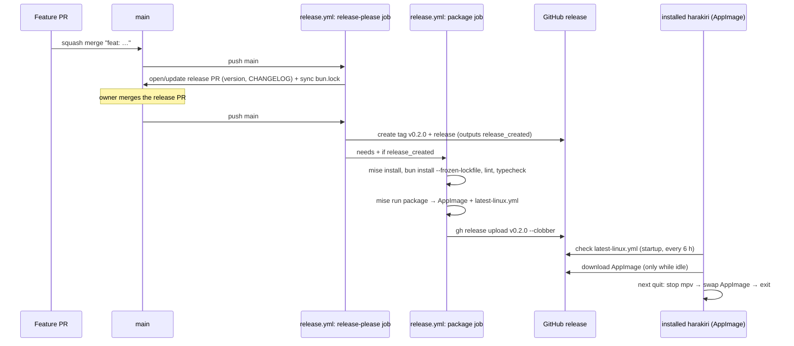

**Repos touched:** `harakiri`

### Summary of change request

When the owner merges a release-please release PR, CI builds the Linux desktop app and attaches it to the GitHub release. An installed harakiri then finds that release, downloads it, and replaces itself without the owner rebuilding or copying anything by hand.

### Current State

- There is no release. Merging to `main` produces a commit and nothing else: no version bump, no changelog, no tag, no downloadable build.
- The only way to get a runnable harakiri is to clone the repo and run it from source. Nobody has ever produced a packaged build.
- The app never updates itself. A new version means rebuilding from source.
- The app shows its version only in Settings, and nothing in the UI can tell the owner that a newer version exists.
- CI checks only PR titles. The Conventional Commit titles that release-please needs are already enforced on every PR.

### Desired End State

- Each merge to `main` keeps a release PR open that shows the next version and its changelog. Merging that PR creates the tag and the GitHub release, and CI attaches the AppImage and `latest-linux.yml` to it within minutes.
- A harakiri running as an AppImage checks for a new release, downloads it in the background while nothing is playing, and installs it on the next quit. Settings shows the update state and offers "Restart to update".
- An update never interrupts playback, and the existing quit protocol (stop mpv, report the stop to Jellyfin, then exit) still runs before the swap.
- `mise run package` builds the same AppImage locally that CI builds.
- `docs/PRD.md` gains a short "Distribution and updates" section, so scope questions about packaging have a source of truth.
- `docs/decisions/autonomous-run.md` and every reference to it are gone, and the stale NAS-path note in `docs/reviews/01-foundation.md` is fixed, so the source can go public (Q6).
- The owner takes these one-time repo actions: make `tcorzo/harakiri` public, and enable "Allow GitHub Actions to create and approve pull requests".

### What we're not doing

- Flatpak, Snap, rpm, deb or pacman packages. Flatpak updates come from Flathub, not electron-updater, and it stays with the "own mpv build" open question in the PRD.
- Bundling mpv, ffmpeg or libplacebo. The AppImage keeps using the system mpv, and bundling gets its own triaged issue (Q5).
- Windows and macOS builds (out of scope in the PRD).
- Code signing or a GPG signature. Linux updates are checked only by the sha512 in `latest-linux.yml`.
- Beta or nightly channels, rollback, downgrade, and staged rollouts.
- Running `mise run check` or e2e on CI, and launching the packaged app in CI. Both need system mpv/ffmpeg and a compositor on the runner (Q11).
- An app icon and desktop integration. The build uses electron-builder's default icon unless the logo work lands first.
- Splitting the 845 kB renderer chunk.

### Proposed End State Architecture

#### Release flow



#### Files

```diff
 .github/workflows/
   pr-title.yml
+  release.yml                       # release-please job + package job
+release-please-config.json          # root package ".", simple strategy, extra-files → apps/desktop/package.json
+.release-please-manifest.json       # { ".": "0.1.0" }
+CHANGELOG.md                        # written by release-please
 mise.toml
+  [tasks.package]                   # bounded.sh package 4G -- bun run package
 apps/desktop/
   electron-builder.yml
+    publish: github tcorzo/harakiri, artifactName with version
   package.json
+    dependencies: electron-updater
   src/main/
     index.ts                        # wires updates into main() and the quit hold
     lifecycle.ts                    # quit hold runs an install step after stopping mpv
+    updates.ts                      # update controller over an injectable UpdaterLike
+    updates.test.ts
     ipc.ts                          # + updates:status, updates:restart
   src/shared/bridge.ts              # + channels and zod UpdateStatus
   src/preload/bridge.ts             # + updates.status(), updates.restart()
   src/renderer/src/settings/
     SettingsScreen.tsx              # version row shows update state, + Restart to update
 CLAUDE.md                           # - autonomous-run.md bullet
 docs/PRD.md                         # + Distribution and updates, - autonomous-run.md references
-docs/decisions/autonomous-run.md
 docs/reviews/01-foundation.md       # stale NAS-path note fixed
 docs/reviews/03-fix-wave.md         # D16 reference reworded
```

#### `release.yml` shape

```text
on: push main
permissions: contents write, pull-requests write, issues write

job release-please
  googleapis/release-please-action@v5  (GITHUB_TOKEN)
  if a release PR is open: check out its branch, bun install, commit bun.lock if it changed, push
  outputs: release_created, tag_name, version

job package
  needs: release-please
  if: needs.release-please.outputs.release_created == 'true'
  runs-on: ubuntu-24.04 or 26.04 (pinned label, not ubuntu-latest)
  checkout at tag_name
  jdx/mise-action@v4 (bun, node, hk)
  bun install --frozen-lockfile
  mise run lint, lint:skips, lint:private, typecheck
  mise run package                       # electron-builder --publish never
  assert dist/latest-linux.yml sha512 == sha512(dist/*.AppImage)
  gh release upload $tag dist/*.AppImage dist/latest-linux.yml --clobber
```

#### Update controller (main)

```text
startUpdates(updater, { isPlaying, log })
  if not running as an AppImage ($APPIMAGE unset): status = unsupported; return
  updater.autoDownload = false
  updater.autoInstallOnAppQuit = false        # our quit hold installs; app.exit(0) skips "quit"
  updater.logger = logtape ["harakiri", "updates"]
  check now, then every 6 h
  on update-available(v): status = available(v); if not isPlaying(): download
  when playback stops and status is available: download
  on download-progress(p): status = downloading(v, p)
  on update-downloaded(v): status = ready(v)
  on error(e): log; status = failed(message); retry on the next tick

installIfReady()                              # called by the quit hold after mpv stopped
  if status is ready: updater.quitAndInstall(true, false) without re-entering quit
```

```diff
 on before-quit(event)
   event.preventDefault()
   if already stopping: return
   stopping = true
   result = race(player.stop(), 5 s)
   if result is timed-out: log warning
+  updates.installIfReady()          # swap the AppImage; mpv is already gone
   app.exit(0)
```

#### Settings

```diff
 <SettingsScreen>
   <dl>
     <dt>App</dt>
-    <dd>Version {appVersion}</dd>
+    <dd>Version {appVersion} · {up to date | 0.3.0 downloading 42% | 0.3.0 ready, installs when you quit | update check failed}</dd>
   </dl>
   <ListAction label="Sign out" />
   <ListAction label="Change server" />
+  {status is ready && <ListAction label="Restart to update" detail="Installs 0.3.0 and opens harakiri again" />}
```

### Design Questions

None open.

### Resolved Design Questions

#### Q1. Where the release-please package lives, and how pre-1.0 bumps work

Root package `.` with the `simple` strategy, tags `v0.2.0`, and `bump-minor-pre-major: true` only. Every commit counts, including those that touch only `packages/*`, which are bundled into the app. The `v` prefix matches electron-builder's default, and the plain semver tag is what electron-updater expects.

```json
{
  "packages": {
    ".": {
      "release-type": "simple",
      "include-component-in-tag": false,
      "bump-minor-pre-major": true,
      "extra-files": [
        { "type": "json", "path": "apps/desktop/package.json", "jsonpath": "$.version" }
      ]
    }
  }
}
```

Not chosen: `apps/desktop` with the `node` strategy, because it would never release a change made only in `packages/*` (the schema has no `additional-paths`). Root `.` with `node`, because it would add a meaningless `version` to the root `package.json`. `bump-patch-for-minor-pre-major`, because `feat` should bump the minor.

#### Q2. How packaging is triggered after release-please creates the release

A `package` job in the same `release.yml`, gated on `release_created`, plus a `workflow_dispatch` input `tag` that rebuilds an existing tag. No secret is needed. The release PR gets no `pull_request` checks with the default token. That is accepted: no check is required, and release-please writes a conventional title.

Not chosen: a PAT or GitHub App token with a second workflow `on: release`, because it costs a long-lived secret or an App and a second file for no check the release PR needs.

#### Q3. How artifacts reach the release, and the gap before they do

`electron-builder --publish never`, then `gh release upload <tag> … --clobber`. A re-run at any time does the same thing. The minutes between release-please publishing the release and the upload are accepted: an update check in that window logs a 404, and the updater tries again at the next check.

Not chosen: `--publish always`, because of its 2 h window on published releases and the implicit-publish rules that change in v27. `draft: true` with `force-tag-creation`, because its fix for the duplicate-PR issue is unconfirmed on action v5.

#### Q4. What gets built

AppImage, x64 only, with electron-builder 26's default toolset (FUSE 2 at runtime). The owner's Fedora 44 has `fuse-libs` 2.9.9. Revisit the `1.0.3` static-runtime toolset if a target TV box lacks FUSE 2.

Not chosen: an rpm as well, because its updates elevate with pkexec/sudo and skip GPG checks. The `1.0.3` toolset now, because electron-builder 26 still marks it beta.

#### Q5. mpv in the packaged app

The AppImage keeps using the system mpv on `PATH`, as the app does today. Bundling mpv, ffmpeg and libplacebo is triaged into its own issue, [#2](https://github.com/tcorzo/harakiri/issues/2), next to the PRD's open question about shipping an own mpv build.

Not chosen for this task: bundling a self-built mpv in `extraResources`, because it needs its own build pipeline and its own HDR and passthrough validation.

#### Q6. Where the update feed lives

Make `tcorzo/harakiri` public, and use electron-updater's public `github` provider: no token in the app and no extra host. Before the switch, this task deletes `docs/decisions/autonomous-run.md` and every reference to it, instead of fixing its stale NAS-path note:

```diff
-docs/decisions/autonomous-run.md
 CLAUDE.md:10       - the "Where things are written down" bullet, including "Append to it when you make a call the owner did not"
 docs/PRD.md:10     - the matching "decisions made without the owner" bullet
 docs/PRD.md:164    - "Decisions made without the owner go into docs/decisions/autonomous-run.md …"
 docs/reviews/03-fix-wave.md:28   names decision D16; reword so it does not point at the deleted file
 docs/reviews/01-foundation.md:29 still fix the stale "fixtures keep real NAS paths" note
```

The repo setting changes stay with the owner: visibility to public, and "Allow GitHub Actions to create and approve pull requests".

Not chosen: a separate public releases repo, because it needs a write token as a secret and splits tags from releases. A token baked into the app, because anyone with the AppImage can extract it. A `generic` feed on a static host, because it adds a host and its credentials.

#### Q7. When the app checks, downloads and installs

Fully automatic, never during playback. The app checks at startup and every 6 h, downloads only while no file plays, and installs on the next quit. Settings shows the state and offers "Restart to update". The Settings change goes through the impeccable loop.

Not chosen: notify-and-ask, because the renderer has no app-wide notice surface. Manual only, because it is not "self auto-update".

#### Q8. How installing fits the existing quit protocol

An explicit install step in the quit hold. `holdQuitUntilStopped(app, stop, { afterStop: updates.installIfReady })` installs after mpv stops and before `app.exit(0)`. "Restart to update" calls `app.quit()` with a relaunch flag, so it takes the same path. `autoInstallOnAppQuit = false`. During planning, confirm in `electron-updater@6.8.x` that `autoInstallOnAppQuit` hooks the `quit` event, which `app.exit(0)` skips.

Not chosen: `quitAndInstall()` from the Restart action alone, because a plain quit would never install. Ending the quit hold in `app.quit()`, because it re-enters `before-quit` and changes a protocol that e2e verifies.

#### Q9. How update status reaches the renderer

An invoke channel `updates:status`, which Settings polls through React Query (`refetchInterval: 1000`) while it is mounted, and an invoke `updates:restart`. This adds no broadcast and no stored window reference.

Not chosen: a pushed `updates:status` event, because it would be the first broadcast and needs a stored window, for one screen.

#### Q10. `bun.lock` drift after a release PR

The release-please job syncs it. When a release PR is open, the job checks out its branch, runs `bun install`, and commits and pushes `bun.lock` if it changed. `package.json` stays the single version source.

Not chosen: accepting the drift, because every developer's next `bun install` would leave an unexpected diff. Moving the version out of `package.json`, because electron-builder, Electron tooling and `identity.ts` read it there.

#### Q11. What the package job checks before it builds

The package job runs `lint`, `lint:skips`, `lint:private` and `typecheck`, then packages, then checks the metadata: the sha512 in `latest-linux.yml` matches the AppImage, and its version matches the tag. Tests stay on the hk pre-push hook. A `ci.yml` that runs `mise run check` on PRs is a separate task.

Not chosen: full `check` on `ubuntu-26.04` before packaging, because Ubuntu's ffmpeg 8.0.1 may not match the goldens recorded with 8.1.3, and its decoder set is unconfirmed.

#### Q12. How we prove the update path works

Unit tests plus one observed update on the owner's machine. `updates.test.ts` drives the controller through a fake `UpdaterLike`: no download during playback, `installIfReady` only when ready, and the status changes. `lifecycle.test.ts` checks that `afterStop` runs before `exit`. Then release v0.2.0, install it, release v0.2.1, and watch the app swap itself. That observation is the "done" evidence.

Not chosen for now: a `*.local.test.ts` tier that builds two AppImages and serves a `generic` feed on localhost, because it builds the app twice per run and needs FUSE. Add it if the update path breaks once.

### Patterns to follow

These show the patterns found in the existing codebase that will be followed to implement the proposed end state architecture.

#### Workflows install the toolchain through mise and run mise tasks

`.github/workflows/pr-title.yml` uses no setup-node or setup-bun action. It installs the pinned tools with `jdx/mise-action` and calls a mise task, passing untrusted values through `env`.

```yaml
- uses: actions/checkout@v4
- uses: jdx/mise-action@v4
  with:
    install_args: hk
# The title goes through env, never interpolated into the script.
- run: mise run lint:pr-title
  env:
    PR_TITLE: ${{ github.event.pull_request.title }}
```

```yaml
# release.yml, package job
- uses: actions/checkout@v4
  with: { ref: "${{ needs.release-please.outputs.tag_name }}" }
- uses: jdx/mise-action@v4
  with: { install_args: bun node hk }
- run: bun install --frozen-lockfile
- run: mise run lint && mise run typecheck
- run: mise run package
- run: gh release upload "$TAG" apps/desktop/dist/*.AppImage apps/desktop/dist/latest-linux.yml --clobber
  env:
    TAG: ${{ needs.release-please.outputs.tag_name }}
    GH_TOKEN: ${{ github.token }}
```

#### Heavy work is a mise task wrapped in `bounded.sh`

The `e2e` and `check` tasks wrap memory-hungry steps in `scripts/bounded.sh`. On a runner without systemd it falls back to a plain `exec`. `package` becomes a task in the same style, so the owner and CI run the same command.

```toml
[tasks.package]
description = "Build the Linux AppImage and its update metadata into apps/desktop/dist"
dir = "apps/desktop"
run = "../../scripts/bounded.sh package 4G -- bun run package"
```

#### Main-process modules take a narrow injectable interface, and tests pass a fake

`lifecycle.ts` depends on `QuittingApp { on, exit }` rather than Electron's `app`, and `lifecycle.test.ts` passes a fake.

```ts
interface QuittingApp {
  on(event: "before-quit", listener: (event: { preventDefault(): void }) => void): unknown;
  exit(code?: number): void;
}
export function holdQuitUntilStopped(
  app: QuittingApp,
  stop: () => Promise<void>,
  capMs = STOP_CAP_MS
): void;
```

```ts
// updates.ts
export interface UpdaterLike {
  autoDownload: boolean;
  autoInstallOnAppQuit: boolean;
  logger: { info(m: string): void; warn(m: string): void; error(m: string): void } | null;
  checkForUpdates(): Promise<unknown>;
  downloadUpdate(): Promise<unknown>;
  quitAndInstall(isSilent?: boolean, isForceRunAfter?: boolean): void;
  on(
    event: "update-available" | "download-progress" | "update-downloaded" | "error",
    l: (arg: never) => void
  ): unknown;
}
export function startUpdates(
  updater: UpdaterLike,
  deps: { isPlaying(): boolean; appImage: string | undefined }
): Updates;

// lifecycle.ts
export function holdQuitUntilStopped(
  app: QuittingApp,
  stop: () => Promise<void>,
  options?: { capMs?: number; afterStop?: () => void }
): void;
```

The real updater comes from `import pkg from "electron-updater"; const { autoUpdater } = pkg`, because the main bundle is ESM and the package is CJS.

#### The five-file IPC path for a new capability

A channel name in `shared/bridge.ts`, a zod schema and a `HarakiriBridge` member, a preload `invoke` that parses the reply, and a `handle` in `main/ipc.ts` behind `fromAppOnly`.

```ts
// preload/bridge.ts
deviceId: (() => invoke(channels.deviceId, DeviceId),
  // main/ipc.ts
  handle(channels.deviceId, () => deviceId()));
```

```ts
// shared/bridge.ts
updateStatus: "updates:status", updateRestart: "updates:restart",
export const UpdateStatus = z.discriminatedUnion("state", [
  z.object({ state: z.literal("unsupported") }),
  z.object({ state: z.literal("idle") }),
  z.object({ state: z.literal("available"), version: z.string() }),
  z.object({ state: z.literal("downloading"), version: z.string(), percent: z.number() }),
  z.object({ state: z.literal("ready"), version: z.string() }),
  z.object({ state: z.literal("failed"), message: z.string() }),
]);
// preload/bridge.ts
updates: {
  status: () => invoke(channels.updateStatus, UpdateStatus),
  restart: () => invoke(channels.updateRestart, z.undefined()),
},
// main/ipc.ts
handle(channels.updateStatus, () => updates.status());
handle(channels.updateRestart, () => updates.restart());
```

#### Settings rows and actions

Read-only facts go in the `<dl>`, and actions are `ListAction` rows with a `label` and a `detail`. The change goes through the impeccable loop (craft floor, detector, critique), as CLAUDE.md requires for renderer UI.

```tsx
<dt className="text-paper-dim stretch-condensed">App</dt>
<dd className="m-0">Version {appVersion}</dd>
…
<ListAction label="Change server" detail="Find or type another server" onPress={() => void leave(false)} />
```

#### One logger API, with a category per module

Main modules log through `getLogger(["harakiri", "<name>"])` into the console and the per-run file. The updater gets its own category and is passed to electron-updater as its `logger`, so update errors appear in the run log.

```ts
const logger = getLogger(["harakiri", "lifecycle"]);
logger.warn("mpv did not stop within {capMs} ms", { capMs });
```

#### One version source, compiled in

`apps/desktop/package.json` holds the version. `electron.vite.config.ts` defines `HARAKIRI_APP_VERSION` from it, and nothing calls `app.getVersion()`. release-please bumps that same field (Q1, Q10), and electron-builder reads it for the artifact name and `latest-linux.yml`. No new version source is added.
