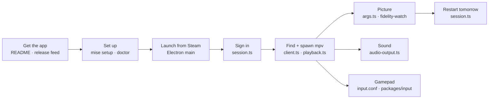
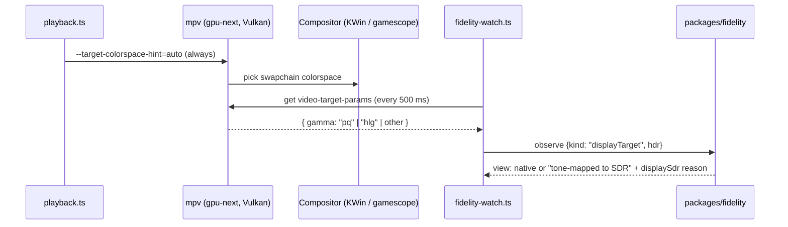

# Research: How harakiri behaves today on Bazzite in Steam Game Mode

**Date**: 2026-11-20T18:45:35-03:00
**Git Commit**: 759eb96b499d6d3d687aef98b3e61734001a72a3
**Branch**: tcorzo/bazzite-first-party
**Repository**: harakiri

Permalinks: every `path:line` below resolves at
`https://github.com/tcorzo/harakiri/blob/759eb96b499d6d3d687aef98b3e61734001a72a3/<path>#L<line>`
(the commit is on `origin/main`; the repo is private today).

## Research Question

The owner installed harakiri on a living-room HTPC running Bazzite (immutable Fedora 44) that boots into Steam Game Mode (gamescope-session), and hit a run of problems, filed as GitHub issues. The goal of the task is a holistic "plug and play" epic. This research documents, for each problem, the code and docs that produce today's behaviour, and the external facts about the platform. It does not propose the epic.

Issues in scope: #20 (tracking), #2, #8, #9, #10, #11, #12, #13, #14, #15, #17. Out of scope: #16 and #18 (worked on in parallel sessions), #19 (renderer preload warnings, not platform-related).

1. How does a user get harakiri today, and what do the README and the updater point at?
2. What does `mise run setup` / `doctor` check, and what does it not check?
3. What does the main process do at startup, and what does it inherit from Steam?
4. How is the session persisted, and what happens with no keyring?
5. How is the mpv binary chosen, spawned, and how are its failures reported?
6. How does the picture path decide HDR vs SDR, and where is `--target-colorspace-hint` set?
7. How does the audio path decide which codecs to bitstream?
8. How does gamepad input reach mpv during playback, and what does it depend on?
9. What do the PRD, README, CLAUDE.md and research docs say about target platforms and distribution?
10. What do primary sources say about gamescope, Steam, Bazzite and mpv packaging for these points?
11. (Follow-up from the owner) None of these surfaced before a first install on the HTPC, and a Bazzite VM per run does not scale. What does the test infrastructure model today, and what is the smallest environment known to show each mechanism behind these issues?
12. (Follow-up spike from the owner) Can a smolvm microVM boot Fedora 44 and Bazzite, and run nested KWin, lavapipe, Electron and mpv inside it? Does a virtual gamepad reach mpv, and does the #8 fake sink work without kernel sound? Does a GitHub runner have KVM?

## Research Methodology (verbatim)

This document will remain objective and factual. It does not contain any recommendations or implementation suggestions.
Open questions will not ask Why things haven't been built or what should be built in the future.

There is no "implementation" section - that is intentional.

## Summary

harakiri has no notion of the platform it runs on. Nothing in `apps/` or `packages/` reads `XDG_CURRENT_DESKTOP`, `XDG_SESSION_TYPE`, `GAMESCOPE_WAYLAND_DISPLAY`, `ENABLE_GAMESCOPE_WSI`, `LD_PRELOAD` or any Steam variable. The main process sets no Chromium switches. The mpv argv is the same on every host, and only the passthrough codec list changes per play. The product is specified, built and tested for one platform: Fedora 44, KDE Plasma, Wayland (`docs/PRD.md:57`), with e2e under nested `kwin_wayland --virtual`. Steam Game Mode differs from that platform on every axis the code depends on: X11 (through gamescope's XWayland) instead of Wayland, Steam's `LD_PRELOAD` in the environment, no keyring, no host mpv, and an HDR path that runs through gamescope's Vulkan WSI layer.

The first-install problems all sit on one path, from getting the app to playing a film after a restart, and each lands on a single seam in the code. Distribution: the README promises AppImage releases (`README.md:43-45`), but the repo is private with no tags, and the updater polls the public GitHub feed. Setup: `doctor` requires harness-only tools (weston, kwin) and does not probe any playback-time requirement. Launch: Chromium's GPU process inherits Steam's overlay preload. Sign-in: `session.ts` deliberately keeps the session in memory when `safeStorage` is on `basic_text`. Playback: mpv is always `"mpv"` on `PATH` (`packages/mpv/src/client.ts:327`). It always gets `--input-gamepad=yes` and `--target-colorspace-hint=auto` (`packages/mpv/src/args.ts:56,59`). Its early-exit reason is logged only at debug. Audio: the PipeWire format strings are matched exactly against bare names (`audio-output.ts:45`).

Several seams already exist and nobody uses them. `MpvSpawnOptions.binary` is never passed, `PlaybackConfig.colorspaceHint` is never set, and `audioOutput` is injected through `createPlayer` wiring. The fidelity engine is pure and observation-driven: it learns the display only from `video-target-params.gamma` and has no compositor input. The research docs already chose Flatpak as the primary Linux target (`docs/research/06-mpv-packaging.md:26`). The CI release design deferred bundling mpv to #2 and kept the system mpv on `PATH` (`docs/tasks/2026-11-17-ci-release-packaging/02-design-discussion-ci-release-packaging.md:217-221`).

None of this surfaced earlier because every check runs against one host: the developer's Fedora KDE machine (§13). CI runs no tests. e2e forces native Wayland, replaces pactl with an env-provided output, and stores the token in plain text instead of exercising the no-keyring branch. The dev box's own mpv has `sdl2-gamepad`, and its sinks list only `pcm`. Most mechanisms behind the issues can still be shown without the HTPC:

- **#8** was reproduced on the dev box with a rootless PipeWire and a fake `iec958_*` ALSA sink, with no root or kernel module. That corrects `docs/research/03-audio-harness.md`.
- **#12 and #13** are reproduced by any mpv lacking the option, or by a stand-in binary.
- **#11** follows from Chromium's desktop detection given `XDG_CURRENT_DESKTOP=gamescope`.

Only #9, #10 and #20 depend on gamescope's real HDR output or on Steam's own overlay library.

A spike on 2026-11-20 ran the e2e stack inside a smolvm microVM (§13.4), off the developer's session:

- **What ran.** nested KWin, mpv's gpu-next on lavapipe, and Electron with its renderer sandbox on. A uinput pad reached mpv's own SDL gamepad input, and the #8 strings appeared with no kernel sound.
- **What didn't.** An IEC 61937 stream got no link. The 5.2 GB Bazzite image never finished importing.

External research confirms most mechanisms reported in the issues. Flathub's and Homebrew's mpv are built without `sdl2-gamepad`, which defaults to `disabled` in mpv's meson options. gamescope's WSI layer injects HDR10 swapchain formats for X11 Vulkan clients. Electron selects `basic_text` when it cannot map the desktop to a keyring. Bazzite's gamescope-session-plus honours `CUSTOM_REFRESH_RATES`. Several points are only verifiable on the target hardware: whether Steam Input's virtual pad reaches mpv's SDL gamepad, how Steam's per-shortcut resolution behaves, whether the WSI layer reaches a Flatpak sandbox, and passthrough inside Flatpak. No primary source was found linking `gameoverlayrenderer.so` to Chromium's seccomp policy. The issue's A/B test (`env -u LD_PRELOAD` gives 0 crashes) is the only evidence for that mechanism.

## Detailed Findings

### 1. The in-scope issues all sit on one first-run path, each at one code seam

On Bazzite Game Mode, a first run goes: get the app, set it up, launch it from Steam, sign in, press play, and come back tomorrow. Each issue falls on one step of that path, and each step runs through a different part of the code.



| Step              | Issue(s)                      | Code that produces today's behaviour                                                                                  |
| ----------------- | ----------------------------- | --------------------------------------------------------------------------------------------------------------------- |
| Get the app       | #15                           | `README.md:43-53`, `apps/desktop/electron-builder.yml:13-16`, `apps/desktop/src/main/updates.ts:77-210`               |
| Set up            | #17, #13 (doctor half)        | `mise.toml:14-27`, `packages/harness/src/doctor.ts:68-130`                                                            |
| Launch from Steam | #10                           | `apps/desktop/src/main/index.ts:82-190` (no switches, `child-process-gone` logging)                                   |
| Sign in / restart | #11                           | `apps/desktop/src/main/session.ts:87-166`, `docs/PRD.md:65,71`                                                        |
| Find mpv          | #2, #14                       | `packages/mpv/src/client.ts:36-46,327`, `apps/desktop/src/main/player/playback.ts:309-312`                            |
| mpv start failure | #12, #13                      | `packages/mpv/src/client.ts:337-374`, `playback.ts:294-326`, `screening-screen.tsx:216-225,417-418`                   |
| Picture           | #9, #20 (resolution, refresh) | `packages/mpv/src/args.ts:56`, `fidelity-watch.ts:63,69,234`, `packages/fidelity/src/picture.ts:58-99`                |
| Sound             | #8                            | `apps/desktop/src/main/player/audio-output.ts:11-47`                                                                  |
| Gamepad           | #13                           | `packages/mpv/src/args.ts:59`, `apps/desktop/src/main/player/input-conf.ts:10-29`, `packages/input/src/route.ts:4-10` |
| Docs              | #14, #20                      | `README.md`, `docs/PRD.md:57,166-186`, `CLAUDE.md` onboarding                                                         |

The environment in every issue is the same: Bazzite 44.20260921 (`bazzite-deck-nvidia`), terra-gamescope 3.16.28, gamescope-session-plus `ogui-steam` with SDDM autologin, an NVIDIA GPU over HDMI to an AV receiver and a 4K120 HDR10 TV, and PipeWire 1.6.9. Game Mode exports `XDG_CURRENT_DESKTOP=gamescope`, `XDG_SESSION_TYPE=x11`, `DISPLAY=:1`, `ENABLE_GAMESCOPE_WSI=1` and `GAMESCOPE_WAYLAND_DISPLAY=gamescope-0`, and does not set `WAYLAND_DISPLAY` (issue #9, "Environment").

### 2. Nothing in the app reads the platform it runs on

A case-insensitive grep of the whole repo (excluding `node_modules`, `.git`, `bun.lock`) finds no code hit for `gamescope`, `Steam`, `Bazzite`, `steamos`, `distrobox`, `LD_PRELOAD`, `XDG_CURRENT_DESKTOP`, `XDG_SESSION_TYPE` or `GAMESCOPE_*`. The only code-side `WAYLAND_DISPLAY` is in e2e scaffolding (`apps/desktop/e2e/headless.sh:19`). Platform words appear only in docs:

- `docs/research/05-tv-ui-input.md:82-86,154`: "Steam Input / Steam Deck (`unverified`, general knowledge)". As a non-Steam shortcut Steam exposes a virtual Xbox 360 pad. There is a double-input risk. "In Deck Game Mode the gamescope compositor runs one app fullscreen … test this early."
- `docs/research/02-hdr-harness.md:24,36,39,99`: gamescope as a candidate headless HDR compositor (not installed, version in Fedora updates, `--backend headless --hdr-enabled` flags).
- `docs/research/01-shell-architecture.md:44-46,87,92-93`: X11 options for embedding, and "X11 has no per-surface HDR anyway".

The env schema validates five variables (`apps/desktop/src/main/env.ts:4-20`): `HARAKIRI_E2E`, `HARAKIRI_USER_DATA`, `HARAKIRI_DISCOVERY_ADDRESS`, `APPIMAGE`, `APPDIR`. Three more are read raw: `ELECTRON_RENDERER_URL` (`index.ts:30`), and `HARAKIRI_MPV_ARGS` and `HARAKIRI_AUDIO_OUTPUT`, both honoured only when `HARAKIRI_E2E=1` (`apps/desktop/src/main/player/index.ts:9-20`).

#### Testing patterns

There is no test of platform detection, because none exists. The e2e fixture forces native Wayland (`--ozone-platform=wayland`, `apps/desktop/e2e/support/harakiri.ts:185`). It drops `DISPLAY` and `APPIMAGE` from the inherited env (`harakiri.ts:176`). So every e2e run is the KDE-Wayland path. No test runs under X11 or gamescope.

### 3. Getting the app: the README and the updater both point at a feed that does not exist yet

The README's install section says "Each GitHub release ships one Linux x64 AppImage. It uses the system mpv, so install `mpv` 0.41 or newer and `ffmpeg` from RPM Fusion first" (`README.md:43-45`). It gives a `chmod +x` / run snippet (`README.md:50-53`). The PRD's distribution section says the same (`docs/PRD.md:168`). `gh repo view` reports the repo `PRIVATE`. `gh release list` is empty, and `git tag` shows only `pre-squash`. The CI release design made the switch to public an owner one-time action (`02-design-discussion-ci-release-packaging.md:31,223-238`).

The packaged app's feed is GitHub's public provider: `publish: {provider: github, owner: tcorzo, repo: harakiri}` (`apps/desktop/electron-builder.yml:13-16`). It is embedded as `resources/app-update.yml`, and `package:check` asserts it has no token (`scripts/check-release.ts:150-161`).

The update controller runs only inside its own AppImage. `ownAppImage` requires `APPIMAGE` and `APPDIR`, and `process.execPath` must be under `APPDIR` (`updates.ts:54-66`). Otherwise the status is `unsupported` and the updater is never created (`updates.ts:78-84`). Inside the AppImage it works like this:

```text
startUpdates
  check() now, then every 6 h (CHECK_EVERY_MS = 21_600_000)
  poll every 60 s
    available && !playing     -> download
    downloading && playing    -> cancel (status back to available)
    failed && ≥15 min since last check -> check() again (RETRY_AFTER_MS = 900_000)
  on electron-updater "error" -> status {state: "failed", message}
  quit hold -> stop mpv (≤5 s) -> installIfReady() -> app.exit(0)
```

There is no 404- or 401-specific branch. electron-updater's own logger is routed to LogTape at its native levels (`updater.ts:39-49`), so its 404 error arrives at ERR with the stack-like message quoted in #15. `check()` swallows the rejection at debug (`updates.ts:110-119`). Settings shows "update failed, tries again later" (`apps/desktop/src/renderer/src/settings/version-line.ts:6-23`).

#### Testing patterns

- `apps/desktop/src/main/updates.test.ts` uses fake timers and a fake updater. It covers check cadence, download gating on playback, the failed check retry (with `net::ERR_INTERNET_DISCONNECTED`), `installIfReady`, and `ownAppImage` cases. No test names a 404.
- `apps/desktop/src/main/updater.test.ts` covers the electron-updater adapter: flags off, LogTape routing, events and cancel tokens.
- `scripts/check-release.ts` (`mise run package:check`) checks the artifact: version, sha512, size, the embedded feed, and runtime deps in the asar.
- No test launches the packaged AppImage or hits the real feed.

### 4. Setup requires the headless-harness tools and probes nothing that playback depends on

`mise run setup` is `bun install --frozen-lockfile`, then `hk install --global --mise`, a hook-registration check, and finally `mise run doctor`, all under `bash -euo pipefail` (`mise.toml:14-22`). A failed doctor therefore fails setup. `doctor` runs `bun src/cli.ts doctor` in `packages/harness` (`mise.toml:24-27`, `packages/harness/src/cli.ts:14-16,34-54`).

Every probe is a `spawnSync` of a bare command name resolved from `PATH` (`packages/harness/src/process.ts:22-61`). No check takes a binary path or an argument.

| #   | Check                                  | Required | Probe → judgement (`doctor.ts`)       |
| --- | -------------------------------------- | -------- | ------------------------------------- |
| 1   | mpv                                    | yes      | `mpv --version` ≥ 0.41.0 (70-74)      |
| 2   | libplacebo linked into mpv             | yes      | `mpv --version` line present (75-80)  |
| 3   | ffmpeg filter libplacebo               | yes      | `ffmpeg -filters` row (81-86)         |
| 4   | ffmpeg bsf dovi_rpu                    | yes      | `ffmpeg -bsfs` row (87-93)            |
| 5   | ffmpeg encoders ac3, eac3, dca, truehd | yes      | `ffmpeg -encoders` rows (94-99)       |
| 6   | kwin_wayland                           | yes      | `kwin_wayland --version` (100-105)    |
| 7   | weston                                 | yes      | `weston --version` ≥ 15.0.0 (106-111) |
| 8   | podman                                 | **no**   | `podman --version` (112-117)          |
| 9   | dovi_tool                              | yes      | `--version` (118-123)                 |
| 10  | hdr10plus_tool                         | yes      | `--version` (124-129)                 |

Doctor does not probe any of these:

- mpv's `input-gamepad` option or `sdl2-gamepad` feature
- an ffmpeg or mpv decoder (`--vd=help`, `--ad=help`, HEVC, H.264, VC-1, E-AC-3)
- PipeWire sinks and their IEC 61937 formats
- gamescope's WSI layer
- a keyring or Secret Service
- the session type

The "HEVC decoder" requirement exists only as prose (`README.md:47-48`, CLAUDE.md onboarding). Checks 3-10 serve the validation harness: the T2-T4 picture tiers under kwin and weston, the corpus generation, and the dev Jellyfin. Output is @clack/prompts lines and an outro of `N required check(s) failed.`, with exit 1 on any required failure (`cli.ts:18-53`, `doctor.ts:144-145`).

In #13 every mpv check passed with the Flathub mpv on `PATH`, because none of the checks above touch gamepad support. In #17 only weston failed.

#### Testing patterns

`packages/harness/src/doctor.test.ts` unit-tests `parseVersion` and `compareVersions`, and the judges (`versionAtLeast` on 0.41.0 and 0.40.0 banners, not-found, exit 127, and `listsAll` on an encoder listing), all with synthetic `ToolRun` values. `CHECKS` as a list, `runChecks`, the CLI and the exit code are untested. `packages/harness/src/process.test.ts` covers `runTool`.

### 5. Launch from Steam: the main process sets no Chromium switches, so Steam's environment reaches every child

Startup order (`apps/desktop/src/main/index.ts`):

```text
module top
  set userData from HARAKIRI_USER_DATA                      (25-27)
  compute appUrl                                            (29-33)
  requestSingleInstanceLock ? start() : app.exit(0)         (176-190)
main()
  openRunLog(logs dir)                                      (109)
  configure LogTape: file ≥ debug, console ≥ info           (111-117)
  first log line: version, Electron, platform               (118-123)
  logProcessTrouble()  — unhandledRejection, render-process-gone, child-process-gone (82-105)
  killOnExit(mpvPid); holdQuitUntilStopped(...)             (126-133)
  second-instance, web-contents-created, window-all-closed  (134-140)
  removeStaleMpvDirs(tmpdir, uid, 60 s)                     (142-147)
  await app.whenReady()                                     (149)
  startUpdates; CSP; registerIpc; createWindow              (151-171)
```

There is no `app.commandLine.appendSwitch`, `disableHardwareAcceleration`, `--ozone-platform` hint, sandbox flag or `enable-features` anywhere in `apps/desktop/src` or the builder config. There is also no custom AppRun, launcher script or `executableArgs` (`electron-builder.yml` has none, and electron-builder's default AppRun applies). Electron therefore inherits Steam's environment unchanged, including `LD_PRELOAD`. It picks its ozone platform by default: with no `WAYLAND_DISPLAY` in Game Mode it runs X11, and the GPU process in #10 shows `--ozone-platform=x11`.

A GPU-process death is logged by `child-process-gone` as `Electron's {type} process is gone: {reason}` at error (`index.ts:89`). That is the triple `[ERR]` in #10. Nothing reacts to it beyond logging. Chromium's own fallback (`--use-gl=disabled` after 3 crashes) is what leaves the UI software-rendered.

The window is `fullscreen: app.isPackaged`, 1920×1080 when unpackaged, with `sandbox: true` and `contextIsolation: true` per renderer (`index.ts:35-58`). There is no kiosk mode.

**What the issue measured (#10):** with Steam's `LD_PRELOAD=…/gameoverlayrenderer.so`, the sandboxed GPU process hits `seccomp-bpf failure in syscall nr=0x112` (274, `get_robust_list`) and exits 139, three times. With `env -u LD_PRELOAD` there are 0 crashes. The issue also notes that disabling the gamescope WSI layer does not change the result.

**External (see §12):** no Chromium bug or Steam report naming this exact mechanism was found. The adjacent evidence is an Electron non-Steam shortcut on Steam Deck that needed `--no-sandbox`, `LD_PRELOAD=""` as the documented way to disable the overlay, and Chromium's `--disable-gpu-sandbox` diagnostic.

#### Testing patterns

There is no unit test of `index.ts` startup or window options. `lifecycle.test.ts` covers the quit hold and stale-dir sweep. `run-log.test.ts` covers the log file (0600, newest 10 kept). No test runs under X11, under Steam, or with `LD_PRELOAD`.

### 6. With no keyring, the session is kept in memory on purpose, so every restart is a fresh sign-in

The PRD says: "The session (server, user, token, device ID) persists across restarts. The token is encrypted with Electron `safeStorage`" (`docs/PRD.md:65`). Its acceptance criterion is "A restart after sign-in goes straight to the library" (`docs/PRD.md:71`). The PRD has no wording for the no-keyring case.

The store (`apps/desktop/src/main/session.ts`) writes `session.json` and `device-id` under `userData`. Writes are atomic: a 0600 temp file, fsync, then rename (`session.ts:66-85`). Encryption is "usable" only when `isEncryptionAvailable()` and the backend is not `basic_text` (`session.ts:87-89`). `save` has three branches:

```text
save(session)
  if encryptionUsable()            -> session.json { token: {kind: "encrypted", base64} }
  else if allowPlaintextToken      -> session.json { token: {kind: "plain", value} }   (e2e only: allowPlaintextToken = isE2E)
  else
    warn "safeStorage has no keyring (backend {backend}); the session is kept in memory and will not survive a restart"
    memorySession = session; rm session.json
```

(`session.ts:142-166`, the instance at `179-187`). `load` returns `memorySession` if set, then the file, and logs unreadable or undecryptable files at error and returns `null` (`session.ts:115-140`). The device ID survives `clear` (`session.ts:168-171`). The renderer decides onboarding vs library from `session.get()`: `routes/index.tsx:7-8` and `routes/_signedIn.tsx:7-10` redirect to `/onboarding` when it is `null`. The foundation review recorded "safeStorage `basic_text` backend treated as encryption" as a finding (`docs/reviews/01-foundation.md:14`). The current branch structure is how that finding was addressed.

**What the issue measured (#11):** in Game Mode the backend is `basic_text` because `XDG_CURRENT_DESKTOP=gamescope` maps to no keyring. `--password-store=kwallet6` fails because D-Bus can't activate kwalletd6: the systemd user manager has no `DISPLAY`, so Qt's xcb plugin aborts. `--password-store=gnome-libsecret` selects `gnome_libsecret`, but no Secret Service provider is running. Under SDDM autologin, PAM gets no password to unlock a wallet. The issue lists three product options and marks it "Decision needed", a PRD-level decision.

**External: Electron's `safeStorage` API in Electron 45.**

- **Backend selection.** `basic_text` is chosen when the desktop environment is not recognised, or with `--password-store="basic"`, and then items are "encrypted via hardcoded plaintext password". `getSelectedStorageBackend()` (Linux only, not deprecated) returns `basic_text`, `gnome_libsecret`, `kwallet`, `kwallet5`, `kwallet6`, or `unknown` before `ready`. `setUsePlainTextEncryption(bool)` (Linux only) forces an in-memory password when no password manager is found ([safeStorage docs](https://www.electronjs.org/docs/latest/api/safe-storage)).
- **The synchronous calls are deprecated.** `isEncryptionAvailable()`, `encryptString()` and `decryptString()`, which `session.ts:87-89,146-150` uses, are deprecated in 45.0, and the breaking-changes doc says they "will be removed in Electron 46" ([breaking changes, 45.0](https://www.electronjs.org/docs/latest/breaking-changes)).
- **The async replacements** are `isAsyncEncryptionAvailable()`, `encryptStringAsync()` and `decryptStringAsync()`. The last returns `{shouldReEncrypt, result}` and can decrypt data written by `encryptString`.
- Electron is pinned at 45.1.0 (CLAUDE.md dependencies).

#### Testing patterns

`apps/desktop/src/main/session.test.ts` (unit, injected fake `TokenCrypto`) covers:

- an encrypted round trip
- a smuggled device ID being replaced
- `clear`
- corrupt or undecryptable files reading as null
- the e2e plaintext branch
- the memory-only branch, and `basic_text` counting as no keyring
- atomic 0600 writes
- device-ID persistence

`apps/desktop/e2e/session.spec.ts` covers restart persistence, but only through the e2e plaintext branch, because `HARAKIRI_E2E=1` sets `allowPlaintextToken`.

### 7. The mpv binary is always `"mpv"` from `PATH`; the seam to change it exists and is unused

`MpvSpawnOptions` already has `binary?: string`, documented as "Defaults to `mpv` on PATH" (`packages/mpv/src/client.ts:36-46`). `spawnMpv` spawns `options.binary ?? "mpv"` (`client.ts:327`). The app's only call site passes `{ config: { dir }, args }` and no binary (`apps/desktop/src/main/player/playback.ts:309-312`). There is no env var or setting for a path, no use of `process.resourcesPath`, and `app.isPackaged` is used only for window fullscreen (`index.ts:40`). Two harness tools also run bare `mpv`: `doctor.ts:70-78` and `packages/harness/src/audio/mpv-capture.ts:23`.

Everything mpv needs at runtime besides the binary is generated by the app. The config dir is `userData/mpv` (`create-player.ts:87`), and `input.conf` is rewritten before every spawn (`playback.ts:307-308`). No `mpv.conf` is written. Audio-output capability comes from the host `pactl` (§10).

On Bazzite there is no host mpv (issue #14). The builds the owner tried behave differently:

| mpv 0.41.0 build                               | `sdl2-gamepad`                                     | Works with harakiri | Source                                                                                                                                                                                      |
| ---------------------------------------------- | -------------------------------------------------- | ------------------- | ------------------------------------------------------------------------------------------------------------------------------------------------------------------------------------------- |
| Fedora `mpv-0.41.0-5.fc44` + RPM Fusion ffmpeg | yes (SDL2 via `sdl2-compat`)                       | yes                 | issue #13                                                                                                                                                                                   |
| Flathub `io.mpv.Mpv`                           | no (no SDL2 in manifest; meson default `disabled`) | no                  | issue #13; [manifest](https://raw.githubusercontent.com/flathub/io.mpv.Mpv/master/modules/mpv.yaml), [meson.options](https://raw.githubusercontent.com/mpv-player/mpv/master/meson.options) |
| Homebrew `mpv` (Linux)                         | no (no `sdl2` dependency)                          | no                  | issue #13; [formula](https://raw.githubusercontent.com/Homebrew/homebrew-core/HEAD/Formula/m/mpv.rb)                                                                                        |
| `pkgforge-dev/mpv-AppImage`                    | no SDL; PipeWire disabled                          | not tried           | [get-dependencies.sh](https://raw.githubusercontent.com/pkgforge-dev/mpv-AppImage/main/get-dependencies.sh)                                                                                 |

The only working setup (#14) is a Fedora 44 distrobox with RPM Fusion ffmpeg and Fedora mpv. In Game Mode it also needs the host's gamescope WSI layer JSON copied into the box's `/etc/vulkan/implicit_layer.d/`, with `library_path` pointed at `/run/host/usr/lib64/…`. A `PATH`-shadowing `mpv` wrapper, put first on `PATH` by harakiri's launcher, runs `distrobox-enter`. The wrapper also needs a watchdog loop, because `spawnMpv`'s SIGKILL on a failed start (`client.ts:369-374`) kills only `distrobox-enter` and would leave mpv running in the container. Checked from the box: shared `/tmp` for the IPC socket, the readable `--config-dir`, host PipeWire with all passthrough formats, and NVIDIA Vulkan.

Issue #2 frames three distribution options: an AppImage with a self-built mpv in `extraResources`, a Flatpak with mpv, libplacebo and FFmpeg modules, or the system mpv plus an override and an in-app check. It lists owner decision points: format, the mpv line (0.41 vs master/FEL), the licensing of a GPL FFmpeg with HEVC/TrueHD/DTS decoders, and whether dev switches too. The research doc names Flatpak primary and AppImage secondary (`docs/research/06-mpv-packaging.md:10,26,132-133`). The PRD lists "a bundled mpv (issue #2)" as not shipped (`docs/PRD.md:171`), with the own-build question open (`docs/PRD.md:186`).

#### Testing patterns

- `packages/mpv/src/client.test.ts` runs real mpv 0.41 headless (`--vo=null --ao=null`). It asserts argv order (`--config-dir` first via `/proc/<pid>/cmdline`), IPC behaviour, redaction and timeouts. It never passes `binary`.
- `apps/desktop/src/main/player/playback.local.test.ts` runs real mpv against a fake Jellyfin server. It finds the mpv child via `/proc/<pid>/stat` ppid and a cmdline ending in `mpv` (209-217), and asserts no token in argv (434-443).
- No test covers a non-default binary or a packaged app finding its mpv.

### 8. When mpv exits early, the user sees a generic message, and mpv's reason is only in the debug log

`spawnMpv` builds the argv as `--config-dir=<dir> --idle=yes <caller args> --input-ipc-server=<mkdtemp>/ipc.sock` (`client.ts:322-334`). It pipes stdout and stderr through `readline`, and logs each line at **debug** as `mpv: {line}` after `redactSecrets` (`client.ts:337-342`, `packages/mpv/src/redact.ts:5-17`). No line is buffered or kept for later. The start race is:

```text
spawnMpv
  child "exit"  -> spawnFailed.reject(Error("mpv exited before its IPC socket was ready (code N)"))   (348-352)
  child "error" -> spawnFailed.reject(node error, e.g. ENOENT)                                       (353)
  race(connectWhenReady(sock, 5000 ms, exited?), spawnFailed)                                        (362-374)
    connectWhenReady retries every 20 ms; after exit it rethrows the raw connect error;
    after the deadline: "mpv IPC socket … not ready after 5000ms"                                    (85-112)
  on failure: SIGKILL child, rm dir, rethrow                                                         (369-374)
```

For an mpv that exits early, the "exited before" message always wins. The `exit` handler assigns `exit` and rejects `spawnFailed` in one synchronous callback (`client.ts:349-351`). `connectWhenReady` reads `hasExited()` only after a failed connect (`client.ts:97-100`). By the time it could rethrow the raw connect error, `spawnFailed` has already settled the race, and the losing connect error is discarded. A scratch script calling `spawnMpv` with a fake binary confirmed this:

| Fake binary                   | Error the caller gets                                                                                      |
| ----------------------------- | ---------------------------------------------------------------------------------------------------------- |
| `exit 1` immediately (5 runs) | `mpv exited before its IPC socket was ready (code 1)`                                                      |
| `sleep 0.3; exit 1` (3 runs)  | same                                                                                                       |
| path that does not exist      | `ENOENT: no such file or directory, posix_spawn '<path>'`, from the child `error` event at `client.ts:353` |

The 5 s timeout message appears only for an mpv that stays alive without ever creating its socket.

The error then travels to the screen:

```text
startPlayback (playback.ts:294-326)
  catch -> logger.error("Playback of {itemId} failed to start: {message}")       (318)
        -> send({phase: "error", error: message})                               (324)
        -> rethrow
ipc.ts:67-75 -> renderer
screening-screen.tsx
  phase "error" -> fail(next.error)                                             (306-308)
  rejected play() -> failWith(error) -> fail(messageOf(cause))                  (222-225, 321-324)
  render: <Notice>It did not start. {outcome.message}</Notice> + "Back to the programme"   (417-418)
```

So the user reads "It did not start. mpv exited before its IPC socket was ready (code 1)". mpv's own fatal lines, such as `Error parsing option input-gamepad (option not found)`, sit roughly 100 debug lines earlier in the run log (issue #12). Once mpv is running, an unexpected exit has its own message, `mpv exited unexpectedly (code …)` (`playback.ts:623-626`).

#### Testing patterns

`playback.local.test.ts:494-512` asserts the mid-play SIGKILL path (`mpv exited unexpectedly (code SIGKILL)`, a final `reported` event, and a Stopped report with `Failed: true`). `client.test.ts:305-330` asserts verbose output is redacted in a LogTape memory sink. No committed test covers the "exited before its IPC socket was ready" path, a missing binary, or which error wins the race. The table above comes from a throwaway script, not from the suite.

### 9. HDR is decided by mpv's swapchain, and the hint that steers it is fixed to `auto` on every host

The picture path has three layers, and only mpv talks to the compositor:



- **The hint.** `buildPlaybackArgs` emits `["target-colorspace-hint", config.colorspaceHint ?? "auto"]` (`packages/mpv/src/args.ts:56`), with `colorspaceHint?: "auto" | "yes" | "no"` (`args.ts:32-33`). The desktop passes only `audioPassthrough` (`playback.ts:121`), so it is always `auto`. The other fixed options are `--vo=gpu-next --gpu-api=vulkan --hwdec=auto-safe --fullscreen=yes --input-gamepad=yes --ytdl=no` (`args.ts:50-73`). `playback.ts:114-133` adds `--msg-level=all=v --no-osc --input-default-bindings=no --input-builtin-bindings=no --osd-level=0 --start --aid --sid --force-media-title`. No `--gpu-context` is set, so under gamescope mpv tries `waylandvk`, then falls to `x11vk` (log in #9).
- **The observation.** `watchFidelity` reads `video-target-params` while a VO exists, parses `{gamma}` (`fidelity-watch.ts:63`), and computes `hdr = HDR_GAMMAS.has(gamma)` with `HDR_GAMMAS = {"pq","hlg"}` (`fidelity-watch.ts:69,234`). It feeds the engine only on change.
- **The decision.** `picturePlan` (`packages/fidelity/src/picture.ts:58-99`) tone-maps to SDR with `{kind: "displaySdr"}` when `world.display === "sdr"`, and with `rendererFailed` when the renderer is not Vulkan. An `unknown` display is no downgrade. HDR→SDR is report-only and produces no `Action`. The engine has no compositor or display-capability input (`packages/fidelity/src/model.ts`, `engine.ts:42-61`).

Under gamescope this chain reports the truth: mpv picked an sRGB swapchain, so the watcher saw a non-PQ gamma and the engine said "The display takes SDR only". **What the issue measured (#9):** with gamescope HDR on and the WSI layer loaded, `auto` picks `A2B10G10R10 + SRGB_NONLINEAR` and `yes` picks `A2B10G10R10 + HDR10_ST2084`. Both runs list the HDR10 configuration as available.

The research doc for the shell architecture recommended `target-colorspace-hint=yes` for the spawned mpv (`docs/research/01-shell-architecture.md:11-17`). The code uses `auto`.

**External: the gamescope WSI layer, read from source** ([layer source, master](https://raw.githubusercontent.com/ValveSoftware/gamescope/master/layer/VkLayer_FROG_gamescope_wsi.cpp); line numbers are from master, and the 3.16.x tag was not diffed):

- **Two gates control activation.** The loader manifest enables the layer on `ENABLE_GAMESCOPE_WSI=1` and disables it on `DISABLE_GAMESCOPE_WSI=1` ([manifest template](https://raw.githubusercontent.com/ValveSoftware/gamescope/master/layer/VkLayer_FROG_gamescope_wsi.json.in)). Inside, `CreateInstance` passes through untouched unless `isRunningUnderGamescope()`. That check needs `GAMESCOPE_WAYLAND_DISPLAY` set and `WAYLAND_DISPLAY` unset or pointing to the same socket (L197, L207-245, L914).
- **Only X11 surfaces get HDR.** `CreateWaylandSurfaceKHR` hard-codes `.hdrOutput = false, // XXXX FIXME FIXME FIXME` (L1096-1135). `shouldExposeHDR()` is `hdrOutput && hdrAllowed` (L599-602). So a native-Wayland mpv under gamescope never sees HDR10 formats.
- **For X11, HDR comes from a root-window property.** `CreateXcbSurfaceKHR` reads the X11 property `GAMESCOPE_HDR_OUTPUT_FEEDBACK` (L1436-1438). Only then are `A2B10G10R10`/`A2R10G10B10 + HDR10_ST2084` and `R16G16B16A16_SFLOAT + EXTENDED_SRGB_LINEAR` appended (L1137-1141, L1165).
- **gamescope's nested Wayland server offers no colour-management protocol to clients.** `src/wlserver.cpp` creates six globals: gamescope_xwayland, gamescope_swapchain_factory_v2, gamescope_pipewire, gamescope_control, gamescope_private, wp_presentation. The repo's colour-management protocol XMLs are used by its Wayland _backend_, as a client of a host compositor ([protocol dir](https://github.com/ValveSoftware/gamescope/tree/master/protocol)).
- So the X11 route that mpv already falls into (`waylandvk` fails, then `x11vk`) is the only route to HDR under gamescope.
- mpv's `auto` mode (PR #16512, merged 2025-07-11) follows the compositor's advertised colourspace per frame. No mpv issue or doc about gamescope was found.

**Output resolution and refresh (#20, both marked unverified in the issue):**

- gamescope gives the app a 1920×1080 X display even though the TV's mode list includes 3840×2160@60/120. mpv's log shows `Video display: 3840x2160 -> 1920x1080`.
- The TV runs at 60 Hz with `GAMESCOPE_FPS_LIMIT=60`.
- Bazzite's session script passes `--custom-refresh-rates "$CUSTOM_REFRESH_RATES"` when that variable is set in `~/.config/environment.d/*.conf`. This is confirmed in the [upstream gamescope-session-plus script](https://raw.githubusercontent.com/ChimeraOS/gamescope-session/master/usr/share/gamescope-session-plus/gamescope-session-plus), which sources those files with `set -a`.
- harakiri reads none of gamescope's root properties. The engine does not track output resolution or refresh rate.

#### Testing patterns

- `packages/mpv/src/args.test.ts:6-17` asserts the default argv with `auto`. Line 32 asserts `no` when configured.
- `fidelity-watch.test.ts` uses a `fakeMpv` with property maps. It asserts an HDR display keeps the picture and an SDR target is reported (via `video-target-params.gamma`).
- `engine.test.ts` covers HDR vs SDR display and the Vulkan → OpenGL → legacy → none chain.
- `packages/fidelity/src/scenarios.ts:85-99` declares four displays: HDR with Vulkan, SDR with Vulkan, HDR with no Vulkan driver, and no working GPU renderer. None is gamescope.
- `table.test.ts` diffs `docs/fidelity/compatibility.md` against `renderTables()`.
- The e2e `player.hdr.spec.ts` runs under nested KWin only.

### 10. Bitstream codecs come from an exact string match against PipeWire's format list

`readAudioOutput` runs `pactl --format=json info` and `pactl --format=json list sinks` (2 s timeout each) and zod-parses both (`apps/desktop/src/main/player/audio-output.ts:19-27,59-85`). `outputFromPactl` then maps the default sink:

```ts
const CODEC_BY_FORMAT = new Map<string, BitstreamCodec>([
  ["ac3-iec61937", "ac3"],
  ["eac3-iec61937", "eac3"],
  ["truehd-iec61937", "truehd"],
  ["dtshd-iec61937", "dts-hd"],
  ["dts-iec61937", "dts"],
]); // 11-17
// …
bitstream: [...new Set(sink.formats.flatMap((format) => CODEC_BY_FORMAT.get(format) ?? []))]; // 45
```

The whole format string is the map key. On PipeWire 1.6.9 every passthrough entry carries an attribute suffix, for example `truehd-iec61937, format.rate = "{ \"min\": 32000, \"max\": 192000 }"` (issue #8). Nothing matches, so the sink is `{kind: "known", bitstream: []}`. Any pactl failure becomes `{kind: "unknown", detail}` and is never thrown (`audio-output.ts:71-80`).

The result feeds two places:

- `startFidelity`'s `soundWorld.output` (`playback.ts:166-171`), whose `bitstreamFor` returns the listed codecs (`packages/fidelity/src/sound.ts:46-56`).
- `--audio-spdif` through `passthroughOf` → `buildPlaybackArgs`. The flag is omitted entirely when the list is empty (`playback.ts:184-188`, `args.ts:64-66`).

The issue records a local fix that matches on the encoding before the first comma, and the owner confirmed passthrough worked with that build. That fix is not committed at this commit.

#### Testing patterns

`audio-output.test.ts` has three cases, all on the pure `outputFromPactl` with bare format names: a receiver, a PCM-only sink, and a missing default sink. It never spawns pactl. `player.live.test.ts` wires the real `readAudioOutput`. e2e `player.passthrough.spec.ts` sets `HARAKIRI_AUDIO_OUTPUT` and scans `ao_pcm` output for IEC 61937 bursts. Fidelity sound scenarios in `scenarios.ts:19-72` are declared as already-parsed `AudioOutput` values, so pactl string shapes never reach them.

### 11. During playback the gamepad belongs to mpv's SDL input, which only some mpv builds have

`--input-gamepad=yes` is always passed (`args.ts:59`). `input.conf` is generated per play from `BINDINGS` (`apps/desktop/src/main/player/input-conf.ts:10-29`). Each key, including `GAMEPAD_DPAD_*`, `GAMEPAD_ACTION_DOWN`/`RIGHT`, `GAMEPAD_BACK`, `GAMEPAD_START` and `GAMEPAD_MENU`, becomes `script-message harakiri <action>`. mpv's own bindings are off (`playback.ts:125-126`). The main process receives these through `onClientMessage` (`client.ts:302`).

The renderer drops gamepad input while the input mode is `player`: `accepts = { ui: {keyboard, gamepad}, player: {keyboard, gamepad: false} }` (`packages/input/src/route.ts:4-10`). It also silences held pad state across a mode switch (`packages/input/src/gamepad.ts:131-133`). The renderer enters `player` only after `player.play()` resolves (`screening-screen.tsx:317-320`). So with an mpv that lacks `sdl2-gamepad`, the option is rejected at startup and mpv exits (§8). If the option were simply dropped, nothing would drive playback from the pad, because the renderer ignores it by design. The PRD lists "whether mpv's SDL gamepad input stays reliable when focus moves" as an open question, with fallbacks (`docs/PRD.md:185`).

**External (see §12):** Steam Input presents an emulated Xbox 360 device to games. Bazzite's Game Mode doc says some apps need Steam Input disabled per shortcut. SDL issue #14410 reports SDL not detecting Steam's virtual controller. No source shows whether mpv's SDL gamepad sees Steam Input's virtual pad under Game Mode. The owner's run in #14 shows `input-gamepad: true` over IPC, but that does not say which device delivered presses.

#### Testing patterns

`packages/input/src/input.test.ts` covers `route` and the gamepad reader. e2e `input-guard.spec.ts` covers the UI/player guard. `args.test.ts:19-40` covers `gamepad: false`. No test exercises mpv's SDL gamepad, because the e2e harness has no physical or virtual pad for mpv.

### 12. The written platform target is KDE-Wayland; gamescope, Steam and immutable distros are absent from user docs

| Document                                                  | What it says about platforms and distribution                                                                                                                                                   |
| --------------------------------------------------------- | ----------------------------------------------------------------------------------------------------------------------------------------------------------------------------------------------- |
| `docs/PRD.md:57`                                          | "The MVP is done when all three features below meet their acceptance criteria on Fedora 44 with KDE Plasma on Wayland."                                                                         |
| `docs/PRD.md:166-171`                                     | One x64 AppImage per GitHub release, needs system mpv ≥ 0.41 on `PATH`. Not shipped: Flatpak, Snap, rpm, deb, pacman, a bundled mpv (#2), signing, channels.                                    |
| `docs/PRD.md:173-180`                                     | Out of scope: native DV signal, full DV7 EL, overlay over live video, Windows/macOS, multiple servers, offline, music, HDMI-CEC. Game Mode is neither in scope nor listed as out of scope.      |
| `docs/PRD.md:182-186`                                     | Open: ASS controls, SDL gamepad reliability, when to ship an own mpv build.                                                                                                                     |
| `README.md:13`                                            | Badge "platform: Fedora · KDE · Wayland".                                                                                                                                                       |
| `README.md:43-67`                                         | AppImage install (needs system mpv + RPM Fusion ffmpeg). Build from source lists `weston`, `kwin`, `mesa-vulkan-drivers`, `podman` "for the headless harness"/"dev and test Jellyfin".          |
| `README.md:75`                                            | `mise run doctor` "Checks mpv, libplacebo, ffmpeg and the headless compositors."                                                                                                                |
| CLAUDE.md onboarding                                      | Same Fedora package list. The video row is "system mpv 0.41.0 + libplacebo 7.360.1 + RPM Fusion ffmpeg 8.1.3".                                                                                  |
| `docs/research/06-mpv-packaging.md:10,26,118,132-134`     | Flatpak primary (freedesktop 26.08 + ffmpeg-full, mpv and libplacebo as modules), AppImage secondary, don't bundle Vulkan ICDs, a system mpv allowed as override. No gamescope or Deck mention. |
| `docs/research/05-tv-ui-input.md:82-86,154`               | Steam Input / Deck notes, marked unverified.                                                                                                                                                    |
| CI release design Q4-Q6 (`02-design-discussion…:211-238`) | AppImage x64 with FUSE 2 runtime. Keep system mpv (Q5). Make the repo public for the feed (Q6).                                                                                                 |

The README never mentions Steam, gamescope, Bazzite, Flatpak, immutable distros, PipeWire passthrough setup, or the keyring. Any example a doc adds must pass `scripts/lint-private.ts`. That rejects absolute home-directory paths, the NAS mount prefix, an agent scratchpad prefix, the owner domain, and titles in the gitignored `.private-denylist` (`lint-private.ts:26-60`). `~/.config/...` style paths pass.

**External facts gathered for the platform (with links):**

- **gamescope WSI layer.** It adds `A2B10G10R10/A2R10G10B10 + HDR10_ST2084` and `R16G16B16A16_SFLOAT + EXTENDED_SRGB_LINEAR` to the formats offered to clients when HDR output is on ([layer source](https://raw.githubusercontent.com/ValveSoftware/gamescope/master/layer/VkLayer_FROG_gamescope_wsi.cpp); secondary: [DeepWiki](https://deepwiki.com/ValveSoftware/gamescope/4.1-vulkan-wsi-layer)). Activation requires `GAMESCOPE_WAYLAND_DISPLAY`. gamescope-session-plus exports `ENABLE_GAMESCOPE_WSI=1` ([script](https://raw.githubusercontent.com/ChimeraOS/gamescope-session/master/usr/share/gamescope-session-plus/gamescope-session-plus)). Don't combine it with `VK_hdr_layer` ([README](https://github.com/Zamundaaa/VK_hdr_layer), [Arch wiki](https://wiki.archlinux.org/title/Gamescope)).
- **mpv `target-colorspace-hint=auto`.** Wayland auto-switching landed in [PR #16512](https://github.com/mpv-player/mpv/pull/16512) (from [#16305](https://github.com/mpv-player/mpv/issues/16305)). Nothing found about gamescope.
- **Steam overlay and Electron.** An electron-forge app as a non-Steam shortcut on Deck needed `--no-sandbox` ([Steam thread](https://steamcommunity.com/app/1675200/discussions/1/4826187053916237100)). `LD_PRELOAD=""` disables the overlay ([Gentoo wiki](https://wiki.gentoo.org/wiki/Steam/Games_troubleshooting)). Chromium sandbox flags are in the [sandboxing docs](https://chromium.googlesource.com/chromium/src/+/da492f144feba8874ce6d25a9da170228763b21e/docs/linux/sandboxing.md). Two Chromium apps at once crash Game Mode on exit ([Steam thread](https://steamcommunity.com/app/1675200/discussions/1/3416557114747120335)).
- **safeStorage.** `basic_text` is used when the desktop is unrecognised or with `--password-store="basic"`, and protects items only with a hardcoded password ([Electron docs](https://www.electronjs.org/docs/latest/api/safe-storage)). Forcing a backend changes where old secrets are read from ([Arch forum](https://bbs.archlinux.org/viewtopic.php?id=306402)).
- **Refresh and resolution.** Bazzite's quirks doc covers `OUTPUT_CONNECTOR` in `~/.config/environment.d/10-gamescope-session.conf` ([Bazzite quirks](https://docs.bazzite.gg/Handheld_and_HTPC_edition/quirks/)). A 120 Hz request on an HDMI 2.0 TV fell to 59 Hz ([gamescope #2059](https://github.com/ValveSoftware/gamescope/issues/2059)). The frame limit can snap back ([Universal Blue forum](https://universal-blue.discourse.group/t/gpd-win-mini-stuck-on-120hz/5993)).
- **Steam integration.** Non-Steam shortcuts live in binary `shortcuts.vdf`, written with Steam closed ([Valve wiki](https://developer.valvesoftware.com/wiki/Add_Non-Steam_Game), [Steam ROM Manager](https://emudeck.github.io/tools/steamos/steam-rom-manager)). Steam Input emulates an Xbox 360 pad ([Steamworks](https://partner.steamgames.com/doc/features/steam_controller/steam_input_gamepad_emulation_bestpractices)). Some apps need it off ([Bazzite Game Mode](https://docs.bazzite.gg/Handheld_and_HTPC_edition/Steam_Gaming_Mode/)). SDL not seeing the virtual pad is reported in [SDL #14410](https://github.com/libsdl-org/SDL/issues/14410).
- **Bazzite software guidance.** Bazaar/Flathub for GUI apps, Homebrew for CLI, distrobox for the rest, Gear Lever for AppImages ([software intro](https://docs.bazzite.gg/Installing_and_Managing_Software/software-intro/), [distrobox](https://docs.bazzite.gg/uk/Installing_and_Managing_Software/Distrobox/), [Framework KB](https://knowledgebase.frame.work/how-to-use-appimages-on-bazzite-H1vpUAOh1l)). `distrobox-export --bin` exports a container binary to the host ([man page](https://man.archlinux.org/man/distrobox-export.1.en)). No evidence was found that Bazzite ships mpv or a ujust media-player recipe ([Bazzite README](https://raw.githubusercontent.com/ublue-os/bazzite/main/README.md)).
- **mpv packaging prior art.**
  - Flathub mpv: runtime 26.08, its own FFmpeg n9.0.2 (`--enable-gpl --enable-version3`, no nonfree), `--device=all`, `--filesystem=/tmp:rw` ([manifest](https://raw.githubusercontent.com/flathub/io.mpv.Mpv/master/io.mpv.Mpv.yml), [ffmpeg module](https://raw.githubusercontent.com/flathub/io.mpv.Mpv/master/modules/ffmpeg.yaml)).
  - `pkgforge-dev/mpv-AppImage` builds through [mpv-build](https://github.com/mpv-player/mpv-build) with uruntime (no FUSE needed) ([repo](https://github.com/pkgforge-dev/mpv-AppImage)).
  - Host-lib pitfalls in AppImages: [pkg2appimage #510](https://www.github.com/AppImageCommunity/pkg2appimage/issues/510), [RetroArch libwayland](https://forums.libretro.com/t/bug-retroarch-appimage-qt-on-wayland-using-vulkan-driver/50183), [NVIDIA segfaults](https://codeberg.org/pkgforge-dev/Citron-AppImage/issues/67).
  - electron-builder `extraResources` and `process.resourcesPath` are covered in the [contents docs](https://www.electron.build/docs/contents) and the [ASAR docs](https://electronjs.org/docs/latest/tutorial/asar-archives).
- **Flatpak, gamescope and HDR.** The [`VulkanLayer.gamescope` extension](https://github.com/flathub/org.freedesktop.Platform.VulkanLayer.gamescope) branch 25.08 builds gamescope 3.16.31 with meson defaults ([manifest](https://raw.githubusercontent.com/flathub/org.freedesktop.Platform.VulkanLayer.gamescope/branch/25.08/org.freedesktop.Platform.VulkanLayer.gamescope.yml)). It installs under `/usr/lib/extensions/vulkan/gamescope`.
  - gamescope's `enable_gamescope_wsi_layer` option defaults to `true` ([meson_options.txt](https://raw.githubusercontent.com/ValveSoftware/gamescope/master/meson_options.txt)). The layer's meson rule installs both the `.so` and the `implicit_layer.d` JSON ([layer/meson.build](https://raw.githubusercontent.com/ValveSoftware/gamescope/master/layer/meson.build)). So the extension very likely ships the layer, but the built extension's contents were not inspected.
  - PipeWire IEC 61937 passthrough from a Flatpak is reported only anecdotally and as fragile. Kodi's Flatpak needed extra socket access or `KODI_AE_SINK=ALSA` ([PipeWire #2742](https://gitlab.freedesktop.org/pipewire/pipewire/-/issues/2742), [Kodi forum](https://forum.kodi.tv/showthread.php?tid=377077), [Kodi wiki: PulseAudio](https://kodi.wiki/view/PulseAudio)). A Dolphin PR shares `xdg-run/gamescope-0` and says HDR tone-maps to SDR without the extension ([Dolphin PR #178](https://github.com/flathub/org.DolphinEmu.dolphin-emu/pull/178)). See also the Steam Flatpak "non-Gamescope swapchain" report ([#1308](https://github.com/flathub/com.valvesoftware.Steam/issues/1308)) and Flatpak's [Electron guide](https://docs.flatpak.org/en/latest/electron.html) and [Zypak](https://github.com/refi64/zypak). Jellyfin Desktop on Flathub is Qt WebEngine plus libmpv ([Flathub](https://flathub.org/en-GB/apps/org.jellyfin.JellyfinDesktop)). A Deck user saw washed-out HDR with the JMP Flatpak ([Jellyfin forum](https://forum.jellyfin.org/t-hdr-rendering-improperly-over-direct-play-with-flatpak)).
- **Licensing.** An `--enable-gpl` FFmpeg is redistributable with source obligations. `--enable-nonfree` is not ([FFmpeg legal](https://www.ffmpeg.org/legal.html)). Patent royalties for HEVC/DTS/TrueHD were not covered by any source found.

### 13. Every check runs against the dev box, so the HTPC's differences are invisible until install

#### 13.1 The suite models one host, and the e2e flags bypass the host facts that differ

All tiers run on the developer's machine. The default tier (`mise run test`, `mise.toml:50-52`) uses whatever mpv, ffmpeg and ffprobe are on `PATH`. The live, contract and fate tiers are selected by file name (`vitest.shared.ts:1-23`, `vitest.tiers.config.ts:12-57`) and add only a Jellyfin or FATE samples. CI runs no tests. `.github/workflows` has `pr-title.yml` and `release.yml`, and the release `package` job on `ubuntu-24.04` runs lint, lint:skips, lint:private, typecheck, `package` and `package:check`, but not `test`, `check`, `e2e` or `doctor`. Tests run only on the owner's machine, through hk's pre-push hook, which runs `typecheck` and `test` (`hk.pkl`).

e2e drives the built app under one nested compositor (`apps/desktop/e2e/headless.sh`: `kwin_wayland --virtual`, `WAYLAND_DISPLAY` only). Several of its switches route around exactly the host facts that differ on Bazzite:

| Host fact on the HTPC                                               | What e2e does instead                                                                                                                                                             | Where                                                              |
| ------------------------------------------------------------------- | --------------------------------------------------------------------------------------------------------------------------------------------------------------------------------- | ------------------------------------------------------------------ |
| X11 through gamescope's XWayland                                    | `--ozone-platform=wayland`, `DISPLAY` dropped                                                                                                                                     | `e2e/support/harakiri.ts:173-201`                                  |
| pactl format strings from a real HDMI sink                          | `HARAKIRI_AUDIO_OUTPUT` JSON replaces `readAudioOutput()`                                                                                                                         | `player.passthrough.spec.ts:25-33`, `main/player/index.ts:13-20`   |
| No keyring, so the session lives in memory                          | `HARAKIRI_E2E=1` sets `allowPlaintextToken`, so the session goes to disk                                                                                                          | `main/session.ts:179-187`                                          |
| mpv's real VO, AO and gamepad                                       | `HARAKIRI_MPV_ARGS="--vo=null --ao=null"` by default; the gamepad is a fake `navigator.getGamepads` in the renderer, and mpv input is sent as `keypress` over a second IPC client | `harakiri.ts:73`, `support/gamepad.ts:40-58`, `support/mpv.ts:115` |
| Steam's environment (`LD_PRELOAD`, `XDG_CURRENT_DESKTOP=gamescope`) | Inherited from the developer's shell, so absent                                                                                                                                   | `harakiri.ts:176`                                                  |

The dev box differs from the HTPC on the same axes. Checked on 2026-11-20:

- Fedora's `mpv-0.41.0-5.fc44` is installed, and its `mpv -v` configuration line includes `-Dsdl2-gamepad=enabled`.
- gamescope is not installed.
- Both PipeWire 1.6.11 sinks list only `pcm` (a USB headset and a USB interface), so `outputFromPactl` never sees a passthrough format here.

The picture tiers past T2 do not exist in code. The PRD's tier table names T2 (kwin virtual, properties), T3 (`WAYLAND_DEBUG` under Weston 15 headless) and T4 (screenshots vs `ffmpeg -vf libplacebo`) (`docs/PRD.md:139-146`). `packages/harness/src` contains `audio/`, `corpus/`, `doctor`, `process`, `version` and `cli`: there is no compositor launcher, no `WAYLAND_DEBUG` parser and no screenshot comparison. The only picture checks are `player.hdr.spec.ts` under KWin virtual, which always reports SDR (`docs/research/02-hdr-harness.md:13`). The HDR-harness research considered gamescope headless and dropped it: "different signalling path (WSI layer, frog/X11) from what users get on KDE" (`02-hdr-harness.md:99,260`).

No committed fixture holds real host output. There is no recorded `pactl` JSON, `mpv --version` or `mpv -v` banner, environment dump or Wayland log. Host-shaped data appears only as inline literals: the bare format names in `audio-output.test.ts`, and an `MPV_VERSION` banner in `doctor.test.ts:8-10`.

New heavy processes run under `scripts/bounded.sh`, which puts them in a transient scope in `harakiri.slice` (MemoryMax, no swap). The watchdog kills only scopes in that slice, or restarts a `harakiri-jellyfin*` container. Containers are capped with podman `--memory` (`dev/jellyfin/jellyfin.sh`).

#### 13.2 Smallest environment known to show each mechanism

| Issue    | Mechanism                                                                            | Smallest environment known to show it                                                                                                                                                           | Status of that evidence                            | What the repo exercises today                                         |
| -------- | ------------------------------------------------------------------------------------ | ----------------------------------------------------------------------------------------------------------------------------------------------------------------------------------------------- | -------------------------------------------------- | --------------------------------------------------------------------- |
| #8       | PipeWire appends `, format.rate = "…"` to IEC 61937 formats                          | Rootless `pipewire` + `pipewire-pulse` with an ALSA `null` PCM named `iec958_*` behind an `api.alsa.pcm.sink` adapter with `iec958.codecs`. No root, no kernel module, no sound card.           | **Verified on the dev box 2026-11-20** (see below) | Bare names in `audio-output.test.ts`. e2e replaces pactl.             |
| #9       | `target-colorspace-hint=auto` picks sRGB on gamescope's X11 path                     | A gamescope with HDR output and the WSI layer. gamescope's headless backend hard-codes SDR, and `--hdr-debug-force-support` only fakes the atom ("HDR clients will be outputted as SDR still"). | Source-derived; gamescope not run here             | `args.test.ts` asserts `auto`. KWin virtual is always SDR.            |
| #10      | Steam's `gameoverlayrenderer.so` in `LD_PRELOAD` kills the GPU process via seccomp   | The real overlay library, which ships with the Steam client. No documented synthetic repro.                                                                                                     | HTPC A/B only (issue #10)                          | e2e inherits the shell env. GPU crashes are only logged.              |
| #11      | An unrecognised `XDG_CURRENT_DESKTOP` gives `OTHER` and then `basic_text`            | Any Electron launch with `XDG_CURRENT_DESKTOP=gamescope` and `DESKTOP_SESSION`, `KDE_FULL_SESSION`, `GNOME_DESKTOP_SESSION_ID` unset, or with `--password-store=basic`                          | Source-derived (Chromium); HTPC probe in issue #11 | `session.test.ts` with a fake crypto. e2e takes the plaintext branch. |
| #12, #13 | mpv without `sdl2-gamepad` exits on `--input-gamepad`, and the reason stays at debug | Any mpv build without the option, or a stand-in binary that exits 1                                                                                                                             | Stand-in **verified** (§8). Build matrix below.    | Host mpv only, and `binary` is never set in tests.                    |
| #14, #2  | No host mpv on Bazzite                                                               | The Bazzite OCI image's userland (`rpm -q`, `PATH`)                                                                                                                                             | Not run                                            | Nothing                                                               |
| #15      | Feed 404 while the repo is private                                                   | Any packaged run                                                                                                                                                                                | Issue log                                          | `package:check` reads the embedded feed config only                   |
| #17      | Doctor requires weston                                                               | Any host without weston                                                                                                                                                                         | Issue log                                          | Judges only, in `doctor.test.ts`                                      |
| #20      | gamescope gives the app a 1080p display at 60 Hz                                     | gamescope with a real output. Root atoms like `GAMESCOPE_DISPLAY_MODE_LIST_EXTERNAL` are set in `steamcompmgr.cpp` (L9502, L9517).                                                              | Not run; headless population unknown               | Nothing                                                               |

**The #8 reproduction, observed.** The ALSA config was a private `~/.asoundrc` with `pcm.iec958_null { type null }`. A PipeWire drop-in had a dummy driver plus this adapter:

```text
{ factory = adapter args = {
    factory.name = api.alsa.pcm.sink  node.name = fake-spdif  media.class = Audio/Sink
    api.alsa.path = "iec958_null"
    iec958.codecs = [ PCM AC3 EAC3 TrueHD DTS DTS-HD ]
    audio.position = [ FL FR FC LFE RL RR SL SR ] } }
```

Running `pipewire` and `pipewire-pulse` under `env -i` with a private `HOME` and `XDG_RUNTIME_DIR`, without wireplumber, `pactl --format=json list sinks` returned:

```text
{"name":"fake-spdif","formats":["pcm",
 "dts-iec61937, format.rate = \"{ \\\"min\\\": 1, \\\"max\\\": -1 }\"",
 "ac3-iec61937, format.rate = …", "eac3-iec61937, format.rate = …",
 "truehd-iec61937, format.rate = …", "dtshd-iec61937, format.rate = …"]}
```

This has the same shape as the HTPC's strings in #8, so `outputFromPactl` would return `bitstream: []` for it (`audio-output.ts:45`). Details:

- **Codec spelling.** The codec names must be spelled as in `spa/include/spa/param/audio/iec958-types.h` (`TrueHD`, `DTS-HD`). The research agent saw `TRUEHD` and `DTSHD` dropped silently, although the [PipeWire props man page](https://docs.pipewire.org/page_man_pipewire-props_7.html) lists those spellings.
- **Device name.** The SPA ALSA sink enumerates IEC958 formats only for device names starting with `iec958` or `hdmi` ([alsa-pcm.c](https://gitlab.freedesktop.org/pipewire/pipewire/-/raw/master/spa/plugins/alsa/alsa-pcm.c)). `support.null-audio-sink` enumerates raw formats only ([null-audio-sink.c](https://gitlab.freedesktop.org/pipewire/pipewire/-/raw/master/spa/plugins/support/null-audio-sink.c)).
- **Correction to existing research.** This refines `docs/research/03-audio-harness.md:17,116-117,154,178`, which says a null sink cannot take passthrough and that the T3 path needs `snd-aloop` and root. That holds for `support.null-audio-sink`; the ALSA `null` PCM route needs neither.
- **mpv against the fake sink.** In the same isolated PipeWire, `mpv --ao=pipewire --audio-spdif=ac3,…` on a 2 s AC-3 clip logged `AO: [pipewire] 44100Hz stereo 2ch spdif-ac3`. It did not finish within 20 s, and `timeout` stopped it. Without wireplumber nothing links the stream to `fake-spdif`, so sink-side IEC958 negotiation and end-to-end flow are **not** shown.

**The mpv build matrix for `sdl2-gamepad`.** mpv's meson option defaults to `disabled` ([meson.options](https://github.com/mpv-player/mpv/blob/master/meson.options)). A build has the option only if its packager enables it.

| Build                       | `sdl2-gamepad`                                                                   | Source                                                                                                          |
| --------------------------- | -------------------------------------------------------------------------------- | --------------------------------------------------------------------------------------------------------------- |
| Fedora (`mpv.spec`, 0.41.0) | enabled, `BuildRequires: pkgconfig(sdl2)`                                        | [mpv.spec](https://src.fedoraproject.org/rpms/mpv/raw/rawhide/f/mpv.spec); dev box `mpv -v`                     |
| Arch                        | enabled                                                                          | [PKGBUILD](https://gitlab.archlinux.org/archlinux/packaging/packages/mpv/-/raw/main/PKGBUILD)                   |
| Homebrew (Linux)            | not set, no SDL dependency                                                       | [formula](https://raw.githubusercontent.com/Homebrew/homebrew-core/master/Formula/m/mpv.rb)                     |
| Flathub `io.mpv.Mpv`        | not set in the mpv module                                                        | [modules/mpv.yaml](https://raw.githubusercontent.com/flathub/io.mpv.Mpv/master/modules/mpv.yaml); issue #13 run |
| Debian / Ubuntu             | `--auto-features=auto`; depends on `libsdl2-dev` in Build-Depends, not confirmed | [debian/rules](https://salsa.debian.org/multimedia-team/mpv/-/raw/debian/master/debian/rules)                   |

`mpv -v` prints the full meson configuration on its `[cplayer] Configuration:` line. That is how the dev box's `-Dsdl2-gamepad=enabled` was read above.

#### 13.3 What exists outside the repo for Bazzite and Steam environments

- **Bazzite images.**
  - Bazzite publishes OCI images on GHCR. bazzite-deck tags include `stable`, `stable-45`, `45.20261117.1`, `testing` and `unstable`, all Fedora 45 now ([versions page](https://github.com/orgs/ublue-os/packages/container/bazzite-deck/versions)). The HTPC in the issues is on 44.20260921.
  - They are ordinary Fedora rootfs images, so `podman run … rpm -q …` should answer userland questions. That is not run here, and such a container has no systemd session, Steam, gamescope output or GPU.
  - Turning the image into a VM disk goes through `ublue-os/image-template`'s `build-disk` workflow. It uses bootc-image-builder, now archived into [osbuild/image-builder](https://github.com/osbuild/bootc-image-builder).
  - GitHub-hosted Linux runners got KVM on larger runners in 2023, extended to 2-vCPU runners in 2024 ([changelog](https://github.blog/changelog/2024-04-02-github-actions-hardware-accelerated-android-virtualization-now-available/)). Not confirmed for `ubuntu-latest` in this repo.
- **AppImage runtime.**
  - electron-builder 26's default AppImage toolset is the legacy FUSE 2 runtime. Toolsets `1.0.2` and `1.0.3` use the static runtime, which needs no libfuse2 ([electron-builder 26 AppImage](https://www.electron.build/v26/docs/appimage), [type2-runtime](https://github.com/AppImage/type2-runtime)).
  - Fedora Atomic is dropping FUSE 2 ([change](https://fedoraproject.org/wiki/Changes/AtomicDesktopDropFuse2)). A Bazzite developer said Bazzite still ships libfuse and "will be the last to make this change" ([tracker](https://forge.fedoraproject.org/atomic-desktops/tracker/issues/50), snippet).
  - `--appimage-extract-and-run` and `APPIMAGE_EXTRACT_AND_RUN=1` bypass FUSE ([AppImage docs](https://docs.appimage.org/user-guide/troubleshooting/fuse.html)).
- **Game Mode environment.**
  - gamescope-session-plus exports `ENABLE_GAMESCOPE_WSI=1`, `QT_QPA_PLATFORM=xcb` and `SDL_VIDEO_MINIMIZE_ON_FOCUS_LOSS=0`, plus `GAMESCOPE_WAYLAND_DISPLAY`, `ENABLE_HDR_WSI` and `DXVK_HDR` with HDR, and reads `DISPLAY` back from gamescope's ready fd ([script](https://raw.githubusercontent.com/ChimeraOS/gamescope-session/master/usr/share/gamescope-session-plus/gamescope-session-plus)).
  - Bazzite's own scripts test `XDG_CURRENT_DESKTOP != gamescope` ([switcherooctl](https://github.com/ublue-os/bazzite/blob/main/system_files/overrides/usr/bin/switcherooctl)).
  - No primary source lists what Steam adds for a non-Steam shortcut (`LD_PRELOAD`, `SteamGameId`, `SDL_GAMECONTROLLERCONFIG`, …). The issues quote parts of it from the HTPC's logs.
- **Steam runtime.** The Steam Linux Runtime can launch non-Steam programs in its container, but it is installed through the Steam client by app ID ([SLR for developers](https://gitlab.steamos.cloud/steamrt/steam-runtime-tools/-/blob/main/docs/slr-for-game-developers.md)). umu-launcher runs the runtime container without the client ([README](https://cdn.jsdelivr.net/gh/open-wine-components/umu-launcher@main/README.md)). Neither reproduces gamescope-session or the overlay preload.
- **Chromium keyring selection.**
  - `GetDesktopEnvironment()` splits `XDG_CURRENT_DESKTOP` and recognises Unity, Deepin, GNOME, X-Cinnamon, KDE, Pantheon, XFCE, UKUI, LXQt and COSMIC. It falls back to `DESKTOP_SESSION`, `GNOME_DESKTOP_SESSION_ID`, `KDE_FULL_SESSION`, then `OTHER` ([xdg_util.cc](https://chromium.googlesource.com/chromium/src/+/main/base/nix/xdg_util.cc)).
  - `--password-store` overrides detection, and `OTHER` maps to basic text ([key_storage_util_linux.cc, older snapshot](https://chromium.googlesource.com/chromium/src/+/08fbce0a25be93e3ccef86182a5a7e8f08f4be2f/components/os_crypt/key_storage_util_linux.cc); main moved it under `components/os_crypt/sync/`).
- **Headless gamescope.**
  - `--backend headless` exists ([main.cpp](https://raw.githubusercontent.com/ValveSoftware/gamescope/master/src/main.cpp)), and real headless runs log "Starting Xwayland on :0" ([gamescope #1984](https://github.com/ValveSoftware/gamescope/issues/1984), open, with cursor-only output and zero-modifier warnings).
  - `HeadlessBackend` reports `SupportsHDR()` false and 709/Gamma22 colourimetry ([HeadlessBackend.cpp](https://raw.githubusercontent.com/ValveSoftware/gamescope/master/src/Backends/HeadlessBackend.cpp)).
  - No public CI use of headless gamescope, with or without lavapipe, was found.

#### 13.4 A smolvm microVM runs the whole e2e stack and a virtual gamepad, off the developer's session

On 2026-11-20 the owner asked for a time-boxed spike: can a [smolvm](https://github.com/smol-machines/smolvm) microVM hold the checks above, so that they don't depend on the workstation? Setup:

- smolvm v1.35.5 (released 2026-11-19), the `linux-x86_64` tarball with its checksum verified, run from a scratch directory without the install script.
- The VM's state lived in a throwaway directory that was deleted afterwards.
- Every VM ran under `scripts/bounded.sh` in `harakiri.slice`.
- Host: the dev box (Fedora 44, kernel 7.2, RTX 3080 Ti, `/dev/kvm` mode 0666). No `--gpu`: all rendering was lavapipe.

| #   | Question                                               | Result                                                                                                   |
| --- | ------------------------------------------------------ | -------------------------------------------------------------------------------------------------------- |
| 1   | Does a `fedora:44` VM boot?                            | **Yes.** `machine run --image fedora:44` printed `uname` about 12 s after the call, image pull included. |
| 2   | Do KWin virtual, lavapipe, Electron and mpv run in it? | **Yes**, as a non-root guest user under `dbus-run-session`. Details below.                               |
| 3   | Does a fake gamepad reach mpv's gamepad input?         | **Yes.** A uinput pad reached mpv's SDL gamepad input, after guest-side setup as root.                   |
| 4   | Does the #8 fake sink work with no kernel sound?       | **The pactl strings, yes.** PCM plays end to end. An IEC 61937 stream gets no link.                      |
| 5   | Does `ghcr.io/ublue-os/bazzite-deck:stable` boot?      | **Not reached.** The image import never finished.                                                        |
| 6   | Does a GitHub-hosted runner expose `/dev/kvm`?         | **Documented, not run.** Standard 2-vCPU Linux runners have it since 2024-04, given a udev rule.         |

**The guest kernel is 6.18.60, not the 6.6.59 config read earlier.** `/proc/cmdline` carries `nomodule`, and there is no `/proc/config.gz`. The kernel exposes:

- **Present:** `/sys/class/misc/uinput` (10:223), `fuse`, `tun`, `vsock` and the `input` and `drm` majors.
- **Absent:** `/sys/class/sound`, `/proc/asound` and any DRM card; `/sys/class/drm` holds only `version`.

**The workload runs in a container inside the VM, which limits what it sees.** `/dev` is a 64 MiB tmpfs with only the basic nodes: no `uinput`, `input/`, `dri/` or `snd/`. `/sys` is read-only. The workload runs as root with full capabilities, so it can `mknod /dev/uinput c 10 223` and mount a `devtmpfs` to reach new event nodes. As root, `Seccomp:` is 0.

**Check 2 in detail.** `dnf install` of `kwin mesa-vulkan-drivers mpv pipewire wireplumber …` took about 60 s.

- `kwin_wayland --virtual --no-lockscreen --socket … --width 1920 --height 1080` created its socket, as in `apps/desktop/e2e/headless.sh:9`.
- mpv 0.41.0 (Fedora) drew a frame with `--vo=gpu-next --gpu-api=vulkan --gpu-context=waylandvk`, logging `VO: [gpu-next] 1280x720 yuv420p` and `Exiting... (End of file)`.
  - It needed `--vulkan-device=<lavapipe UUID>`, as in `e2e/support/mpv.ts:119-131`. Without it, libplacebo logged "Found no suitable device".
- Electron 45.1.0, the upstream zip with a non-setuid `chrome-sandbox`, loaded a window with `--ozone-platform=wayland` and `sandbox: true`.
  - `app.getAppMetrics()` plus `/proc/<pid>/status` showed the renderer (`Tab`) at `Seccomp: 2`, so Chromium's namespace sandbox ran without `--no-sandbox`.
  - GPU compositing was `disabled_software`, and no separate GPU process appeared, so the GPU-process seccomp path behind #10 was not exercised.

**Check 3 in detail.** The guest-side setup, run as root:

1. `mknod /dev/uinput`.
2. Mount a `devtmpfs` and symlink `/dev/input` to its `input/` directory.
3. Create a python-evdev `UInput` named "Microsoft X-Box 360 pad" (045e:028e), and `chmod 666` its event node.

mpv ran as the guest user with `SDL_JOYSTICK_DISABLE_UDEV=1 --input-gamepad=yes` and an input.conf of `GAMEPAD_ACTION_DOWN quit 42`. It logged `[input/#1] added controller: Xbox 360 Controller` and exited with status 42 after the pad pressed `BTN_SOUTH`. That is the playback gamepad path that e2e replaces with a fake `navigator.getGamepads` (§13.1).

**Check 4 in detail.** The guest ran the §13.2 recipe as the guest user, with `pipewire`, `wireplumber` and `pipewire-pulse`, and with no `/dev/snd`. `pactl --format=json list sinks` returned the same `fake-spdif` format list as on the dev box, including `ac3-iec61937, format.rate = "{ \"min\": 1, \"max\": -1 }"`.

- **PCM.** With the dummy driver and the sink in `node.group = pipewire.dummy`, a 6-channel AC-3 clip decoded to PCM played to `End of file`. Without the dummy driver it stalled until `timeout`.
- **IEC 61937.** With `--audio-spdif=ac3`, mpv logged `AO: [pipewire] 48000Hz stereo 2ch spdif-ac3`, then `Error during playback: No such file or directory, no target node available`, and kept retrying. `pactl set-sink-formats <index> "pcm; ac3-iec61937; …"` did not change that. Why WirePlumber finds no target for the encoded stream was not found within the time box.

**Check 5 in detail.** `bazzite-deck:stable` is 256 layers and 5.21 GB compressed (`skopeo inspect --raw`).

- The first attempt ran while the check-2 VM was still up. It shared `harakiri.slice` (7 GB in total) and was OOM-killed at its 5 GB cap after 54 s.
- The second ran alone with a 6.8 GB cap and `--max-image-size 30GiB`. After 30 min its memory sat at the cap, its CPU time was still growing, and the state directory had stopped at about 11 GB. The VM had not started. It was killed.
- smolvm's own default image cap is 8 GiB (`--max-image-size`).
- Two things stay unrun: what the Bazzite userland reports (open question 7), and whether smolvm boots it.

**Check 6.** GitHub's changelog of 2024-04-02 says the 2-vCPU GitHub-hosted Linux runners have hardware acceleration. The runner user gets access through a udev rule that sets `/dev/kvm` to `0666` ([changelog](https://github.blog/changelog/2024-04-02-github-actions-hardware-accelerated-android-virtualization-now-available/)). No workflow ran here. The repo is still private.

**Operational facts from the spike:**

- **State size.** A VM's state directory holds its image, storage and overlay disks: 2.1 GB after provisioning check 2.
  - In the session scratch directory it hit the `/tmp` user quota. `/tmp` is a 16 GB tmpfs on this box, so VM state there costs RAM.
  - With the quota exhausted, `machine stop` failed with `database operation failed: … disk I/O error`. The VM process was then stopped by stopping its systemd scope.
- **Containment.** `machine start` inside `bounded.sh` leaves the VM process in that scope, so `systemctl --user stop` of the scope stops the VM, and the watchdog's slice policy applies.
- **Memory budget.** The default VM memory is half the host's RAM, up to 8 GiB. A 4 GiB VM plus anything else exceeds the 7 GB slice cap.

#### Testing patterns

This section is the testing map. Unit tiers use synthetic host data. `playback.local.test.ts`, `client.test.ts` and `t1-mpv.test.ts` use the host's real mpv. e2e uses nested KWin, `--vo=null`, an e2e-only audio override and a renderer-side fake pad. No test, fixture or CI job models gamescope, X11, Steam's environment, a missing keyring through the real app, a non-Fedora mpv, or an IEC958-capable PipeWire sink.

## Code References

### mpv process and argv (exhaustive for this area)

- `packages/mpv/src/client.ts:36-46` — `MpvSpawnOptions` incl. unused `binary`
- `packages/mpv/src/client.ts:85-112` — `connectWhenReady` retry loop and errors
- `packages/mpv/src/client.ts:322-390` — `spawnMpv`: argv, stdout/stderr at debug, exit/error promises, start race, SIGKILL on failure
- `packages/mpv/src/redact.ts:5-17` — secret redaction for log lines
- `packages/mpv/src/args.ts:32-33,50-73,81-82` — `PlaybackConfig`, `buildPlaybackArgs`, `configArg`
- `packages/mpv/src/http.ts` — `setHttpHeaders` over IPC
- `packages/mpv/src/args.test.ts`, `packages/mpv/src/client.test.ts`, `packages/mpv/src/http.test.ts`

### Player wiring in the desktop main process

- `apps/desktop/src/main/player/index.ts:9-29` — e2e-only `HARAKIRI_MPV_ARGS`/`HARAKIRI_AUDIO_OUTPUT`, `createPlayer` wiring
- `apps/desktop/src/main/player/create-player.ts:87,97,144-153,168` — config dir, prepare/play, serialization, mpv pid
- `apps/desktop/src/main/player/playback.ts:110-133` — `mpvArgs` extras
- `apps/desktop/src/main/player/playback.ts:166-188` — `startingFidelity`, `passthroughOf`
- `apps/desktop/src/main/player/playback.ts:294-326` — start try/catch, error log and event
- `apps/desktop/src/main/player/playback.ts:619-626,701-728` — exit handling, watcher and `log-message` hooks
- `apps/desktop/src/main/player/input-conf.ts:10-29` — generated `input.conf`
- `apps/desktop/src/main/player/audio-output.ts:11-85` — pactl → `AudioOutput`
- `apps/desktop/src/main/player/fidelity-input.ts`, `fidelity-watch.ts` — Jellyfin → engine inputs; mpv property sampling
- Tests: `audio-output.test.ts`, `fidelity-input.test.ts`, `fidelity-watch.test.ts`, `create-player.test.ts`, `playback.local.test.ts`, `player.live.test.ts`; fixtures in `apps/desktop/src/main/player/fixtures/`

### Fidelity engine (key files; package has no other source files of note)

- `packages/fidelity/src/model.ts` — `AudioOutput`, `Observation`, `Action`, `DowngradeReason`
- `packages/fidelity/src/engine.ts:24-164` — state, `startFidelity`, `fidelityView`, `learn`, `observe`
- `packages/fidelity/src/picture.ts:7-99` — `PictureWorld`, renderer chain, `picturePlan`
- `packages/fidelity/src/sound.ts:13-138` — `SoundWorld`, `bitstreamFor`, `soundPlan`
- `packages/fidelity/src/scenarios.ts:6-165` — scenario arrays and `simulate`
- `packages/fidelity/src/table.ts`, `table-cli.ts`, `table.test.ts`; `docs/fidelity/compatibility.md`

### Main process, session, updates, logging

- `apps/desktop/src/main/index.ts:25-190` — startup order, window, `logProcessTrouble`, single-instance
- `apps/desktop/src/main/env.ts:4-20` — env schema
- `apps/desktop/src/main/session.ts:16-187` — session store, `basic_text` branch
- `apps/desktop/src/main/ipc.ts:43-75` — session, update and play channels
- `apps/desktop/src/main/updates.ts:54-210`, `apps/desktop/src/main/updater.ts:36-104` — update controller and electron-updater adapter
- `apps/desktop/src/main/lifecycle.ts:9-150` — quit hold, `killOnExit`, stale mpv dirs
- `apps/desktop/src/main/run-log.ts` — per-run log file
- Tests: `session.test.ts`, `updates.test.ts`, `updater.test.ts`, `lifecycle.test.ts`, `run-log.test.ts`

### Renderer touch points

- `apps/desktop/src/renderer/src/screening/screening-screen.tsx:37-38,216-225,301-324,389-392,417-418` — play failure display, input mode switches
- `apps/desktop/src/renderer/src/routes/index.tsx:7-8`, `routes/_signedIn.tsx:7-10`, `data/session.ts:9-13` — onboarding redirect
- `apps/desktop/src/renderer/src/settings/settings-screen.tsx:89-95`, `settings/version-line.ts:6-23` — update status UI
- `packages/input/src/route.ts:4-10`, `packages/input/src/gamepad.ts:131-133` — input-mode guard

### Packaging, setup, doctor

- `apps/desktop/electron-builder.yml` — AppImage x64, GitHub publish, no `extraResources`/launcher
- `apps/desktop/package.json:9,12,36,50` — dev/package scripts, electron-updater pin
- `scripts/check-release.ts` — `package:check`
- `mise.toml:14-32,120-123,146-152` — setup, doctor, dev, package, check, package:check
- `packages/harness/src/doctor.ts:6-145`, `cli.ts:14-68`, `process.ts:22-61`, `version.ts:4-16`; `doctor.test.ts`, `process.test.ts`
- `packages/harness/src/audio/mpv-capture.ts:23` — harness mpv from `PATH`
- `scripts/lint-private.ts:26-131` — private-content lint

### e2e (exhaustive for support files; specs listed)

- `apps/desktop/e2e/headless.sh` — nested `kwin_wayland --virtual`, the only compositor launch in the repo
- `apps/desktop/playwright.config.ts` — one project, `workers: 1`, global setup
- `apps/desktop/e2e/support/harakiri.ts:73,150-201` — `mpvArgs`/`extraEnv` fixtures, launch args and env (drops `DISPLAY`, `APPIMAGE`)
- `apps/desktop/e2e/support/{backend,global-setup,jellyfin,library,keyboard}.ts` — e2e Jellyfin container and data
- `apps/desktop/e2e/support/gamepad.ts:40-58` — renderer-side fake pad
- `apps/desktop/e2e/support/mpv.ts:115` — mpv `keypress` over IPC, `lavapipeDeviceUuid`
- `apps/desktop/e2e/support/stub.ts`, `hold-load.lua`
- Specs: `session`, `onboarding`, `navigation`, `screening`, `input-guard`, `player.headless`, `player.hdr`, `player.passthrough`

### Test tiers, CI and resource bounds

- `vitest.shared.ts:1-23`, `vitest.config.ts`, `vitest.tiers.config.ts:12-57` — tier selection by file name
- `packages/*/vitest.config.ts`, `apps/desktop/vitest.config.ts:12-28` — per-project hermetic excludes
- `scripts/lint-skips.ts` — no-skip rule
- `.github/workflows/pr-title.yml`, `.github/workflows/release.yml` — the only CI; no test job
- `hk.pkl` — pre-commit lint/format, pre-push typecheck and test
- `scripts/bounded.sh`, `scripts/watchdog.sh` — `harakiri.slice` scopes and the watchdog
- `dev/jellyfin/jellyfin.sh` — pinned rootless podman dependency the suite starts itself
- `packages/harness/src/audio/{iec61937,wav,clips,assertions,mpv-capture}.ts` and `t0-golden`, `t1-mpv`, `hbr.fate` tests — the implemented sound tiers
- `docs/research/02-hdr-harness.md:13-17,97-99,237-281`, `docs/research/03-audio-harness.md:17,63,114-124,154,178` — harness research, including the dropped gamescope row and the null-sink claim refined in §13.2

### Docs

- `docs/PRD.md:57-72,111,118,126-131,133-156,166-186`
- `README.md:13-15,43-80`
- `docs/research/06-mpv-packaging.md:8-26,100-147,155-189`, `docs/research/01-shell-architecture.md:11-17,44-46,73-122`, `docs/research/05-tv-ui-input.md:82-86,154`, `docs/research/02-hdr-harness.md:24-39,99`
- `docs/tasks/2026-11-17-ci-release-packaging/01-research-ci-release-packaging.md:110-181`, `02-design-discussion-ci-release-packaging.md:25-41,211-238`
- `docs/reviews/01-foundation.md:14`

## Architecture Documentation

**Decisions are pure; the platform reaches them only through observation.** `packages/fidelity` has no mpv, Electron or Jellyfin types. It takes the file's streams, the delivery, and an `AudioOutput`, then folds `Observation`s into a view and a list of `Action`s. The desktop adapters turn the outside world into those observations: pactl for the output, mpv's `video-target-params`, and `ao/`/`vo/` log messages. The engine therefore cannot tell KDE from gamescope. It sees whatever swapchain mpv ended up with. Compositor-dependent behaviour lives entirely in mpv's own `auto` logic and in the argv, which today is host-independent. CLAUDE.md requires any new fidelity case to land as a scenario and a reviewed `compatibility.md` diff.

**Seams exist where the issues press.** Three of the pressure points already have an unused parameter:

- `MpvSpawnOptions.binary` for the mpv binary
- `PlaybackConfig.colorspaceHint` for the hint
- `wiring.audioOutput` and the `AudioOutputJson` schema for the output

Session storage is behind an injected `TokenCrypto` with an `allowPlaintextToken` flag. The updater is behind `createUpdater` and `ownAppImage`, so non-AppImage runs are already `unsupported`.

**Host dependencies are discovered late, at play time.** The packaged app never probes mpv, ffmpeg, pactl or the GPU stack at startup. The first sign of a bad mpv is a failed play, and the first sign of a pactl format mismatch is a downgrade message. `doctor` is a dev-time CLI tied to the harness toolchain and is not part of the packaged app.

**Security rules constrain how mpv can be launched.** Secrets never go in mpv's argv: headers are set over IPC before `loadfile`, and `playback.local.test.ts` reads the real cmdline. mpv is killed with SIGKILL on a failed start or a request timeout, and `killOnExit` SIGKILLs it when Electron exits. That makes a wrapper or container in front of mpv responsible for propagating the kill, as #14's watchdog loop does.

**Validation runs on one machine.** The suite's environment is the developer's host plus nested KWin. CI packages and lints but never runs the tests. Host variance (mpv build, sinks, session type, keyring, preload) therefore reaches the suite only if the dev box happens to have it.

**Validation is tiered and hermetic.** Unit tests are the default and need no services. `*.local`, `*.live`, `*.contract` and `*.fate` tiers need real mpv, Jellyfin or samples, and throw naming the mise task. e2e runs the built app under nested KWin against a podman Jellyfin. Everything committed must run from a fresh clone with no personal paths, titles or hardware, enforced by `lint-private` and `lint-skips`. The real HTPC is therefore reachable only as an opt-in, hardware-in-the-loop check (PRD sound T4 "on the target box").

## Open Questions

1. **Does mpv's SDL gamepad see Steam Input's virtual pad, the physical pad, or both,** in Game Mode? Does the per-shortcut Steam Input setting change it?
2. **Inside a Flatpak, is gamescope's WSI layer discovered, and does IEC 61937 passthrough work?** The extension very likely ships the layer JSON (§12), but whether the runtime's loader finds it, how `library_path` resolves inside the sandbox, and whether passthrough works from a Flatpak are all unverified.
3. **What does Steam's per-shortcut "Game Resolution: Native" do** to the X display size gamescope gives a non-Steam shortcut? Does `CUSTOM_REFRESH_RATES` expose 120 Hz or 24 Hz-multiple modes on this TV (#20, unverified)?
4. **Does removing `LD_PRELOAD` keep Steam's Quick Access menu and focus handling working** for the shortcut (#10, untested)?
5. **Does headless gamescope start on lavapipe?** Does it run an XWayland that Electron (ozone x11) and mpv (`x11vk`) can use, and populate `GAMESCOPE_DISPLAY_SUPPORTS_HDR` and `GAMESCOPE_DISPLAY_MODE_LIST_EXTERNAL` with `--hdr-debug-force-support`? gamescope is not installed on the dev box. Issue #1984 reports zero-modifier warnings even on real GPUs.
6. **Why does WirePlumber find "no target node" for an IEC 61937 stream to the fake `iec958_null` sink,** when PCM to the same sink plays (§13.4)? Is the null PCM's output observable, or only the negotiated format?
7. **What does a Bazzite image report** for `rpm -q mpv weston kwin pipewire gamescope fuse-libs kf6-kwallet`? `bazzite-deck:stable` is 5.21 GB compressed in 256 layers. smolvm did not finish importing it in 30 min under a 6.8 GB cap (§13.4). `podman run` is untried.
8. **What exact environment does Steam give a non-Steam shortcut in Game Mode** (`LD_PRELOAD`, `SteamGameId`, `SDL_*`, `XDG_*`)? No primary source lists it. Only the HTPC can produce an `env` dump.
9. **Do Debian and Ubuntu's mpv packages have `sdl2-gamepad`?** It depends on whether `libsdl2-dev` is in Build-Depends.
