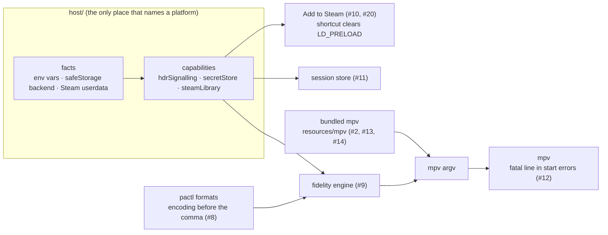

**Repos touched:** `harakiri`

### Summary of change request

The owner runs harakiri on a living-room HTPC with Bazzite (immutable Fedora) that boots into Steam Game Mode (gamescope). The first install there hit a run of problems, filed as #2, #8 to #15, #17 and #20. The request is one epic that makes harakiri plug and play on that machine: install it, add it to Steam, sign in once, and play HDR with bitstreamed audio from the couch, with no hand-made launcher, wrapper, container or Vulkan-layer copy. #16, #18 and #19 are out of scope.

Steam Game Mode becomes harakiri's main target (resolved Q1). The code still never branches on a platform name. Features ask what the host supports, through one capability layer (resolved Q2). harakiri ships its own mpv inside the AppImage now, not in a later step (resolved Q3).

### Current State

- **Getting the app.** The README offers an AppImage from GitHub releases, but the repo is private and has no release. The auto-updater polls the same feed and logs a red error with a stack trace on every check.
- **Setting up from source.** `mise run setup` fails on a machine without the harness compositors (weston, kwin), although those only matter for tests. It does not check what playback needs (gamepad support in mpv, HEVC decoder, passthrough sink).
- **Getting mpv.** Bazzite has no mpv. The easy ones (Flathub, Homebrew) lack gamepad support and break playback. The only working setup is a Fedora distrobox, a PATH-shadowing wrapper with a watchdog loop, and a hand-copied gamescope Vulkan layer.
- **Launching from Steam.** The UI comes up software-rendered: Steam's overlay preload crashes Chromium's GPU process three times.
- **Signing in.** There is no keyring in Game Mode, so the session is kept in memory. Every launch starts at onboarding, and the owner types the server and password with a controller again.
- **Playing.** When mpv refuses to start, the screen says "mpv exited before its IPC socket was ready (code 1)". mpv's reason is buried in the debug log.
- **Picture.** HDR films reach the TV tone-mapped to SDR, even with Steam's HDR on. In the one logged Game Mode run (#20), mpv got a 1080p display on the 4K TV at 60 Hz. The cause and whether it recurs are unverified.
- **Sound.** The receiver never gets a bitstream: PipeWire's format strings carry attributes that the parser does not expect, so every play falls back to PCM.
- **Verification.** Every test runs on the KDE dev box, whose own mpv, sinks, environment and keyring hide all of the above.
- **Docs.** Nothing mentions Steam, gamescope, Bazzite or immutable distros. The PRD's only target is Fedora KDE on Wayland.

### Desired End State

- On Bazzite, the owner downloads one AppImage, adds it to Steam as a non-Steam game, and launches it from Game Mode. Nothing else is installed by hand: no mpv, no distrobox, no wrapper, no layer copy, no launch options.
- The AppImage carries harakiri's own mpv build, so the version, libplacebo, gamepad support and decoders are the same on every host.
- On first start with Steam present, harakiri offers to add itself to the Steam library, with its artwork. That shortcut is the first-party way to run harakiri in Game Mode. It clears Steam's overlay preload, so the UI is GPU-rendered.
- The owner signs in once. Later launches go straight to the library, with or without a keyring.
- An HDR film reaches the TV as HDR when Steam's HDR is on, and the player reports SDR truthfully when it is off.
- A TrueHD or E-AC-3 track reaches the receiver as a bitstream.
- When mpv fails to start, the screen shows mpv's own reason.
- A 4K film that is scaled down by the output is reported as a downgrade.
- No feature code tests for gamescope, Steam, Wayland or a desktop name. Features ask the capability layer, and a lint keeps platform names out of feature code.
- Platform bugs are reproduced in a declared environment (a microVM and recorded host facts), not on the dev box. The HTPC is the final opt-in check.
- The PRD names Steam Game Mode as the main target, with acceptance criteria. The README has a "Steam Game Mode" section.
- A first public release exists under MIT, and the updater reports an unreachable feed as one plain warning.

### What we're not doing

- #16 (mise.lock `min_version`), #18 (AppImage icon and `desktopName`) and #19 (renderer preload warnings).
- A native Dolby Vision signal over HDMI. (The DV 7 enhancement layer is in scope, through mpv 0.42: Q4.)
- Flatpak, Snap, rpm or deb packaging. One AppImage stays the only artifact.
- A system mpv as a supported way to run the packaged app. A developer override stays (Q12).
- Code paths per platform. Platform names live only in the host-facts module and in docs.
- Fixing gamescope itself: the 60 Hz default and Steam's frame limit are documented, not patched.
- Setting, checking or explaining Steam's per-game settings (Game Resolution, Steam Input, refresh, frame limit). The SteamOS and Bazzite defaults are what harakiri needs, and a misconfigured Steam is the user's to fix.
- Supporting Game Mode launches outside harakiri's own shortcut. A hand-made shortcut or another launcher gives up the first-party fix (Q13).
- Steam's CEF debug API, and editing `shortcuts.vdf` while Steam runs (see Q13).
- HDMI-CEC remotes and a Steam Deck handheld layout.
- Running the microVM suite in CI. GitHub's 2-vCPU runners document KVM, but wiring it up is a follow-up once the suite runs locally.

### Proposed End State Architecture

harakiri reads its host once, at startup, into raw facts. One capability layer turns those facts into answers named by behaviour. Features ask capabilities, never platform names. The mpv binary is no longer a host fact at all: it ships inside the AppImage.



How each first-run step changes:

| Step               | Issue        | Today                                            | End state                                                                     |
| ------------------ | ------------ | ------------------------------------------------ | ----------------------------------------------------------------------------- |
| Get the app        | #15          | private repo, no release; updater ERR with stack | public MIT release; 404/401 → one WRN "update feed unreachable"               |
| Set up from source | #17          | doctor needs weston and system mpv               | doctor checks what dev needs; no system mpv (Q8, Q12)                         |
| Find mpv           | #2, #13, #14 | `"mpv"` from `PATH`, any build                   | the AppImage's own mpv with SDL2 gamepad and every decoder                    |
| Add to Steam       | #20          | by hand, no artwork                              | first-run "Add to Steam" card; the shortcut carries harakiri's artwork (Q13)  |
| Launch from Steam  | #10          | GPU process inherits the overlay preload         | harakiri's shortcut clears `LD_PRELOAD` before harakiri starts (Q13)          |
| Sign in, restart   | #11          | memory-only without a keyring                    | `secretStore: "file"` → 0600 file; Settings says so                           |
| mpv fails          | #12          | generic IPC message                              | the start error carries mpv's fatal line                                      |
| Picture            | #9, #20      | hint `auto` everywhere                           | engine picks the hint from `hdrSignalling`; downscale is a reported downgrade |
| Sound              | #8           | exact string match                               | match on the encoding before the first comma                                  |
| Verify             | all          | dev box only                                     | microVM guest + recorded facts + opt-in HTPC check                            |
| Docs               | #14, #20     | KDE only                                         | PRD main target; README Game Mode section                                     |

Where the code changes:

```diff
 apps/desktop/src/main/
+├── host/
+│   ├── facts.ts           # readHostFacts(env, safeStorage): the only reader of XDG_*, GAMESCOPE_*, Steam*, LD_PRELOAD
+│   └── capabilities.ts    # capabilitiesOf(facts) → HostCapabilities, named by behaviour
+├── steam-setup/           # "Add to Steam": launcher script (unset LD_PRELOAD; exec), .desktop, steam:// URL, grid artwork (Q13)
 ├── index.ts               # logs facts and capabilities in the first line
 ├── session.ts             # secretStore "file" → 0600 {kind: "obfuscated"}; async safeStorage API
 ├── updates.ts             # 404/401 → one WRN, no stack
 └── player/
+    ├── mpv-binary.ts      # packaged: resources/mpv/mpv; dev: the built bundle; HARAKIRI_MPV for devs (Q12)
     ├── audio-output.ts    # encoding(format) before the CODEC_BY_FORMAT lookup
     ├── fidelity-watch.ts  # + osd-dimensions vs video size observation
     └── playback.ts        # passes the binary and the engine's colorspace hint
 packages/mpv/src/
 └── client.ts              # keeps a redacted tail of mpv output; fatal line in the start error
 packages/fidelity/src/
 ├── model.ts               # PictureWorld.hdrSignalling; observation {kind: "outputSize"}
 ├── picture.ts             # hint decision; "scaled down by the output" downgrade
 └── scenarios.ts           # + swapchain-format HDR on / off, 1080p output for 4K
 packages/harness/src/
 └── doctor.ts              # mpv checks removed; harness tools only (Q8)
+mpv/                       # pinned container build: mpv 0.42 + libplacebo 7.387 + FFmpeg 9.x + SDL2
+scripts/lint-host.ts       # platform names and host env reads only under main/host/
+dev/vm/                    # smolvm guest definition for platform checks (Q11)
 apps/desktop/electron-builder.yml   # extraResources: mpv
 scripts/check-release.ts   # asserts the bundled mpv: version, gamepad, decoders, host-only libs
 README.md                  # Steam Game Mode; no system mpv step
 docs/PRD.md                # main target, no-keyring wording, distribution, acceptance
```

The mpv argv changes only in two values, both decided outside the player:

```diff
 spawn(
-  "mpv",
+  mpvBinary(),                                         // the bundled build
   [ "--config-dir=…", "--idle=yes",
     "--vo=gpu-next", "--gpu-api=vulkan",
-    "--target-colorspace-hint=auto",
+    `--target-colorspace-hint=${plan.colorspaceHint}`, // from capabilities.hdrSignalling
     "--input-gamepad=yes", …, "--input-ipc-server=…" ])
```

### Design Questions

None. Every question is resolved below.

### Resolved Design Questions

#### Q1. Steam Game Mode is the main target; nothing in the code is coupled to it

Steam Game Mode on Bazzite becomes harakiri's main target in the PRD, with acceptance criteria: launch from Steam with a GPU-rendered UI, sign in once, HDR10 at the TV with Steam's HDR on, a bitstream at the receiver, and a reason for every downgrade. KDE Plasma on Wayland stays a supported target and the dev platform. The implementation is not coupled to Game Mode: no feature code names gamescope, Steam or a desktop (see Q2).

Not chosen: a second target alongside KDE (the owner's TV runs Game Mode, so it leads), and best effort with README notes only (no acceptance criterion would catch a regression).

#### Q2. Host facts live in `apps/desktop/src/main/host/`, behind a capability layer

A pure `readHostFacts(env, safeStorage)` in `apps/desktop/src/main/host/facts.ts` is the only code that reads platform variables. `capabilitiesOf(facts)` turns facts into answers named by behaviour, and features only ever see those answers. No `if (gamescope)` or `if (wayland)` outside `host/`.

```ts
// host/facts.ts: the only place that names a platform
type HostFacts = {
  gamescopeDisplay: string | undefined; // GAMESCOPE_WAYLAND_DISPLAY
  waylandDisplay: string | undefined; // WAYLAND_DISPLAY
  desktop: readonly string[]; // XDG_CURRENT_DESKTOP, split on ':'
  preload: readonly string[]; // LD_PRELOAD entries
  secretBackend: string; // safeStorage.getSelectedStorageBackend()
};

// host/capabilities.ts: what features ask
type HostCapabilities = {
  /** How a Vulkan client gets an HDR swapchain: the compositor says what it wants, or it only offers HDR formats. */
  hdrSignalling: "colour-management" | "swapchain-formats";
  /** Where a sign-in can be kept: an OS keyring, or a 0600 file in userData. */
  secretStore: "keyring" | "file";
  /** LD_PRELOAD entries known to kill Chromium's sandboxed GPU process. */
  sandboxBreakingPreloads: readonly string[];
};
```

```text
consumer                asks                                  never asks
launch guard (#10)      sandboxBreakingPreloads               "launched by Steam?"
session store (#11)     secretStore                           "XDG_CURRENT_DESKTOP is gamescope?"
fidelity engine (#9)    hdrSignalling (as a PictureWorld input)  "compositor is gamescope?"
```

The capability list above is illustrative. `sandboxBreakingPreloads` went away with Q13, because harakiri's own Steam shortcut clears the preload, and Q13's Steam setup adds a `steamLibrary` capability.

Enforcement, per CLAUDE.md's rule table: `scripts/lint-host.ts` (hk pre-commit and `mise run check`) fails when a file outside `apps/desktop/src/main/host/` reads `XDG_*`, `GAMESCOPE_*`, `Steam*` or `LD_PRELOAD`, calls `getSelectedStorageBackend`, or names gamescope, Steam or KWin in code. Tests, fixtures, scenario labels and docs are exempt. A recorded Game Mode environment is a fixture for `readHostFacts` and `capabilitiesOf`.

Not chosen: a `packages/host` with one export (doctor no longer needs host facts after Q8), and host detection inside `packages/fidelity` (breaks the engine's no-IO rule).

#### Q3. Bundle harakiri's own mpv in the AppImage, now

The long-term solution is built in this epic, with no system-mpv step first. A pinned container build (mise task, bounded) produces mpv with libplacebo, FFmpeg and SDL2 linked in. electron-builder copies it to `resources/mpv/` through `extraResources`. The host keeps the Vulkan loader, the GPU drivers, PipeWire, libwayland, X11 and glibc. Because mpv uses the host's Vulkan loader, gamescope's implicit WSI layer is found with no copy step. electron-updater swaps app and mpv together, and the quit hold already stops mpv before the swap.

Not chosen: a Flatpak (second format and channel; WSI layer and passthrough inside the sandbox unverified), the system mpv with an override and a recipe (still four hand-made pieces on Bazzite), a staged rollout of that recipe first (the owner wants the long-term solution now), and an mpv container image run through podman (keeps the layer copy and the SIGKILL watchdog problem).

#### Q4a. harakiri is MIT; the bundle carries a GPL mpv and FFmpeg as a separate program

harakiri gets an MIT licence (or similar permissive) before the repo goes public. mpv runs as a separate executable over IPC, so the GPL covers the bundled binary, not harakiri. The release links the build recipe and the exact source tarballs of mpv, libplacebo, FFmpeg and SDL2 to meet the GPL's source obligation. FFmpeg is built with `--enable-gpl` and without `--enable-nonfree`, and the owner accepts the patent position that other public mpv and VLC builds take.

Not chosen: an LGPL-only build (drops mpv features and does not change the decoders' patent position).

#### Q4. The bundle pins mpv 0.42.x, libplacebo 7.387.0 and FFmpeg 9.x, and #24's fidelity work joins this epic

This reopened and replaces the earlier Q4b (mpv 0.41.x). That choice rested on the premise that the Dolby Vision 7 enhancement layer (FEL) needs mpv master. Triage of [#24](https://github.com/tcorzo/harakiri/issues/24) showed that mpv 0.42.0 (2026-11-05) ships it in `gpu-next`, with libplacebo ≥ 7.387.0. A follow-up found that it also needs FFmpeg's `dovi_split` bitstream filter, which first appears in FFmpeg 9.0. Without the filter, mpv silently renders the base layer only. #24's "FFmpeg 8.1.x unchanged" is wrong on this point.

The epic therefore also covers:

- **DV 7 FEL moves into the PRD's scope.**
- **The FEL label comes from mpv's report**, not from Jellyfin's range type. An "enhancement layer dropped" scenario joins `scenarios.ts`. The FATE corpus file `fate-dv-p7-fel` is the real sample.
- **T4 picture references are rebuilt against the bundle's libplacebo**, because 7.387 changes DV reshaping for profiles 5 and 8 too. T2 `vo-passes` expectations get re-checked. The harness's system `ffmpeg` stays on 8.1.
- **TLS verification stays on** (the 0.42 default). A certificate failure shows as a plain sentence on screen. A per-server opt-out waits in #24 until a user asks for it.
- **Re-checked on the bundle:** `http-header-fields` over the new libcurl backend (`playback.local.test.ts`), hwdec now that Vulkan hwdec has left `auto-safe`, and #9 (see Q7).
- **FEL with hardware decoding was tested upstream only on NVDEC**, which is the HTPC's GPU. VAAPI stays unverified.

Not chosen: pinning 0.41.x and moving later (everything would be validated twice, once per pin, since dev and tests run the bundle), and pinning 0.42 with the enhancement layer turned off (it ships a capability switched off on purpose, while the reshaping and TLS changes land anyway).

#### Q5. Without a keyring, the session goes to a 0600 file, and Settings says so

When `secretStore` is `"file"`, the session is written with safeStorage's `basic_text` backend, marked `{kind: "obfuscated"}`, 0600 under `userData`. Settings shows "Signed in on this device without a keyring". The log says it once at INFO. The Jellyfin token can be revoked from the server dashboard. The store moves to the async `safeStorage` API, because Electron 46 removes the synchronous calls. The e2e plaintext branch goes away, so e2e exercises the same branch as Game Mode. The PRD's onboarding section gets a no-keyring sentence.

```diff
 save(session)
   if encryptionUsable()          -> {kind: "encrypted", base64}
-  else if allowPlaintextToken    -> {kind: "plain", value}          (e2e only)
-  else                           -> memory only, rm session.json
+  else                           -> {kind: "obfuscated", base64}    (secretStore "file", 0600)
```

Not chosen: asking once during onboarding (an extra step on the gamepad-only path, and the answer on a TV is always yes), and keeping memory-only with keyring docs (fails the PRD's restart criterion; a keyring cannot be unlocked under autologin in Game Mode).

#### Q7. The fidelity engine picks the colorspace hint from the `hdrSignalling` capability

`PictureWorld` gains `hdrSignalling: "colour-management" | "swapchain-formats"`, filled from the capability layer (Q2). The start plan returns `colorspaceHint: "auto"` for colour-management compositors (KWin, whose protocol states what it wants) and `"yes"` for swapchain-format ones (gamescope, whose WSI layer only adds HDR10 formats to an X11 window's list). New display scenarios cover swapchain-format HDR on (PQ target, kept) and off (sRGB target, "The display takes SDR only"), with a reviewed `compatibility.md` diff. The watcher keeps reporting what mpv actually got.

With mpv 0.42 (Q4), this is re-checked on the bundle. 0.42 sends Wayland HDR through the colour-management protocol instead of the Vulkan API. gamescope's nested Wayland server offers no such protocol, so mpv is expected to fall back to `x11vk`, where `yes` picks the HDR10 formats. That path is unverified on 0.42.

Not chosen: `yes` on every host (with KDE's HDR off, KWin tone-maps a PQ surface and the report would claim HDR was kept), and a user setting for the hint (not plug and play, and it moves a fidelity decision into Settings).

#### Q8. With mpv bundled, the build is checked at release time and host failures surface as mpv's own reason

Bundling fixes everything about mpv's own build, so those checks move from runtime to `package:check`. The bundled mpv runs `-v`, `--list-options`, `--vd=help` and `--ad=help`. `ldd` is checked against an allowlist of host libraries: the Vulkan loader, the GPU driver, PipeWire, libwayland, X11 and glibc. There is no in-app probe. What still fails at runtime is the host:

- A missing Vulkan driver is already a fidelity observation (`rendererFailed`, then OpenGL, with a reason).
- Sink formats already feed the sound world (#8 fixes the parse).
- When mpv refuses to start, `spawnMpv` keeps the last 20 redacted output lines. On an early exit, the error carries the lines that match `Error|Fatal|failed`. The player logs them at ERR, and the screen shows them (#12).

doctor drops its mpv and libplacebo checks and becomes a dev-only check of the harness tools (#17). Player users take the AppImage.

Not chosen: a startup self-test of the bundled mpv (it costs startup time, and a play shows the same reason a second later anyway), and the original runtime probe of the mpv build (redundant, since the build cannot change on the user's machine).

#### Q9. An output smaller than the video is a reported downgrade

The watcher compares `osd-dimensions` with the video size. When the output is smaller, the engine reports "Scaled down to 1920×1080 by the output". The reason is generic and names no platform. It lands as a scenario plus a `compatibility.md` diff, following the PRD's rule of a reason for every downgrade. The report measures what mpv actually got, so it holds whether or not the 1080p output seen once in #20 recurs.

Before building, the owner re-checks on the HTPC with the Q13 shortcut in place: mpv's `Display 0 (gamescope)` line, and the shortcut's Game Resolution value. Per Q13, the README does not walk users through Steam's settings. A line is added only if the re-check shows the defaults scale films down. A refresh-rate mismatch is never reported, because mpv cannot change the output's mode.

Not chosen: docs only (a downscale would go unreported, against the PRD's rule).

#### Q10. Go public and cut `v0.1.0` now, before the bundle lands

The repo goes public under MIT (Q4a), and release-please cuts `v0.1.0`. The HTPC then gets every fix in this epic through the updater, which makes on-target checks cheap. Until the bundle ships, the README says the release needs a system mpv, and the HTPC keeps its distrobox wrapper for a few releases. The updater logs a 404 or 401 from the feed as one WRN line ("update feed unreachable") with no stack trace. Settings keeps its "tries again later" line.

Not chosen: holding the first release until the bundle is in (the HTPC would run hand-copied builds for the whole epic, and the updater path would stay untested until the end).

#### Q11. Platform bugs are reproduced in a declared microVM guest, with recorded host facts and an opt-in HTPC check

The smolvm spike (research §13.4) showed that a `fedora:44` guest holds nested KWin, mpv gpu-next on lavapipe, Electron with its renderer sandbox on, a uinput pad reaching mpv's SDL gamepad input (that would have caught #13), and the #8 attribute-suffixed pactl strings with no kernel sound.

- `dev/vm/` declares that guest with KWin, lavapipe, PipeWire with the fake `iec958_*` sink, and a uinput pad. e2e and a new platform tier run inside it, under `scripts/bounded.sh`, with VM state off `/tmp` and a 4 GiB VM to fit the 7 GB slice. The dev box's mpv, sinks, env and keyring no longer reach any test.
- The guest runs the built app with the dev desktop's environment, and also through the launcher script of the shortcut harakiri creates (Q13) with a recorded Game Mode environment (no keyring, `XDG_CURRENT_DESKTOP=gamescope`, an `LD_PRELOAD` entry). That exercises the capability layer end to end: the session survives a restart through the file store, and the preload never reaches harakiri.
- Recorded host facts (a scrubbed Game Mode env, attribute-suffixed pactl JSON, mpv banners) are fixtures for `readHostFacts`, `capabilitiesOf`, `outputFromPactl` and the fidelity scenarios, in the default tier.
- The bundled mpv runs in the Bazzite userland with `podman run` (untried; smolvm could not import the image) to catch missing host libraries.
- An opt-in HTPC checklist (`mise run htpc:check`, env-configured like `JELLYFIN_DEV_LIBRARY=own`) records what only the target shows: HDR10 at the TV, a bitstream at the receiver, the GPU process under Steam's real preload, the Quick Access menu, and Steam Input reaching mpv.
- Still open inside this: the IEC 61937 link to the fake sink (research Open Questions 6), and the GPU process path, which the spike did not exercise because compositing was software. Until the link works, sound passthrough keeps its `ao_pcm` capture tier.

Not chosen: containers only (a rootless container on the dev box gets the host's devices or none, so a virtual pad would reach the owner's desktop), a Bazzite VM per run (too heavy; the image did not even import), and keeping the dev box as the test host with fixtures only (how these bugs slipped through).

#### Q12. Dev, tests and e2e all run the bundled mpv

`mise run mpv:build` builds the pinned bundle (bounded, cached by recipe hash). CI's release job builds the same recipe, and dev can fetch that artifact by hash instead of building. The app in dev, `playback.local.test.ts`, `client.test.ts`, the T1 sound tier and e2e all resolve the built bundle. The onboarding drops the system `mpv` package. `HARAKIRI_MPV` stays as a developer override, for trying another build. The harness's `ffmpeg` CLI (corpus generation, picture references) stays a system dependency, because it is not the player.

Not chosen: dev keeping the system mpv with a tier for the bundle (two mpvs to keep in step, and the default tier would test the one users never run; Fedora's `sdl2-gamepad` hid #13 exactly that way).

#### Q13. harakiri's own Steam shortcut carries the fix for Steam's environment (1C + 2A)

The first-party way to run harakiri in Game Mode is the shortcut harakiri adds to Steam itself. That shortcut clears Steam's overlay preload before harakiri starts. Launching harakiri some other way in Game Mode, with a hand-made shortcut or another launcher, gives up that fix and is not supported. harakiri itself never inspects or rewrites its own loader environment, so Q2's `sandboxBreakingPreloads` capability goes away. Removing `LD_PRELOAD` gave 0 GPU-process crashes in #10's A/B test, which is the evidence that this is enough.

"Add to Steam" uses Steam's own URL handler, as Heroic Games Launcher does. It needs no Steam restart and no debug port.

1. harakiri writes a launcher script and a hidden `.desktop` file whose `Exec` is that script. The URL handler carries only a path and cannot set launch options, so the fix travels in the script:

   ```sh
   #!/bin/sh
   # Written by harakiri's "Add to Steam": Steam's overlay preload kills Chromium's GPU process (#10).
   unset LD_PRELOAD
   exec '/path/to/harakiri-x86_64.AppImage' "$@"
   ```

   `exec` replaces the shell with harakiri under the same PID, so no wrapper process stays alive. Steam tracks whatever it launched and its children, and that is harakiri itself, with mpv as its child. "Running", "Resume" and "Stop" in Steam's UI then follow harakiri's own lifetime. "Stop" ends harakiri, and `killOnExit` already takes mpv down with it. The AppImage path is stable, because the updater replaces the file in place. harakiri rewrites the script at each start when it exists, so a moved AppImage heals on the next run from its new place.

2. It touches the `/tmp/addnonsteamgamefile` sentinel and opens `steam://addnonsteamgame/<encoded .desktop>`.
3. It reads the new app ID back from `shortcuts.vdf` and writes harakiri's artwork into `grid/`.

There is no settings checklist. The SteamOS and Bazzite defaults (Game Resolution, HDR, Steam Input) are what harakiri needs, and a misconfigured Steam is the user's to fix.

A capability named by behaviour, `steamLibrary: "absent" | "present" | "has-harakiri"`, is read only in `host/` and decides when to offer the card. When it is `"present"`, the card appears at first start. The action is always available in Settings.

```text
first start, Steam present, harakiri's shortcut absent
┌──────────────────────────────────────────────────────┐
│  Play harakiri from Steam                            │
│  Adds harakiri to your Steam library, with its art.  │
│  Launch it from there in Game Mode.                  │
│                                                      │
│   [ Add to Steam ]    [ Not now ]                    │
└──────────────────────────────────────────────────────┘
```

To verify on the HTPC before this is built:

- The URL handler in Desktop Mode and in Game Mode. Bazzite's script refuses a tty unless Steam already runs, which suggests Desktop Mode.
- That Steam keeps the script as the shortcut's target when it reads the `.desktop`.
- Steam's process tracking with the script: Steam shows harakiri as running while it is open, "Stop" closes harakiri and mpv, and nothing still shows as running after harakiri quits. How Steam tracks the process (its `reaper` subreaper) is from general knowledge and unverified.
- That the shortcut launch gives 0 GPU-process crashes, and that Steam's Quick Access menu still works without the preload.
- Whether Steam picks up `grid/` artwork written while it runs, and the app-ID formula's quoting of `Exe`.

The card is web UI, so it goes through the impeccable loop.

Not chosen:

- A declared loader environment inside harakiri (1A). It is too much work for a case outside the first-party path.
- A denylist of preloads in the app (1B).
- `--no-sandbox` or `--disable-gpu-sandbox` (1D). They remove the protection instead of the cause.
- Steam's CEF API (2B). It is undocumented, and it opens an unauthenticated debug port.
- Writing `shortcuts.vdf` (2C). Steam must restart to read it, and in Game Mode that restarts the session.
- Docs only (2D), and a checklist of Steam's own settings.

### Patterns to follow

These show the patterns found in the existing codebase that will be followed to implement the proposed end state architecture.

#### Unused seams take the new values; the player stays a pipe

`spawnMpv` already takes a binary, and `buildPlaybackArgs` already takes a hint. Nobody passes them. The end state passes them from the bundle resolver and the engine's plan. `packages/mpv/src/client.ts:322-335`, `packages/mpv/src/args.ts:50-58`:

```ts
const child = spawn(
  options.binary ?? "mpv",
  [configArg(options.config), "--idle=yes", ...(options.args ?? []), `--input-ipc-server=${socketPath}`],
  { stdio: ["ignore", "pipe", "pipe"] }
);
// args.ts
["target-colorspace-hint", config.colorspaceHint ?? "auto"],
```

```ts
// playback.ts, end state
const client = await spawnMpv({ binary: deps.mpvBinary(), config: { dir }, args });
const args = buildPlaybackArgs({ audioPassthrough, colorspaceHint: plan.picture.colorspaceHint });
```

#### Validated env at the edge, read in one place

New variables go through the t3 env schema, with a comment saying who sets them. After Q2, only `host/facts.ts` and `mpv-binary.ts` read them. `apps/desktop/src/main/env.ts:4-20`:

```ts
export const env = createEnv({
  server: {
    /** Set by the AppImage runtime to the AppImage path; absent in dev, e2e and unpackaged runs. */
    APPIMAGE: z.string().min(1).optional(),
    …
  },
  runtimeEnv: process.env,
  emptyStringAsUndefined: true,
});
```

```ts
/** A developer's mpv instead of the bundled build, e.g. to try mpv master. */
HARAKIRI_MPV: z.string().min(1).optional(),
/** Set by gamescope for its clients; read only by host/facts.ts. */
GAMESCOPE_WAYLAND_DISPLAY: z.string().min(1).optional(),
```

#### Fidelity cases are scenarios with a reviewed table diff

A new display is a scenario entry. `mise run fidelity:table` regenerates `docs/fidelity/compatibility.md`, and `table.test.ts` fails until the diff is committed. `packages/fidelity/src/scenarios.ts:85-99`:

```ts
export const displays = [
  { name: "HDR display, Vulkan", observed: [{ kind: "displayTarget", hdr: true }] },
  { name: "SDR display, Vulkan", observed: [{ kind: "displayTarget", hdr: false }] },
  …
];
```

```ts
{ name: "HDR via swapchain formats, HDR on", hdrSignalling: "swapchain-formats",
  observed: [{ kind: "displayTarget", hdr: true }] },
{ name: "HDR via swapchain formats, HDR off", hdrSignalling: "swapchain-formats",
  observed: [{ kind: "displayTarget", hdr: false }] },
{ name: "4K video on a 1080p output", hdrSignalling: "swapchain-formats",
  observed: [{ kind: "displayTarget", hdr: true }, { kind: "outputSize", width: 1920, height: 1080 }] },
```

#### Rules come with a lint that enforces them

`scripts/lint-private.ts` and `scripts/lint-skips.ts` are the model for `scripts/lint-host.ts`: a Bun script over tracked files, wired into hk pre-commit and `mise run check`, with a row in CLAUDE.md's rule table.

```text
| No feature code names a platform; features ask host capabilities | scripts/lint-host.ts (hk pre-commit, mise run check) |
```

#### The session store branches on an injected crypto

`createSessionStore` takes `TokenCrypto` and flags, so the no-keyring branch is unit-tested with a fake backend. `apps/desktop/src/main/session.ts:146-162`:

```ts
if (encryptionUsable()) {
  token = { kind: "encrypted", base64: options.crypto.encryptString(accessToken).toString("base64") };
} else if (options.allowPlaintextToken) {
  token = { kind: "plain", value: accessToken };
} else {
  logger.warn("safeStorage has no keyring (backend {backend}); the session is kept in memory …", …);
  memorySession = { ...rest, accessToken, deviceId: deviceId() };
```

```ts
const token =
  capabilities.secretStore === "keyring"
    ? { kind: "encrypted", base64: await crypto.encryptStringAsync(accessToken) }
    : { kind: "obfuscated", base64: await crypto.encryptStringAsync(accessToken) }; // basic_text, 0600
```

#### Host data enters through wiring, not through globals

The player's host inputs (`audioOutput`, `extraArgs`) are injected into `createPlayer`, and e2e swaps them there. `mpvBinary` and `capabilities` follow the same shape. `apps/desktop/src/main/player/index.ts:13-29`:

```ts
const audioOutput = async () => {
  const given = isE2E ? process.env.HARAKIRI_AUDIO_OUTPUT : undefined;
  return given === undefined ? await readAudioOutput() : AudioOutputJson.parse(JSON.parse(given));
};
export const { prepare, play, … } = createPlayer({ loadSession, userData, extraArgs: e2eMpvArgs, audioOutput, … });
```

```ts
export const { … } = createPlayer({ …, audioOutput, mpvBinary, capabilities: () => hostCapabilities });
```

#### Tests

- Pure parsers on recorded host output, as in `audio-output.test.ts` (it calls `outputFromPactl` directly). Add the attribute-suffixed pactl JSON from the fake sink as a fixture.
- Real processes where it is cheap, as in `client.test.ts` (real mpv headless, argv read from `/proc/<pid>/cmdline`). Add stand-in binaries for the early-exit path.
- Fake timers and fake adapters, as in `updates.test.ts`. Add a 404 case that asserts one WRN line.
- Tier files that throw and name their mise task, selected in `vitest.shared.ts`, for the microVM and Bazzite userland tiers.
